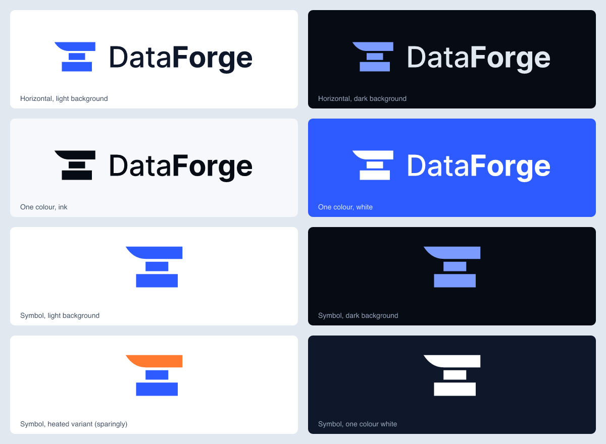
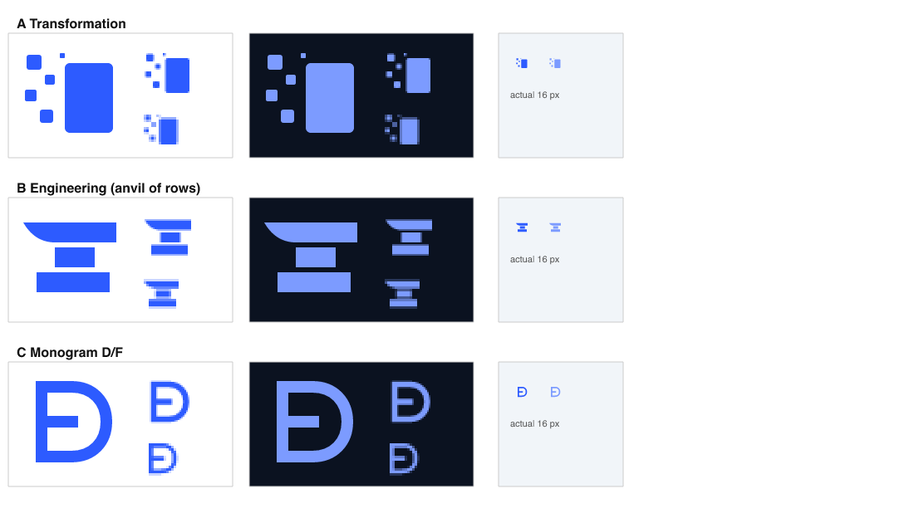
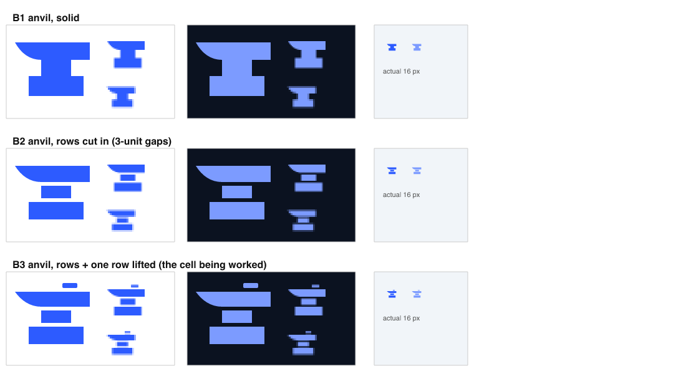
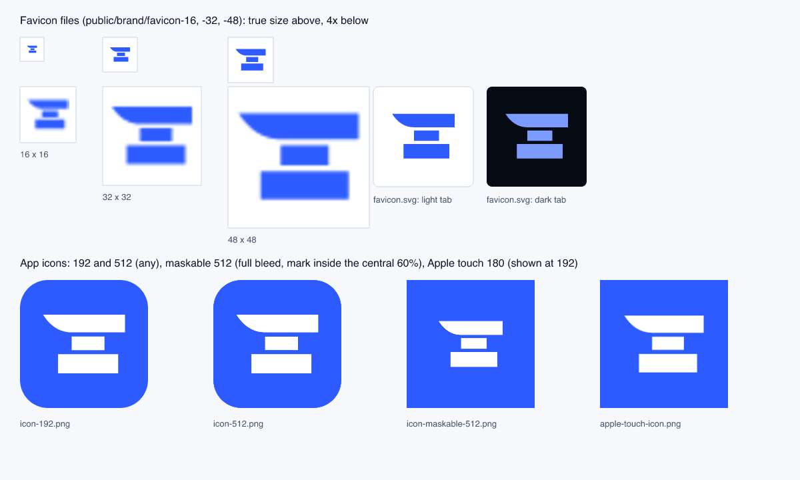

# DataForge brand identity

This document records what the DataForge mark is, why it was chosen over two other concepts, how it is built, and the rules for using it. The geometry lives in one file (`frontend/src/brandGeometry.js`); every asset and the React component are generated from or read from it.



## 1. What the mark means

DataForge turns raw data into structured information, and people learn by working on it. The name says "forge": to shape and refine.

The mark is an **anvil whose body is cut into three rows**: the working face with its horn, the waist, and the base. Two ideas sit in one shape:

- **Forging.** An anvil is where raw material is shaped. It is a tool, not a decoration.
- **Rows.** The 3-unit cuts turn a solid object into stacked rows, the way a table is stored as rows. Raw metal becomes structured data.

It is one flat colour. It has no gradient, stroke, glow or effect, so it works in one ink on any surface.

What it avoids, as the brief asked: no gradient letter, no neural net or brain, no connected dots, no database cylinder, no orbit, swoosh or sparkle.

## 2. Concepts explored

Three genuinely different directions were drawn and compared at large size, at 32 px and at 16 px, on light and dark surfaces. They were not merged.



| | A. Transformation mark | B. Engineering mark (anvil of rows) | C. Monogram D/F |
|---|---|---|---|
| Idea | Scattered squares resolving into one block | An anvil cut into rows | A D with an F bar cut into it |
| Originality | Medium. "Particles into a shape" is common in data and AI branding | High. An anvil is rare in this field and is the literal meaning of "forge" | Medium. Letter monograms are common |
| Meaning | Clear but generic: chaos to order | Forge plus table rows, in one shape | Initials only |
| Memorability | Low. The scatter has no fixed silhouette | High. A distinct, solid silhouette | Medium |
| 16 x 16 | Poor. The small squares turn into dust beside a rectangle | Good. The silhouette holds and the cuts show as lighter lines | Poor. It reads as "Đ" |
| Dark and light | Fine | Fine | Fine |
| Scales up | Poor. Needs many small parts | Good. Three rectangles and one curve | Good |
| Looks like generic SaaS | Somewhat | No | Somewhat |

**Choice: B.** A and C were rejected for the reasons in the table. B went through one refinement: the first draft read as an I-beam at small sizes, so it got a real anvil horn and a narrower waist.



B1 (solid anvil) had no link to data. B3 (one row lifted off) added a part that disappears at 16 px. B2 (rows cut in) was kept. The original quality test was whether the logo could sit unnoticed on 100 unrelated AI startups. An anvil of rows could not.

## 3. Logo system

All files are in `frontend/public/`. They are plain SVG paths or PNG renders of those paths. No emoji, no icon-library glyph, no raster inside an SVG.

| Use | File |
|---|---|
| Horizontal lockup, light background | `brand/logo-horizontal.svg` |
| Horizontal lockup, dark background | `brand/logo-horizontal-on-dark.svg` |
| One colour, ink (light backgrounds, print) | `brand/logo-mono-dark.svg` |
| One colour, white (dark or coloured backgrounds) | `brand/logo-mono-light.svg` |
| Symbol, light / dark background | `brand/mark.svg`, `brand/mark-on-dark.svg` |
| Symbol, one colour | `brand/mark-mono-dark.svg`, `brand/mark-mono-light.svg` |
| Symbol, heated variant | `brand/mark-heated.svg` |
| Favicon (follows the browser colour scheme) | `favicon.svg` |
| Favicon PNG 16 / 32 / 48 | `brand/favicon-16.png`, `-32`, `-48` |
| Favicon ICO (16, 32, 48 in one file) | `favicon.ico` |
| App icon 192 / 512 | `icon-192.png`, `icon-512.png` |
| Maskable app icon 512 | `icon-maskable-512.png` |
| iOS | `apple-touch-icon.png` (180) |
| Default social card 1200 x 630 | `og-image.png` |



The app icon is the white mark on the product-blue tile. The maskable icon is full bleed with the mark inside the central 60%, so any platform mask shape leaves it whole.

### Geometry

- 64 x 64 grid. The ink box is x 2 to 62, y 10 to 53, so the mark sits on the optical centre of the square.
- Three rows: face and horn `M2 10H62V23H23C14 23 7 18 2 10Z`, waist `M23 26H47V36H23Z`, base `M13 39H57V53H13Z`.
- Cuts between rows are 3 units. At 16 px they are about 0.75 px, so they read as a lighter line, and at 32 px as a clear gap.
- Lockup: mark scaled to a 48 unit box, 14 units of space, then the wordmark with its capital height centred on the mark's centre. The lockup canvas is 224 x 48.

### Wordmark

"Data" in Inter Medium and "Forge" in Inter Bold, the application's own typeface (SIL Open Font Licence), with 0.35 px negative tracking at a 32 px size. The letters are **outlined paths**, not live text. That means:

- no new font dependency;
- the logo never waits for a web font, so it cannot shift the header when the font arrives (a 0.0004 layout shift was measured with live text and removed by outlining);
- the app and the files in `brand/` are the same drawing.

The outlines were made from the Inter font file with fontTools in an isolated environment. Nothing was added to the project.

## 4. Colour and tokens

| Token | Light surface | Dark surface | Role |
|---|---|---|---|
| `brand` (`--color-brand`) | `#2D5BFF` | `#7C9BFF` | The mark and product identity |
| `brand-fg` | `#FFFFFF` | `#FFFFFF` | Text or mark on a solid brand tile |
| `brand-ember` | `#FF7A2F` | `#FF7A2F` | Secondary accent: "heated" mark and the social card rule only |
| ink | `#070B14` | | Deep navy, the existing dark surface |
| ink soft | `#0F172A` | | Light-theme wordmark |
| paper | `#F6F8FB` | | Neutral light surface |
| slate | `#475569` | | Neutral text |

Tailwind exposes them as `brand`, `brand-fg` and `brand-ember` (`fill-brand`, `bg-brand`, `text-brand-fg`). They are defined in `frontend/src/site/site.css` for the light theme and both dark selectors, and they equal the constants in `brandGeometry.js` (a test checks that).

**Interactive colours did not change.** Focus rings, links, buttons and selected states keep the existing teal accent (`--color-accent`). The product blue identifies the product: the mark, icons and social cards. This keeps one interactive colour across the app and avoids a second accent competing for attention. The cost is that the brand blue and the UI teal sit side by side in the header. If that should be unified later, the change is limited to token values.

Measured contrast (WCAG ratio):

| Pair | Ratio |
|---|---|
| Blue `#2D5BFF` on white | 5.18 |
| Blue on paper `#F6F8FB` | 4.87 |
| Light blue `#7C9BFF` on ink `#070B14` | 7.49 |
| Light blue on ink soft `#0F172A` | 6.79 |
| White on blue (app icon tile) | 5.18 |
| Ink soft wordmark on white | 17.85 |
| Ember on ink | 7.57 |

The unit tests require at least 3:1 for the mark on every surface it sits on and at least 7:1 for the wordmark.

## 5. Where it is used

An audit of the site found the old identity in the header, the footer, the sign-in and sign-up pages, the favicon, the manifest, the Open Graph images and the head metadata. Those were changed. The logo is **not** added to the dashboard, Learn Hub, Daily Learning or Projects Lab bodies: those pages already sit under the header logo, and repeating a logo in the content would add noise.

| Place | What shows |
|---|---|
| Header, desktop and tablet | Horizontal lockup, 34 px high, a link home named "DataForge home" |
| Header, below 360 px | The mark alone (the name stays for screen readers) |
| Footer | Horizontal lockup, 30 px high, named "DataForge" |
| Sign-in and sign-up | Lockup beside the pitch on desktop, above the form on a phone, once each |
| Browser tab | `favicon.svg`, with 32 and 16 px PNG and `.ico` fallbacks |
| Install and home screen | `manifest.webmanifest` with 192, 512, maskable 512 and the SVG; `apple-touch-icon.png` |
| Link previews | `og-image.png`; the 150 per-question cards use the brand blue and the mark |

Screenshots of the built site (light and dark): `images/brand/nav-desktop-*.png`, `nav-mobile-*.png`, `learn-hub-*.png`, `dashboard-*.png`, `projects-lab-*.png`.

## 6. Using it in code

```tsx
import { BrandLogo, BrandMark } from "../components/BrandMark";

<BrandLogo height={34} compact />            // header; mark only below 360 px
<BrandLogo height={30} label="DataForge" />  // standalone: one named image
<BrandMark size={24} variant="mono" />       // one colour, follows the text colour
```

- `BrandLogo` draws one SVG: the mark in `fill-brand` and the wordmark in `fill-current`. It has no gradient, id or filter, so any number can sit on a page.
- Inside a link or heading that already has the name (the header link has `aria-label="DataForge home"`), leave `label` off: the logo is then `aria-hidden`. When the logo stands alone, pass `label` so it is one `role="img"`.
- The width follows from the height. Never set both to different proportions.

Regenerating the files after changing the geometry:

```
cd frontend
node scripts/build-brand-assets.mjs
```

The script uses `@resvg/resvg-js`, which the project already depends on.

### Rules

- Minimum size: the mark 16 px, the lockup 24 px high.
- Clear space: at least the height of the base row (14 units of the 64 grid, about one fifth of the mark's width) on every side.
- Do not stretch, rotate, outline, add a shadow, glow or gradient, or recolour outside the tokens above.
- Use `logo-mono-dark` or `logo-mono-light` when only one colour is available.
- Use the heated mark sparingly. The default is the single-blue mark.

## 7. Accessibility and motion

- The logo never animates. Nothing needs `prefers-reduced-motion`.
- Decorative instances are `aria-hidden`; a named one is a single image with a label.
- The wordmark is at least 7:1 on every surface it sits on; the mark is at least 3:1.

## 8. Checks that ran

| Check | Result |
|---|---|
| `npx tsc -b` | No errors |
| `npm run lint` | No errors |
| Vitest, whole suite | 125 files, 7006 passed, 10 skipped |
| Brand unit tests | `siteBrandAssets.test.ts` (16) and `siteBrandMark.test.tsx` (8): all pass |
| `npm run build:site` and `npm run check:prerender` | 1138 pages prerendered, no failed Suspense boundaries |
| Brand browser tests, `e2e/brand.spec.ts` | 18 of 18 pass (9 tests on each of desktop and mobile Chromium): header link and name, proportions at 1440, 768, 390 and 340 px, theme colours and contrast, zero header layout shift, auth pages show the logo once, icon files served with the right type and size, footer |
| Regression browser tests on the built site (a11y, UX redesign, Learn Hub, Learn Hub release, Projects Lab, motion, smoke, help, help mobile) | 222 passed, 18 skipped, 0 failed (desktop and mobile Chromium) |

## 9. Limits

- Firefox and WebKit were not run. Only Chromium (desktop and mobile emulation) was.
- Everything above was checked on a local static server serving the production build. **Nothing was deployed**, so the live site, the live `.ico` MIME type and platform caches for favicons and link previews are not verified. Browsers cache favicons for a long time; a changed icon can take days to show.
- The favicon and PNG sizes were checked by rendering and by test, not on real iOS or Android home screens. The maskable icon was checked against a 60% safe zone, not against real device masks.
- The 16 px mark relies on the silhouette. The cuts show as lighter lines, not clear gaps.
- Supabase sign-in was not exercised; only the sign-in and sign-up page layout was.
- The ember accent is used in two places. It is not part of the interface palette.
