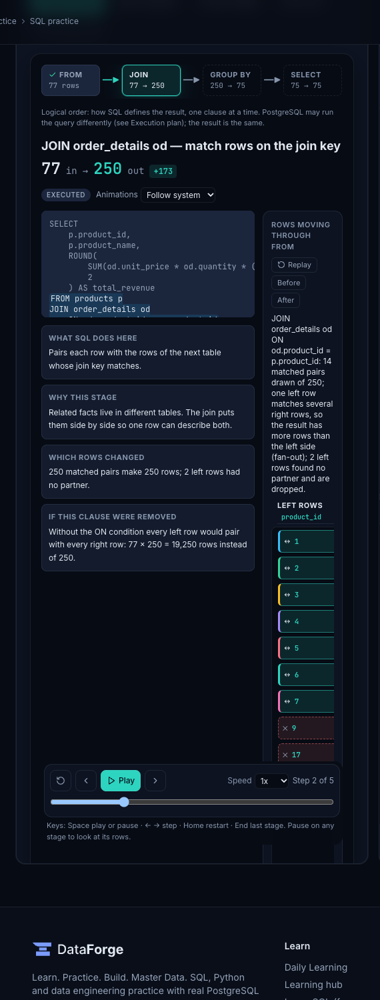
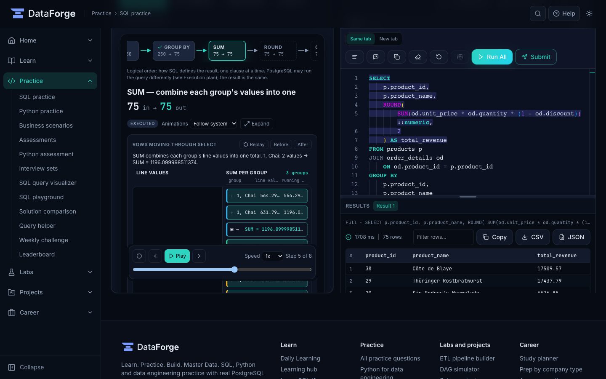
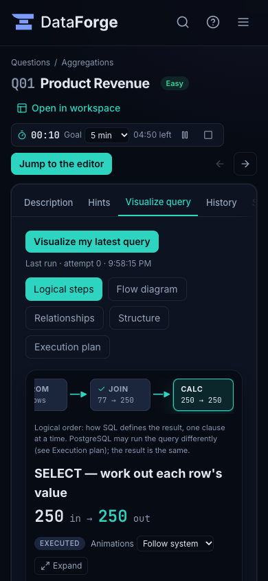
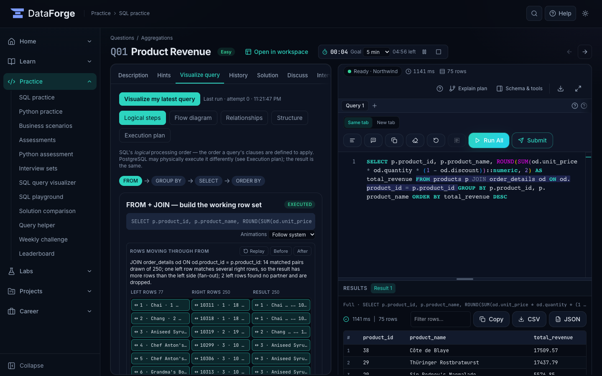
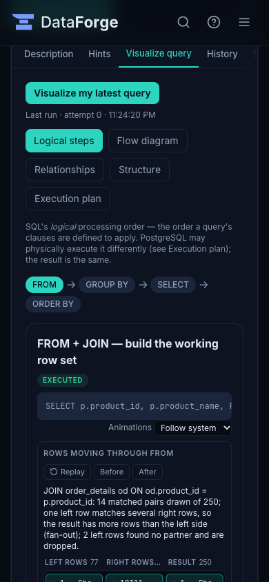
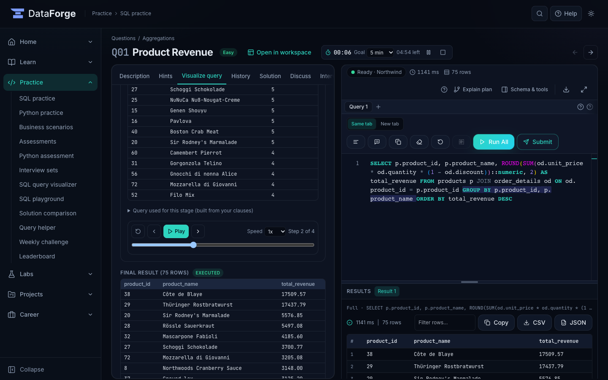
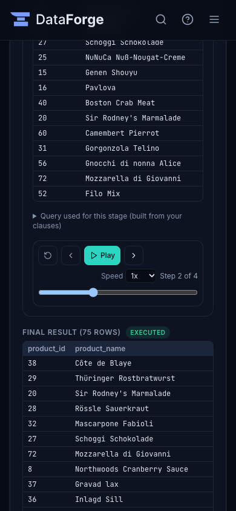
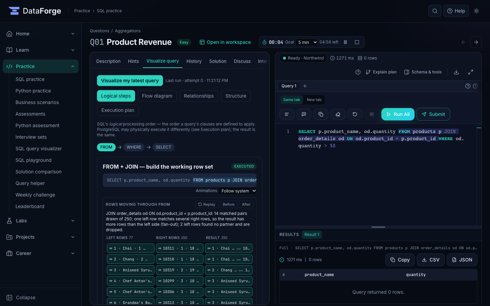
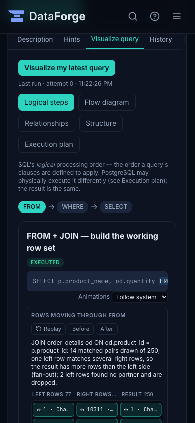

# SQL Practice: the original SQL visualizer, restored

> **Status after merging `origin/main` (2026-11-25).** This document was written when the Cinema was still on the other pages. `main` has since removed the SQL Query Cinema everywhere (`0db0b58`), so `/query-visualizer`, the business scenarios and the exercise workspace now show the plain original `VizView`. SQL Practice question pages show the upgraded original, `VizViewClassic`. Read the "Unchanged: the Query Cinema" cells below as "unchanged by this work". See `docs/SQL_PRACTICE_FINAL_RELEASE_REPORT.md`.

Branch `feature/sql-visualizer-restore`, worktree `sql-practice-platform-sqlviz`. Nothing is committed, pushed, merged or deployed. The live site (Cloudflare version `2008d61c`, deployed earlier today) still shows the SQL Query Cinema on SQL Practice until this is deployed.

## 1. What "SQL Practice" means here, and what was left alone

SQL Practice is the question pages: nav entry "SQL practice" (`/questions`), and each question such as `/questions/q01-product-revenue`. The visualizer there is the "Visualize query" tab. That page is the only place the code was switched.

| Place | Visualizer now |
| --- | --- |
| SQL Practice question pages (`/questions/:slug`) | The original (this change) |
| `/query-visualizer` (nav "SQL query visualizer") | Unchanged: the Query Cinema |
| Business scenarios (`pages/ScenarioPages.tsx`) | Unchanged: the Query Cinema |
| Exercise workspace (`/workspace`, "Open in workspace") | Unchanged: the Query Cinema |
| Python, Pandas, NumPy visualizers | Not touched |

I found no SQL "Problems" section in the app. The only section titled "Problems" is the Python practice list, which is untouched. If you meant one of the places marked "Unchanged" above, say which and it is a one-line switch (see section 3).

## 2. The original, and how it was identified

I used Git history, not memory.

- Cinema commit: `9be309e` "SQL Query Cinema: make the query visualizer an animated pipeline" (2026-11-13). It changed `VizView.tsx`, `visual/RowFlow.tsx`, `lib/visual/rowFlow.ts`, `lib/visual/rowTrace.ts`, `pages/QueryVisualizerPage.tsx`, `site.css`, `help/content/sql.ts` and added `QueryCinema.tsx`, `HighlightedSql.tsx`, `lib/visual/cinema.ts`.
- Reference version: its parent, `cb29eff` (2026-11-12, `9be309e^`), the last commit before the Cinema.
- Cross-check: the local, unpushed commit `0db0b58` ("Revert the 2026-11-13 Query Cinema redesign") holds the same four files. I diffed them against `9be309e^`: `RowFlow.tsx`, `rowFlow.ts` and `rowTrace.ts` are identical, and `VizView.tsx` differs only by `export` on `StageView` (2 lines). So the recovered files are the true originals.

What the original shows on the question page (screenshots below): the five tabs Logical steps, Flow diagram, Relationships, Structure and Execution plan; stage buttons (FROM, GROUP BY, SELECT, ORDER BY, with FROM and JOIN as one step); the query with the current clause highlighted; a "Rows moving through" panel with Replay, Before and After; per-stage tables and counts; the shared playback bar (restart, previous, play, next, speed); and the final result table.

Current Cinema, for comparison: a pipeline rail with a separate JOIN, an animated row board, four text answers per step, and a player at the bottom.

## 3. How it was restored

The shared files (`VizView.tsx`, `RowFlow.tsx`, `rowFlow.ts`, `rowTrace.ts`) were rewritten for the Cinema and the Cinema still uses them on the other pages. So the originals were added as separate files, recovered from `9be309e^` with `git show`, with only their import paths changed to point at each other:

| New file | Recovered from `9be309e^` | Change |
| --- | --- | --- |
| `frontend/src/site/components/VizViewClassic.tsx` | `components/VizView.tsx` | Component renamed `VizViewClassic`; imports point at the classic copies; a header comment; two helper exports made private. |
| `frontend/src/site/components/visual/RowFlowClassic.tsx` | `components/visual/RowFlow.tsx` | Imports `lib/visual/classic/rowFlow`. |
| `frontend/src/site/lib/visual/classic/rowFlow.ts` | `lib/visual/rowFlow.ts` | Relative import paths only. |
| `frontend/src/site/lib/visual/classic/rowTrace.ts` | `lib/visual/rowTrace.ts` | Relative import paths only. |

One existing file changed: `frontend/src/site/pages/QuestionPage.tsx`, two lines (the import and the element name, `VizView` to `VizViewClassic`). Props, the editor-highlight callback and the session history are exactly as before. The SQL engine, `visualize()`, grading, progress, the Cinema files and every other page are unchanged. No dependency was added.

To put the original on another page, replace `VizView` with `VizViewClassic` in that page's import and element.

Also in the working tree, from earlier work and already deployed: the Cinema improvements (container-query layout, CALC, SUM, ROUND and RESULT steps, Expand). They are untouched and still apply to the pages that keep the Cinema. See `docs/SQL_VISUALIZER_REGRESSION_REPORT.md`.

## 4. SQL execution

The original visualizer runs through the same infrastructure as before: `runQuery` on PGlite (PostgreSQL), `visualize()` for the stage counts, and its own original `traceRows` for the rows, using only read-only `SELECT`, `WITH` and `EXPLAIN` queries on top of the learner's single run. Nothing is hardcoded. The tests below check the learner's query is run exactly once, the final result equals an independent run of the same SQL, and an invalid query shows an error and no result.

## 5. Tests and results

Run from `frontend/` in the worktree.

| Check | Result |
| --- | --- |
| `npx tsc -b`, `npx eslint src` | No errors, no output. |
| `siteClassicVisualizerData.test.ts` and `siteClassicVisualizerUi.test.tsx` (the original tests for the row-flow engine and `VizView`, copied from `9be309e^` and pointed at the classic files) | 38 passed. |
| `siteSqlPracticeOriginalVisualizer.test.tsx` (new, real PGlite) | 13 passed: for SELECT and WHERE, INNER JOIN, LEFT JOIN, GROUP BY with HAVING, ORDER BY, a subquery, a CTE and Q01 Product Revenue, the five tabs, the row board and "Next step" are present, no Cinema element is, and the final row count equals an independent query; stepping, replay and restart work; only read-only queries run and the learner's query runs once; an invalid query shows an error and no result; `QuestionPage` imports `VizViewClassic`; the query visualizer page, scenarios and workspace still import the Cinema's `VizView`. |
| Full Vitest (`TZ=UTC npx vitest run`) | 7120 passed, 1187 failed, 57 skipped. The failures are the same 1187 as before this change, all in `siteDaily.test.ts` (1184) and `siteVisualInterview.test.ts` (3): `python3` on this machine has no numpy or pandas (the log says so). Not re-run on the base commit. |
| Playwright `sql-practice-original-visualizer.spec.ts` on the real route `/questions/q01-product-revenue`, desktop and mobile (Chrome, dev server) | Each of the 8 queries (SELECT and WHERE, INNER JOIN, LEFT JOIN, GROUP BY, ORDER BY, subquery, CTE, Q01): the five tabs, the playback group and the row-movement panel are visible, no Cinema element exists, the final result count equals the count the Results panel reports (on a phone, where that panel can sit in another tab, only the caption is checked), Next, Previous and Restart work, no horizontal page scroll. Also: all five tabs open, Play and Pause work, an invalid query reports the error, and `/query-visualizer` still shows the Cinema. |
| Combined browser run (this spec, the Q01 Cinema spec, `query-cinema.spec.ts`, `visual.spec.ts`; desktop and mobile; one retry) | 79 passed, 1 flaky, 1 skipped, 1 failed. Flaky: the GROUP BY test on desktop passed on retry. Failed: my Q01 Cinema spec expected an Expand button on the wide `/query-visualizer` page, where it is hidden by design; I fixed the test and its desktop and mobile runs then passed. Separately, in an earlier run the first test after a dev-server restart failed once and then passed in three reruns. I widened that test's timeouts. |
| `npm run build:site` and `check:prerender` | Exit 0, 1139 pages prerendered; no failed Suspense boundaries. |

Not run: Firefox and WebKit; `ux-redesign.spec.ts`, `help-tours.spec.ts` and `workspace.spec.ts` in this round (the two workspace SQL tests already fail on the unchanged base, see the other report). I did not check whether a Guide tour refers to the old layout of the question page's Visualize tab.

## 6. Screenshots

Before (SQL Practice showing the Query Cinema, Q01):

| | |
| --- | --- |
| JOIN, desktop |  |
| SUM, desktop |  |
| CALC, mobile |  |

After (the original, Q01 at `/questions/q01-product-revenue`):

| | Desktop | Mobile |
| --- | --- | --- |
| FROM + JOIN |  |  |
| Next stage |  |  |
| INNER JOIN query |  |  |

## 7. Limits and open points

- This is the original, so it keeps the original's limits: FROM and JOIN are one step, and there is no per-row calculation, no SUM step and no final-result step. Those exist only in the Cinema.
- Two visualizers now exist side by side in the code: the original on SQL Practice question pages, the Cinema everywhere else. The Cinema's own page for the same query is `/query-visualizer`.
- The local commit `0db0b58` reverts the Cinema everywhere. It is unmerged and unchanged; it conflicts with keeping the Cinema on the other pages.
- The live site still has the Cinema on SQL Practice until this branch is deployed.
- The original's Guide tour text and example chips on `/query-visualizer` are those of the Cinema there; the original's help text for the question page was not rechecked.
