# SQL Practice visualizer: QA report

Branch `feature/sql-visualizer-restore`, worktree `sql-practice-platform-sqlviz`. Written by Agent 5 (testing and regression). Status: **final pass done** on the final tree (dev server on the live worktree, port 5184, nobody editing). Section 9 has the actual numbers of every run. Findings are in section 7, what the screenshots show in section 8.

## 1. What was tested and how

Scope: the "Visualize query" tab on SQL Practice question pages (`/questions/:slug`, checked on `/questions/q01-product-revenue`), which must show the ORIGINAL visualizer (`VizViewClassic`) and never the Query Cinema. The Cinema pages (`/query-visualizer`, scenarios, workspace) must be unchanged.

Strategy: three layers, all against a real PostgreSQL (PGlite), none against mocks of the engine.

| Layer | File | What it proves |
| --- | --- | --- |
| Data (node, vitest) | `frontend/src/test/siteSqlPracticeVizData.test.ts` (26 tests) | `visualize()`, the classic `traceRows()` and the teaching cards (`teachSteps`) report counts, rows, groups, NULL handling and order that equal an INDEPENDENT query. |
| UI (jsdom, vitest) | `frontend/src/test/siteSqlPracticeVizUi.test.tsx` (29 tests) | The contract's test ids and `data-step-index`; every region agrees after every step change; navigation, keyboard, playback, reset, replay; edge cases; reduced motion; the Cinema is not used and not changed. |
| Browser (Playwright) | `frontend/e2e/sql-practice-visualizer-qa.spec.ts` (30 tests per project) | The same on the real route, desktop 1440x900 and mobile 390x844, light and dark: layout, contrast, reduced motion, Run All and Submit unaffected, no console errors. |

Independence of the expectations: every expected value comes from a query written in a different form than the learner's (EXISTS instead of JOIN, correlated sub-selects instead of GROUP BY, comma joins, `FETCH FIRST` instead of `LIMIT`, `NOT (x <= 50)` instead of `x > 50`). In the browser spec the reference database is a second PGlite in the Node test process, loaded from `public/data/northwind.sql`; the page's own database is never used as the oracle. No test reads a number out of the UI and compares it with the UI.

Contract checks (`docs/SQL_VISUALIZER_UPGRADE_CONTRACT.md`): `classic-viz`, `classic-sql`, `classic-step-rail`, `classic-explain`, `classic-tables`, `rowflow`, `classic-progress`, `classic-reset`, `classic-player`; `data-step-index` on all of them; `aria-valuenow = step number`, `aria-valuemax = steps`, `aria-current="step"` on exactly one rail button, `data-range` offsets that slice to the `<mark>` text.

## 2. Existing tests inspected (task 1)

| File | Covers | Changed? |
| --- | --- | --- |
| `siteClassicVisualizerData.test.ts` (331 lines) | The original row-flow engine (`classic/rowTrace`, `classic/rowFlow`): ctid and trace identities, FROM, WHERE, INNER/LEFT/RIGHT/FULL/CROSS JOIN, GROUP BY, aggregation, DISTINCT, ORDER BY, LIMIT, subquery and CTE identities, volatile functions, the learner's query runs once, derived queries are read-only, set operations, pure frame builders. It is `siteVisualRowFlow.test.ts` with the two import paths pointed at `classic/`. | No |
| `siteClassicVisualizerUi.test.tsx` (169 lines) | `RowFlowClassic` reduced and animated rendering, `MotionToggle`, `VizViewClassic` runs the query once and gives the same result with animation on or off. Copy of `siteVisualRowFlow.test.tsx`. | No |
| `siteSqlPracticeOriginalVisualizer.test.tsx` (127 lines) | Eight queries: five tabs, row board, "Next step", no Cinema, final row count equals an independent count; stepping, replay, restart; read-only queries and one run; invalid query; `QuestionPage` imports `VizViewClassic`; the other pages import the Cinema's `VizView`. | No |
| `siteVisualRowFlow.test.ts/.tsx` | The Cinema's copies of the two files above. Not touched. | No |
| `e2e/sql-practice-original-visualizer.spec.ts` (111 lines) | The same eight queries on the real route (desktop and mobile), tabs, playback, five tabs, Play/Pause, invalid SQL, `/query-visualizer` shows the Cinema. | Yes: F3 and F6 fixes, no assertion removed |
| `e2e/query-cinema.spec.ts` (290 lines), `e2e/visual.spec.ts` (88 lines) | The Cinema on `/query-visualizer` and the visual hub. Not part of this work. | No |

Weak spot found in the existing tests: the INNER JOIN query used by `siteSqlPracticeOriginalVisualizer.test.tsx` and the existing e2e spec (`... WHERE od.quantity > 50`) returns **0 rows** (the largest `order_details.quantity` in the data is 40), so its "final result equals an independent count" check compares 0 with 0. The new tests use `od.quantity > 30` (30 rows).

## 3. Baseline ("before")

Taken first, with Chrome (Playwright `channel: "chrome"`), against the live site `https://dataforge.dataforge-learn.workers.dev/questions/q01-product-revenue`: Q01 Product Revenue SQL set through `window.monaco`, Run All, tab "Visualize query", button "Visualize my latest query". Theme emulated the way the site stores it (`localStorage sqlp.theme`, see `ThemeContext`). The onboarding card is skipped with `localStorage df.help.v1`.

What the live site showed: the ORIGINAL visualizer (no Cinema element, `data-testid="cinema"` count 0), i.e. the state before this upgrade: five tabs, stage buttons FROM+JOIN, GROUP BY, SELECT, ORDER BY, a SQL box showing only the first characters of the query, "Rows moving through FROM" with Replay/Before/After, lanes LEFT ROWS / RIGHT ROWS / RESULT, no step progress indicator, no per-step explanation, no intermediate tables.

| | Light | Dark |
| --- | --- | --- |
| Desktop 1440x900 | 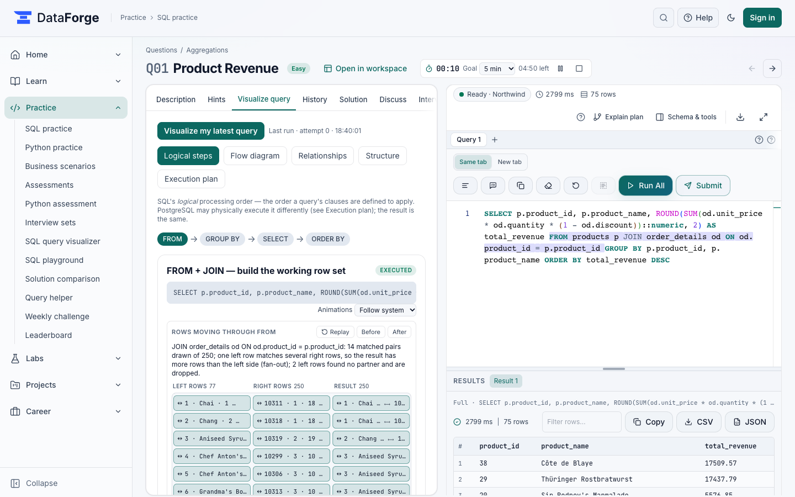 | 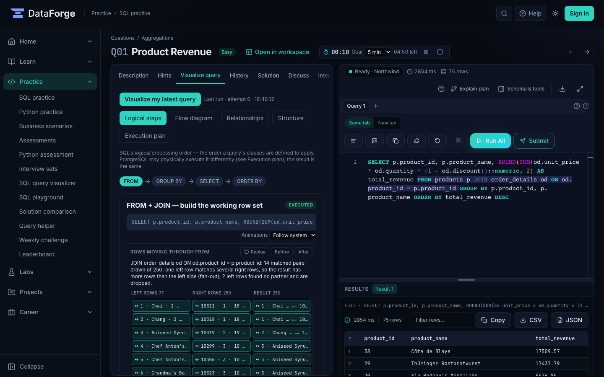 |
| Mobile 390x844 | 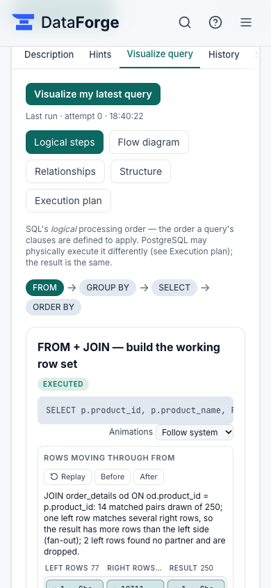 | 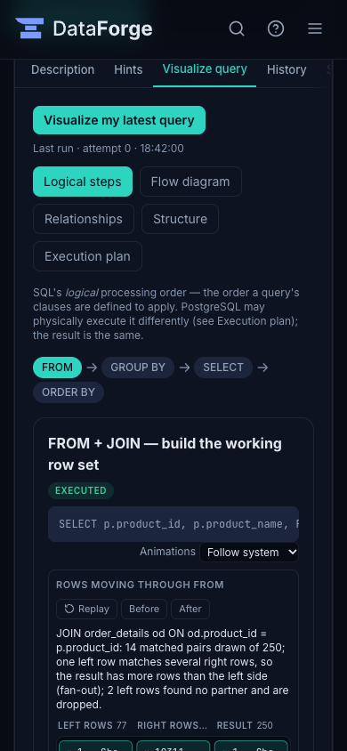 |

The live site logs one console error in this state: `column "od.ctid" must appear in the GROUP BY clause or be used in an aggregate function` (and `column big.ctid does not exist` for a CTE query). See F2: fixed in the final tree.

## 4. How to run everything

From `frontend/` in the worktree:

```
npx tsc --noEmit -p tsconfig.json
npx eslint src/test/siteSqlPracticeVizData.test.ts src/test/siteSqlPracticeVizUi.test.tsx
TZ=UTC npx vitest run src/test/siteSqlPracticeVizData.test.ts src/test/siteSqlPracticeVizUi.test.tsx \
  src/test/siteClassicVisualizerData.test.ts src/test/siteClassicVisualizerUi.test.tsx src/test/siteSqlPracticeOriginalVisualizer.test.tsx

npx vite --config vite.site.config.ts --port 5184 --strictPort        # dev server (other terminal)
E2E_BASE_URL=http://localhost:5184 npx playwright test e2e/sql-practice-visualizer-qa.spec.ts --project=desktop --retries=0
E2E_BASE_URL=http://localhost:5184 npx playwright test e2e/sql-practice-visualizer-qa.spec.ts --project=mobile  --retries=0
# add QA_SHOTS=1 to also write docs/images/sql-practice-visualizer/after-*.png
E2E_BASE_URL=http://localhost:5184 npx playwright test e2e/sql-practice-original-visualizer.spec.ts --project=desktop --project=mobile
```

`e2e/` is not covered by `tsc` or `eslint` (`tsconfig` includes `src` only, the ESLint config ignores `e2e`).

## 5. The matrix, with the actual result of each row

"Data" = `siteSqlPracticeVizData.test.ts`, "UI" = `siteSqlPracticeVizUi.test.tsx`, "E2E" = the Playwright spec (D = desktop, M = mobile). Every cell below is a pass in the final-pass runs of section 9.

| Row | Independent check | Data | UI | E2E D | E2E M |
| --- | --- | --- | --- | --- | --- |
| SELECT / WHERE | final rows and columns equal `NOT (unit_price <= 50)`; FROM 77, WHERE in 77 / out 7; WHERE sample rows all satisfy the filter, removed rows fail it; SELECT narrows to 2 columns; WHERE card holds the kept and removed tables | pass | pass | pass | pass |
| INNER JOIN | matched pairs, unmatched left (2) and result rows equal EXISTS counts; both `product_id` equal in every sampled joined row; trace frame drops exactly the unmatched products and pads nothing; JOIN card total equals comma-join count | pass | pass | pass | pass |
| LEFT JOIN | unmatched customers survive with NULL padding (2); total = matched orders + orphans; anti-join returns exactly the orphans with NULL `order_id`; card text mentions NULL | pass | pass | pass | pass |
| Multiple JOINs (3 tables) | each join step's `resultRows` equals the comma-join count; one board per join; WHERE and final rows equal the independent set | pass | pass | pass | pass |
| GROUP BY | one group per distinct key, group sizes equal correlated counts, `groups` frame present | pass | pass | pass | pass |
| SUM / COUNT / AVG / MIN / MAX | final aggregates equal correlated sub-selects; COUNT(col) skips NULL, COUNT(*) does not; SUM of an empty set is NULL | pass | pass | pass | pass |
| HAVING | survivors and the removed groups equal the independent sets (5 kept, 3 removed); in 8 / out 5 | pass | pass | pass | pass |
| ORDER BY, NULL placement | final order equals `ORDER BY ... NULLS LAST/FIRST`; NULLs last in ASC and first in DESC; ORDER BY card lists the true first rows in the true order | pass | pass | pass | pass |
| LIMIT / OFFSET | final slice equals `OFFSET 2 FETCH FIRST 5`; LIMIT card: kept = the slice, removed tables total = rest, nothing kept appears as removed | pass | pass | pass | pass |
| Subqueries | scalar, IN and correlated EXISTS/NOT EXISTS results equal independent forms | pass | pass | pass | pass |
| CTEs | CTE row count (100 orders), WHERE in/out, final rows equal the independent aggregate | pass | pass | pass | pass |
| Window functions | `RANK() OVER (PARTITION BY ...)` and windowed `SUM` equal correlated computations; `ROW_NUMBER` gives 1..n per partition; window card names the partitions | pass | pass | pass | pass |
| NULL behaviour | `> date` removes NULL rows (not "false"); `IS NULL` finds 15; `= NULL` finds 0; NULL region rows form one group; COALESCE | pass | pass | pass | pass |
| Empty results | final 0 rows, every stage 0, no error, every step still navigable, text says there are no rows | pass | pass | pass | pass |
| Invalid SQL | error shown, `final` undefined, no `Final result`, no throw, no pageerror; `DROP TABLE` is never run (products stays 77) | pass | pass | pass | pass |
| Query editor unchanged | Results panel count (desktop) and first rows equal the independent result before and after visualizing and stepping; Submit grades Q01 "Correct"; a wrong query still fails ("does not match the expected result") | n/a | n/a | pass | pass |
| Step navigation | rail, Next, Previous, Restart, Reset, ArrowLeft/Right, Home, End, timeline slider, no step past either end | n/a | pass | pass | pass |
| Playback synchronisation | after every step the root, `classic-sql`, rail, explain, tables, rowflow and progress carry the same `data-step-index`, `aria-valuenow = n+1`, `aria-valuemax = count`, exactly one `aria-current` | n/a | pass | pass (every query, every step) | pass |
| Reset and replay | Reset and Restart return all regions to step 0; Replay keeps the step; Play runs in order to the end and stops; Pause holds the step | n/a | pass | pass | pass |
| Responsive layout | no horizontal page scroll at every step of every matrix query; visualizer and each region lie inside the viewport and inside `classic-viz`; no pane scrolls sideways | n/a | n/a | pass | pass |
| Light / dark | `html.dark` matches; WCAG AA contrast (4.5, 3 for large text) of every visible text in SQL, rail, explain, tables and player at two steps | n/a | n/a | pass | pass |
| Reduced motion | `prefers-reduced-motion: reduce`: no animation and no transform/opacity/all/geometry transition longer than 1 ms anywhere in `classic-viz`, at every step; `data-reduced="true"`; with motion allowed `data-reduced="false"` | n/a | pass | pass | pass |
| Console errors | no `pageerror` and no `console.error` in any matrix test, and the two former ctid-probe lines are asserted gone (F2) | n/a | invalid-SQL test | pass | pass |
| No Cinema element | no `cinema*` test id on the question page, in any tab, before or after visualizing; the classic view has no Cinema import | n/a | pass | pass | pass |
| `/query-visualizer` unchanged | still shows `cinema-empty`, then `cinema` and `cinema-rail` for the "JOIN + GROUP BY + HAVING" example and no classic region; the Cinema's `VizView` renders `cinema` | n/a | pass | pass | pass |
| One run, read-only | the learner's SQL executes exactly once; stepping, seeking, replay run no query; every other statement is SELECT, WITH or EXPLAIN | pass | pass | n/a | n/a |

The data block also contains a `teaching cards` group (feature tests): one card per stage with label and text, rows in/out equal to the database, WHERE, JOIN, GROUP BY, HAVING, aggregate, ORDER BY, LIMIT, window and empty-result cards, and no `undefined/NaN` in any text.

## 6. How the red tests of the work were classified

Nothing was hidden or weakened. Red tests during the work fell into four groups.

- Feature not there yet when first run, green later with no test change: `classic-sql` without `data-step-index` (host did not pass the step to `ClassicSql`); no ORDER BY / LIMIT tables on the teaching cards.
- Mistakes in my own tests, fixed: the final-result heading is upper-cased by CSS (`innerText` returned "ROWS", now `textContent`); the rail calls the first step "FROM + JOIN"; card columns are qualified (`p.product_id`) and the ORDER BY table has leading `position` columns, so columns are picked by name; the INNER JOIN query returned 0 rows (above); on a phone the Results row chip is in a hidden container and a "2 rows" chip of the visualizer was matched, so the Results row count is read on a desktop only; the invalid-SQL test waits for the failed-step text; the ctid probe filter (now asserted empty).
- Stability fixes that make a test wait for the settled state, not skip a check: the UI test's `mount` waits until the player's `aria-valuemax` equals the root's `data-step-count` (F5); the existing e2e spec waits for `rowflow-refining` to disappear before it reads `data-kind` (F6).
- Reduced motion: the site sets `transition-duration: 0.00001s` on every element under `prefers-reduced-motion: reduce` (the usual "effectively none" idiom). The test treats up to 1 ms as no transition; anything longer, any animation, and any transform/opacity/all transition above that fails.

## 7. Findings

No open implementation bug. Open items are limitations and observations.

| Id | Status | Where | What | Reproduction |
| --- | --- | --- | --- | --- |
| F1 | Known limitation, pre-existing, `pages/QuestionPage.tsx` is read-only for this work | phone only | After tapping "Visualize ↗" the page already shows a visualization of the STARTER query (Q01: 75 rows) before the learner's own query is visualized, and keeps showing it until "Visualize my latest query" is pressed (also after a failed Run). Desktop does not do this. | 390x844: open `/questions/q01-product-revenue`, tap "Visualize ↗", run `SELECT x FROM no_such_table`, open "Visualize query": `Final result (75 rows)` is still there; press "Visualize my latest query": the failed step appears. |
| F2 | Fixed in the final tree | `lib/visual/classic/rowTrace.ts` | The row trace probed `ctid` and PGlite logged each refusal to the console (`column "od.ctid" must appear in the GROUP BY clause...`, `column big.ctid does not exist`); also on the live site before this work. Checked on the final tree for Q01 and the CTE query: console error list is empty. The matrix test now asserts the lines never come back. | `node` script with a console listener, or the Playwright matrix tests. |
| F3 | Fixed (test) | `e2e/sql-practice-original-visualizer.spec.ts` | On a phone its row-count chip locator matched a "2 rows" chip of the visualizer. The count is now read on a desktop only; on a phone the spec's own caption-only branch is used. No assertion removed. | `--project=mobile -g select-where` |
| F4 | Harness | Playwright mobile | `page.emulateMedia({ colorScheme })` before `goto` on the mobile project left the editor invisible (reproducible); the spec sets the theme with `localStorage sqlp.theme` and asserts `html.dark`. A tap on "Visualize ↗" can miss while the page settles; `openQuestion` retries with a reload. | n/a |
| F5 | Observation, low | `useClassicStep` / `ClassicPlayer` (count from the playback reducer) | For the first render after the stages arrive, the progress bar can say `aria-valuemax=0` / `aria-valuenow=0` while the root already says `data-step-count=N` (seen once, in the very first test of a cold vitest run under load; 3 reruns alone passed). It settles within a render. After that every step change is in sync (all runs). | Not reliably reproducible; vitest `siteSqlPracticeVizUi` first test on a cold, busy machine. |
| F6 | Observation, low (original behaviour) | `RowFlowClassic` | Until the row trace arrives, the first frame is drawn from the stage sample (`data-kind="scan"`, text "looking up real row ids…", testid `rowflow-refining`) and is replaced by the real one (`data-kind="join"` for FROM + JOIN). A test or a learner that acts in that moment sees the provisional frame. | Visualize the `group-by` query of the existing e2e spec and read `data-kind` right after the tab opens. |

## 8. Screenshots after, and what they show (`docs/images/sql-practice-visualizer/`)

Written by the spec with `QA_SHOTS=1` on the final tree (Q01): `after-<desktop|mobile>-<light|dark>.png` (step 1, FROM + JOIN), `...-step2.png` (step 3, SUM) and `...-last.png` (step 4, ORDER BY). Two extra desktop pairs show the part of the pane below the board: `after-desktop-<light|dark>-explain-step2.png` (explanation) and `...-tables-step2.png` (intermediate tables). `after-mobile-<light|dark>-full-step2.png` is the whole visualizer on a phone at step 3.

| | Light | Dark |
| --- | --- | --- |
| Desktop, step 1 | 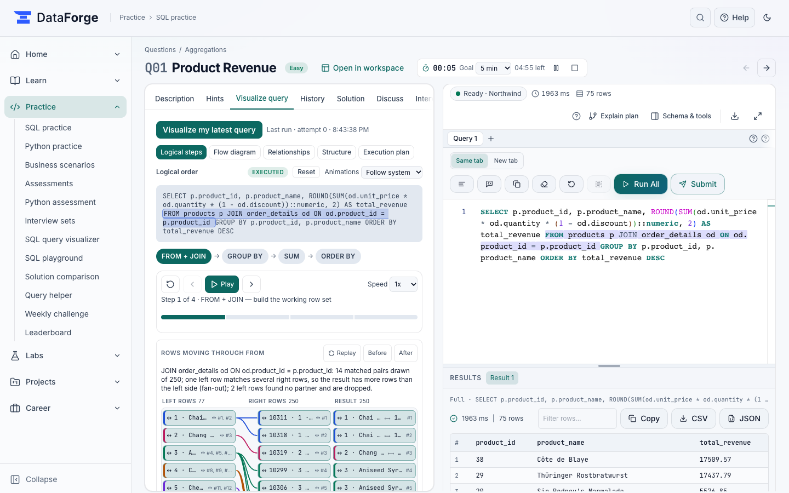 | 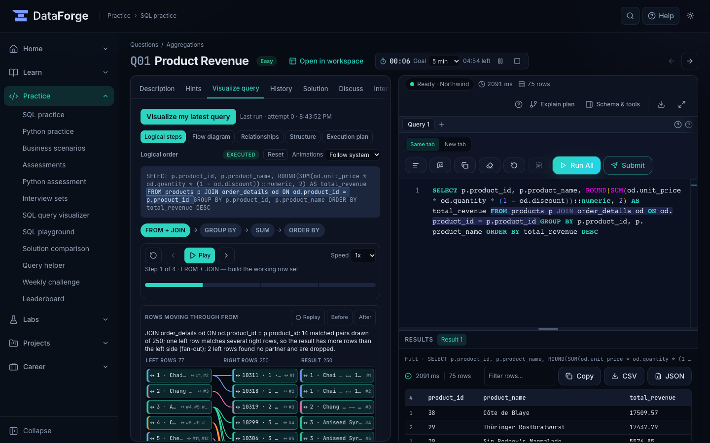 |
| Desktop, step 3 (SUM) | 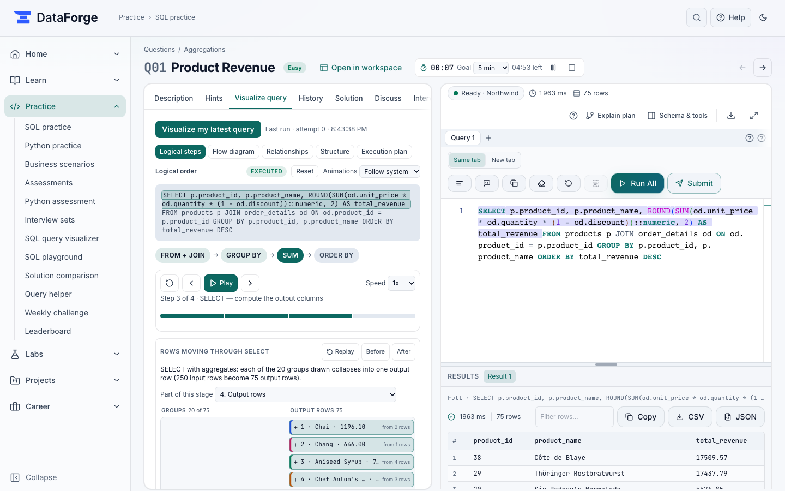 | 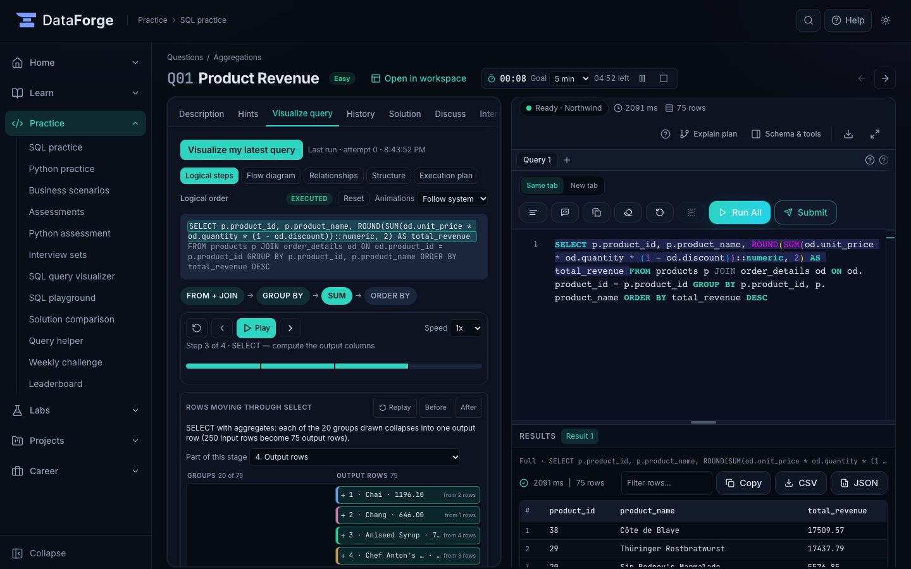 |
| Desktop, last step | 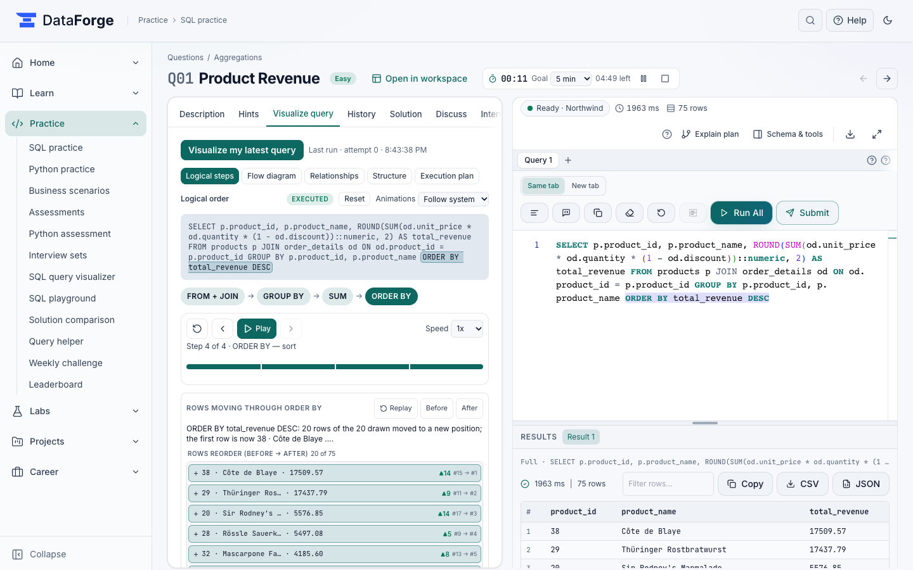 | 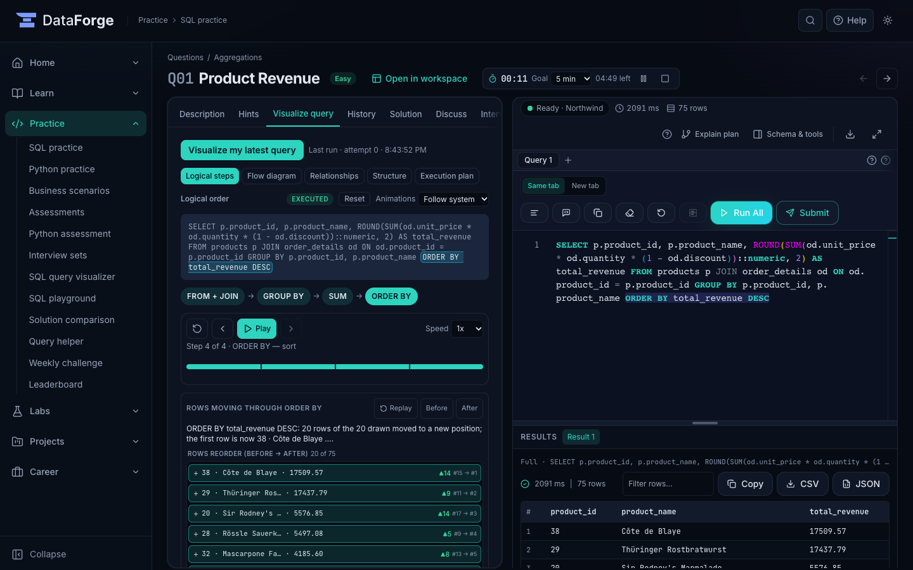 |
| Desktop, explanation, step 3 | 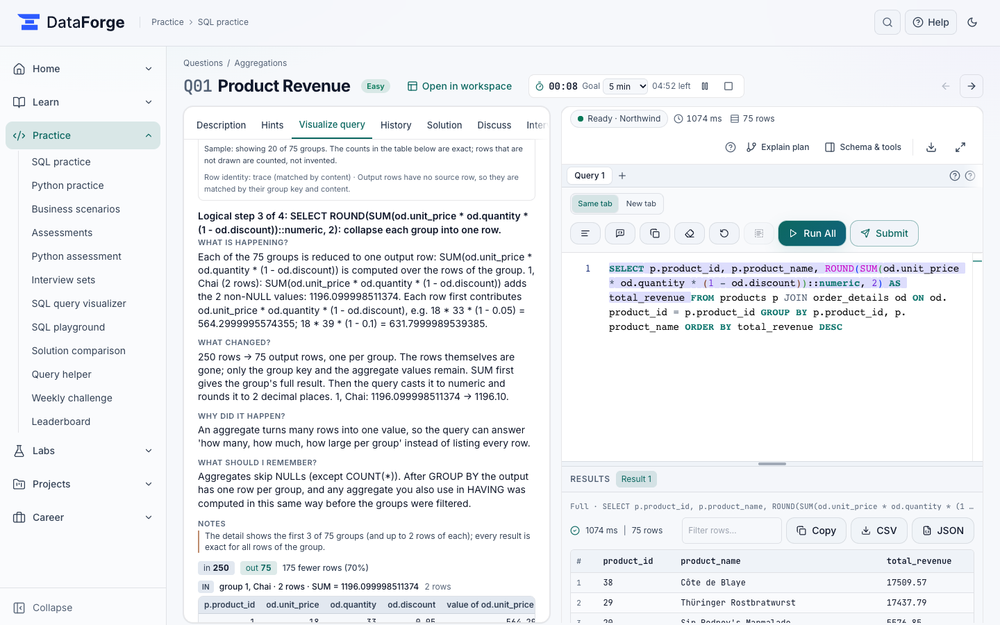 | 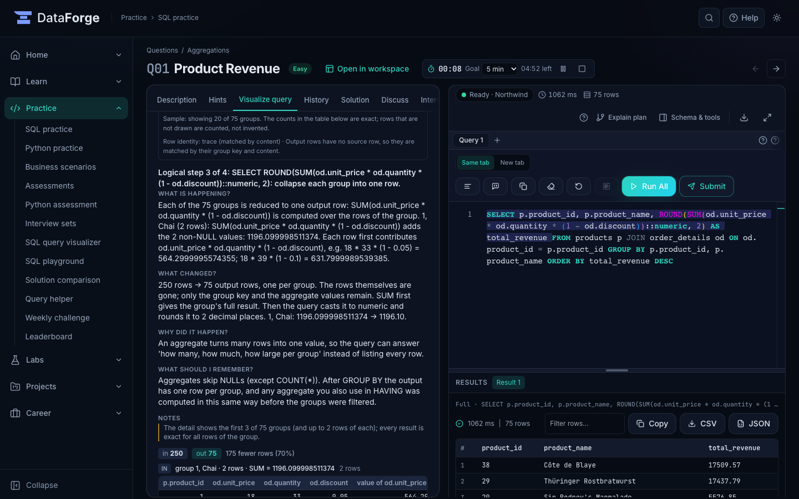 |
| Desktop, tables, step 3 | 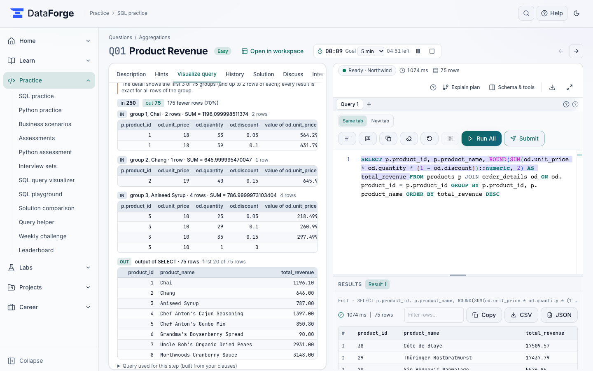 | 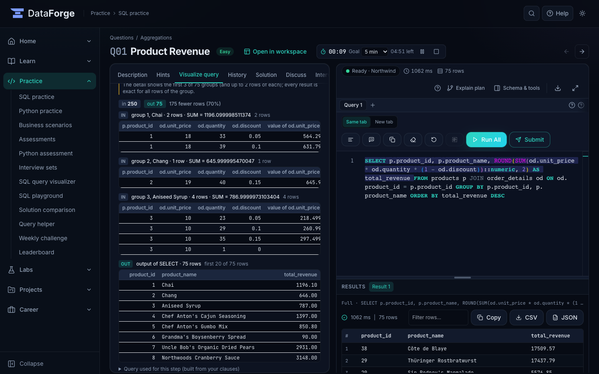 |
| Mobile, step 1 | 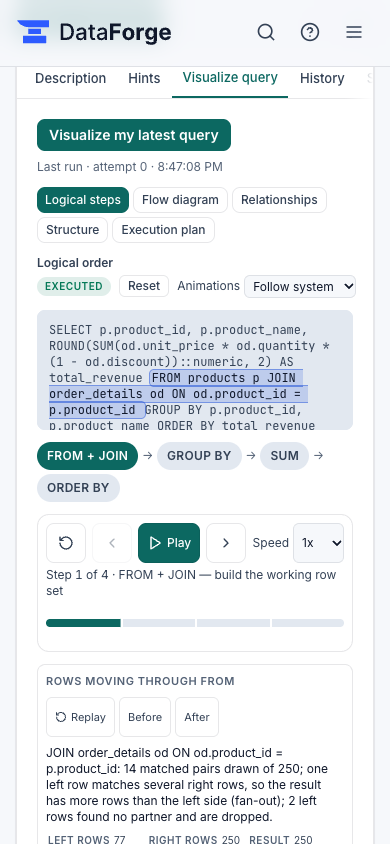 | 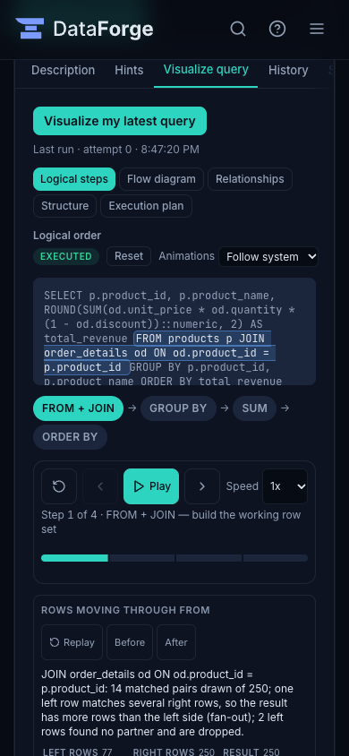 |
| Mobile, step 3 (SUM) | 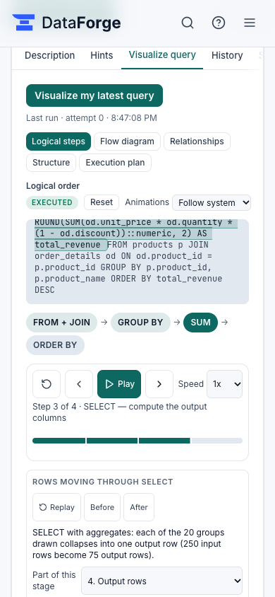 | 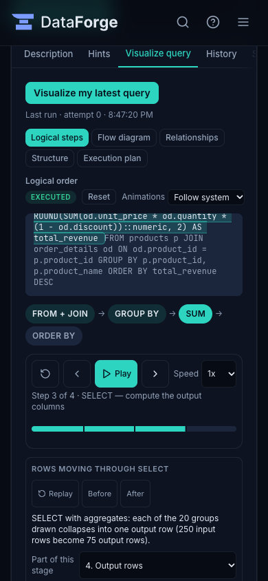 |
| Mobile, last step | 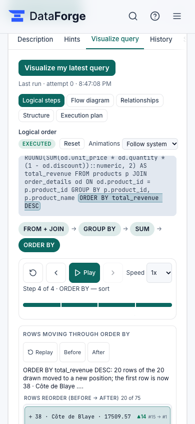 | 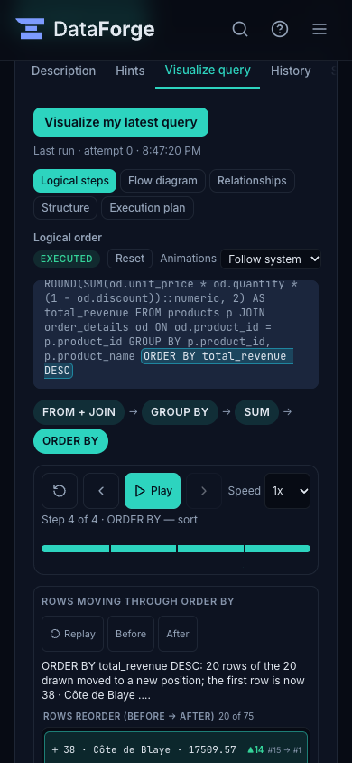 |
| Mobile, whole visualizer, step 3 | 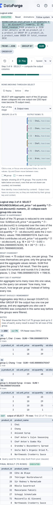 | 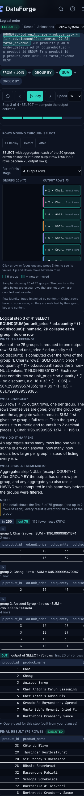 |

Looked at every picture above (desktop and mobile, both themes). No clipped headline text, no overlap, no unreadable text, no horizontal page scroll (also asserted by the spec), the SQL mark is visible in both themes, the active rail step and the progress bar are clear. Things to know, none a defect of the tests:

- Desktop pane (about 500 px): the rail, player and board fill the first screen; the explanation ("What is happening / What changed / Why / What should I remember") and the intermediate tables are below the fold, so the pane must be scrolled. There is no sticky player: while reading the explanation or tables the rail, Next and Previous are out of view, and the learner scrolls back up to step.
- The intermediate tables are wider than the pane at step 3 (`value of od.unit_price * ...` column): the last column is cut at the right edge and the table scrolls inside itself. The page does not scroll sideways.
- Step 3 (SUM), settled: the left lane "GROUPS 20 of 75" is an empty box while the "OUTPUT ROWS 75" lane on the right holds the rows (the groups have collapsed). It reads as empty space rather than as "done".
- The SQL box on a phone shows 4-6 lines and scrolls to the active clause inside itself; the rest of the query is cut by design.
- The light-theme SQL mark is a thin outline on a tinted background (lower emphasis than in the dark theme) but passes the contrast checks.
- Empty state (no rows) and invalid SQL were checked by the tests (text asserted); they were not part of the screenshot set.

## 9. Final pass: actual results

Run on the final tree on 2026-11-24, dev server `npx vite --config vite.site.config.ts --port 5184 --strictPort` on the live worktree, Chrome (`channel: "chrome"`). The coordinator ran the full vitest suite and a production build at the same time for part of it.

| Run | Result |
| --- | --- |
| `tsc --noEmit -p tsconfig.json` | no errors (whole project) |
| `eslint` on my two vitest files | clean |
| vitest, 5 files (`siteSqlPracticeVizData` 26, `siteSqlPracticeVizUi` 29, `siteClassicVisualizerData` 28, `siteClassicVisualizerUi` 10, `siteSqlPracticeOriginalVisualizer` 13) | 106 passed, 0 failed. (One run during the pass failed the first UI test once under load, F5; it passed alone three times and after the `mount` wait, and in the final run.) |
| Playwright `sql-practice-visualizer-qa.spec.ts`, desktop, clean run, `--retries=0`, `QA_SHOTS=1` | 30 passed |
| same, mobile | 30 passed |
| same, matrix tests only, both projects, after adding the "ctid lines stay gone" assertion | 26 passed (all matrix tests) |
| Playwright `sql-practice-original-visualizer.spec.ts`, desktop + mobile, `--retries=1` | First run: 19 passed, 1 flaky, 2 failed: `group-by` on desktop and mobile (and `left-join` desktop once) read `data-kind` "scan" before the row trace arrived and "join" after (F6). Fixed in the spec (waits for `rowflow-refining` to disappear, nothing weakened); re-run: 22 passed, 0 flaky. F3 fixed in the same edit. |
| Playwright `query-cinema.spec.ts`, desktop + mobile, `--retries=1` | 31 passed, 1 skipped (the desktop-only keyboard test on mobile), 0 failed |
| Playwright `visual.spec.ts`, desktop + mobile, `--retries=1` | 12 passed |
| Console check, final tree, Q01 and the CTE query on `/questions/q01-product-revenue` | empty console error list; the two former ctid lines do not appear (F2) |

## 10. Not covered

Firefox and WebKit (the spec runs on the `firefox-*` and `webkit-*` projects when `E2E_ENGINES` is set; not run here); screen-reader behaviour beyond the ARIA attributes asserted; the Flow diagram, Relationships, Structure and Execution plan tabs beyond "they open, the Cinema is absent, and the Logical tab returns to the same step"; signed-in grading and Supabase sync (Submit was checked signed out); questions other than Q01 in the browser (the SQL matrix covers the clause types, not every question's SQL); the Guide tour text for the question page.
