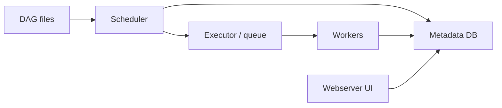

## Introduction

Apache Airflow is an orchestrator. It does not move data itself: it decides *when* each step of a pipeline runs, *in what order*, and *what happens when a step fails*. To do that it is split into a few cooperating services.

## Definition

Airflow is a platform for authoring, scheduling and monitoring workflows written as Python code. A workflow is a **DAG** (directed acyclic graph) of **tasks**. The core components are:

- **Scheduler**: parses DAG files, creates DAG runs, and queues task instances whose dependencies are met.
- **Executor**: the strategy the scheduler uses to run queued tasks (`LocalExecutor`, `CeleryExecutor`, `KubernetesExecutor`).
- **Workers**: processes or pods that actually execute task code.
- **Metadata database**: PostgreSQL or MySQL holding DAG runs, task instance states, XComs, Connections and Variables.
- **Webserver**: the UI for inspecting runs, logs, and triggering or clearing tasks.
- **DAG folder**: the Python files that define DAGs, read by the scheduler (and by workers when running tasks).

## Why it matters

Interviewers ask "what happens between writing a DAG file and a task running?" Knowing the components explains common symptoms: a DAG not appearing (parse error or scheduler not seeing the folder), tasks stuck in `queued` (no free worker or pool slot), slow scheduling (heavy top-level code in DAG files).

## How it works

1. The scheduler's DAG processor parses every file in the DAG folder repeatedly and serialises DAGs into the metadata DB.
2. For each DAG whose schedule is due, the scheduler creates a **DAG run** for a data interval.
3. Task instances whose upstream tasks are done (per their `trigger_rule`) move to `scheduled`, then `queued`.
4. The executor hands queued tasks to workers. Workers run the task and write state (`running`, `success`, `failed`, `up_for_retry`) back to the DB.
5. The webserver reads the same DB to show state and logs.

In Airflow 2.x the standalone DAG processor is optional; in Airflow 3 it became a separate required component, and workers talk to an API server instead of the metadata DB directly.

## Syntax and configuration

Key settings in `airflow.cfg` or environment variables (`AIRFLOW__<SECTION>__<KEY>`):

```bash
export AIRFLOW__CORE__EXECUTOR=LocalExecutor
export AIRFLOW__DATABASE__SQL_ALCHEMY_CONN=postgresql+psycopg2://airflow:airflow@db:5432/airflow
export AIRFLOW__CORE__DAGS_FOLDER=/opt/airflow/dags
export AIRFLOW__CORE__PARALLELISM=32
export AIRFLOW__CORE__LOAD_EXAMPLES=False
```

Starting the components locally:

```bash
airflow db migrate          # create/upgrade the metadata schema (2.7+; older: airflow db init)
airflow scheduler           # in one terminal
airflow webserver --port 8080
airflow standalone          # dev only: all-in-one with SQLite
```

## Examples

A minimal Docker Compose sketch of the services:

```yaml
services:
  postgres:
    image: postgres:16
  airflow-scheduler:
    image: apache/airflow:2.9.3
    command: scheduler
  airflow-webserver:
    image: apache/airflow:2.9.3
    command: webserver
    ports: ["8080:8080"]
```

## Architecture

The scheduler and webserver never talk to each other directly; both go through the metadata database. Workers pick up tasks from the executor (with Celery, via a broker such as Redis).



## Practical example

A team runs the `CeleryExecutor` with three workers. Tasks sit in `queued` for minutes. Checking the UI shows all worker slots (`worker_concurrency`) busy with long sensors in `poke` mode. Switching sensors to `mode="reschedule"` frees the slots between checks and the queue drains.

## Exercises

1. Which component turns a schedule into DAG runs?
   <details><summary>Answer</summary>The scheduler.</details>
2. Why is SQLite only fine for local testing?
   <details><summary>Answer</summary>It allows no concurrent writers, so only the SequentialExecutor works with it; production needs PostgreSQL or MySQL.</details>
3. A DAG file has a syntax error. Where do you see it?
   <details><summary>Answer</summary>As an "import error" banner in the webserver, or with `airflow dags list-import-errors`.</details>

## Common mistakes

- Treating Airflow as a processing engine and moving large data through workers or XCom.
- Using SQLite or `SequentialExecutor` in production.
- Heavy work (DB queries, API calls) at DAG-file top level, which runs on every parse.
- Workers with different code or packages than the scheduler sees.

## Performance and best practices

- Keep DAG files cheap to import; the scheduler parses them continuously.
- Size `parallelism`, pools and `max_active_tasks` to downstream system limits.
- Push heavy compute to Spark, a warehouse or containers; Airflow only triggers it.
- Run the metadata DB on managed PostgreSQL and prune old rows (`airflow db clean`).

## Interview questions

### What are the main components of Airflow?

Scheduler, executor, workers, metadata database and webserver, plus the DAG folder. The scheduler decides what runs; workers run it; the DB records state; the webserver displays it.

### What does the executor do?

It defines how queued task instances are run: in-process subprocesses (`LocalExecutor`), on a Celery worker pool (`CeleryExecutor`), or one pod per task (`KubernetesExecutor`).

### Why is the metadata database critical?

All state lives there: DAG runs, task states, XComs, Connections, Variables. If it is down, scheduling stops and the UI breaks.

### Why do tasks get stuck in queued?

No free capacity: worker slots, pool slots, `parallelism` or `max_active_tasks` limits are exhausted, or workers are not running.

## Quick revision

- Airflow orchestrates; it does not process big data itself.
- Scheduler parses DAGs, creates runs, queues tasks.
- Executor + workers run tasks.
- Metadata DB stores all state; webserver reads it.
- Use PostgreSQL/MySQL in production, not SQLite.
- Keep DAG top-level code light.
