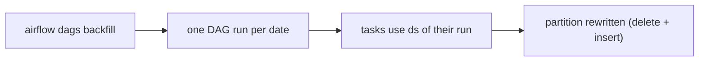

## Introduction

New DAG, fixed bug, or a new column: you often need to rerun a pipeline for past dates. Backfilling creates DAG runs for historical data intervals.

## Definition

**Backfilling** runs a DAG for a range of past logical dates. Two mechanisms:

- **Catchup**: the scheduler automatically creates missed runs since `start_date` when `catchup=True`.
- **Backfill command**: `airflow dags backfill` explicitly runs a date range, regardless of `catchup`.

## Why it matters

Backfills only work if tasks are parameterised by the data interval and idempotent. Otherwise they duplicate data or read "today's" data for every past date.

## How it works

- Each date in the range gets its own DAG run (run type `backfill`).
- Tasks receive that run's `ds` and `data_interval_start/end`.
- `max_active_runs` limits parallel runs; downstream systems need headroom.
- Existing successful runs are skipped unless you pass `--reset-dagruns` (rerun) or use clear.

In Airflow 2.x the CLI runs the backfill from your terminal process. In Airflow 3 backfills are created by the scheduler instead and the command became `airflow backfill create`.

## Syntax and configuration

```bash
# Airflow 2.x
airflow dags backfill daily_sales \
  --start-date 2024-01-01 \
  --end-date 2024-01-31 \
  --max-active-runs 4

# rerun dates that already ran
airflow dags backfill daily_sales -s 2024-01-01 -e 2024-01-31 --reset-dagruns --yes

# rerun only one task (and downstream) for a range
airflow tasks clear daily_sales -t "^load$" -s 2024-01-01 -e 2024-01-31 --downstream --yes
```

A backfill-friendly DAG:

```python-syntax
from datetime import datetime
from airflow import DAG
from airflow.providers.common.sql.operators.sql import SQLExecuteQueryOperator

with DAG("daily_sales", start_date=datetime(2024, 1, 1), schedule="@daily",
         catchup=False, max_active_runs=4):
    SQLExecuteQueryOperator(
        task_id="load",
        conn_id="warehouse",
        sql="""
            DELETE FROM fact_sales WHERE sale_date = '{{ ds }}';
            INSERT INTO fact_sales
            SELECT * FROM staging_sales WHERE sale_date = '{{ ds }}';
        """,
    )
```

## Examples

The runs a backfill of one week will create:

```python
from datetime import date, timedelta

start, end = date(2024, 1, 1), date(2024, 1, 7)
d = start
while d <= end:
    print(f"run ds={d}  interval=[{d}, {d + timedelta(days=1)})")
    d += timedelta(days=1)
```

## Architecture



Each run overwrites only its own partition, so the backfill can be repeated safely.

## Practical example

A currency-conversion bug corrupted January revenue. After the fix, the team runs `airflow dags backfill daily_sales -s 2024-01-01 -e 2024-01-31 --reset-dagruns --max-active-runs 3`. Because the load deletes and reinserts per `ds`, February is untouched.

## Exercises

1. Does `airflow dags backfill` require `catchup=True`?
   <details><summary>Answer</summary>No. Catchup only controls automatic scheduler runs.</details>
2. Why would a backfill load the same rows into every date?
   <details><summary>Answer</summary>The task filters on `now()` instead of the run's data interval.</details>
3. How do you limit load on the warehouse during a backfill?
   <details><summary>Answer</summary>`--max-active-runs`, DAG `max_active_runs`, and pools.</details>

## Common mistakes

- Non-idempotent inserts, which duplicate rows on rerun.
- Using wall-clock time in tasks.
- Running a huge range with unlimited parallelism.
- Leaving `catchup=True` and accidentally triggering a backfill on deploy.
- Backfilling while the regular schedule writes to the same table.

## Performance and best practices

- Overwrite partitions (delete/insert, MERGE, `INSERT OVERWRITE`).
- Backfill in chunks; watch the first few runs.
- Use pools to protect shared systems.
- Prefer `catchup=False` plus explicit backfills.

## Interview questions

### What is the difference between catchup and backfill?

Catchup is automatic run creation by the scheduler for missed intervals. Backfill is an explicit command for a chosen date range.

### What makes a DAG safe to backfill?

Tasks parameterised by the data interval and idempotent writes per partition.

### How do you rerun dates that already succeeded?

`airflow dags backfill ... --reset-dagruns`, or clear those runs/tasks.

### How did backfills change in Airflow 3?

They are managed by the scheduler and created via `airflow backfill create` (or the UI/API) instead of the 2.x client-side `airflow dags backfill`.

## Quick revision

- Backfill = runs for past intervals.
- Catchup automatic; `airflow dags backfill` explicit.
- Each run uses its own `ds`.
- Idempotent partition overwrites.
- Limit with `--max-active-runs` and pools.
- `--reset-dagruns` reruns existing dates.
