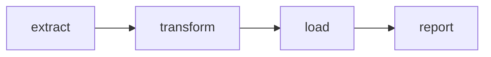

## Introduction

Every Airflow pipeline is a DAG: a set of tasks plus the arrows between them. The DAG file is plain Python that *declares* structure; it does not do the work when it is parsed.

## Definition

A **DAG** (directed acyclic graph) is a collection of tasks with directed dependencies and no cycles. Each execution of a DAG for a given data interval is a **DAG run**. A DAG has a `dag_id`, a `start_date`, a `schedule`, and optional defaults for its tasks.

## Why it matters

Acyclicity guarantees a valid execution order. The DAG parameters (`start_date`, `schedule`, `catchup`) decide how many runs Airflow creates, which is the source of many production surprises.

## How it works

- The scheduler imports the file and registers any `DAG` object found at module level.
- `start_date` + `schedule` define data intervals; a run is created when an interval *ends*.
- `catchup=True` (the 2.x default unless changed in config) creates runs for every missed interval since `start_date`; `catchup=False` creates only the latest one. In Airflow 3 the default became `False`.
- `default_args` are passed to every task (owner, retries, retry_delay...).

## Syntax and configuration

Context manager style:

```python-syntax
from datetime import datetime, timedelta
from airflow import DAG
from airflow.operators.bash import BashOperator

with DAG(
    dag_id="daily_sales",
    start_date=datetime(2024, 1, 1),
    schedule="@daily",
    catchup=False,
    default_args={"owner": "data", "retries": 2, "retry_delay": timedelta(minutes=5)},
    tags=["sales"],
    max_active_runs=1,
) as dag:
    extract = BashOperator(task_id="extract", bash_command="echo extract {{ ds }}")
    load = BashOperator(task_id="load", bash_command="echo load {{ ds }}")
    extract >> load
```

TaskFlow style:

```python-syntax
import pendulum
from airflow.decorators import dag, task

@dag(schedule="@daily", start_date=pendulum.datetime(2024, 1, 1, tz="UTC"), catchup=False)
def daily_sales():
    @task
    def extract() -> list[int]:
        return [1, 2, 3]

    @task
    def load(rows: list[int]) -> None:
        print(f"loading {len(rows)} rows")

    load(extract())

daily_sales()   # calling the function registers the DAG
```

## Examples

Acyclicity is what lets Airflow compute an order. This stdlib sketch does the same topological sort the scheduler implicitly relies on:

```python
from graphlib import TopologicalSorter, CycleError

graph = {"load": {"transform"}, "transform": {"extract"}, "report": {"load"}}
print(list(TopologicalSorter(graph).static_order()))

try:
    list(TopologicalSorter({"a": {"b"}, "b": {"a"}}).static_order())
except CycleError:
    print("cycle detected: not a valid DAG")
```

## Architecture



Each box is a task; each arrow means "must finish before". One DAG run executes this whole graph for one data interval.

## Practical example

A DAG with `start_date=datetime(2023, 1, 1)`, `schedule="@daily"` and `catchup=True` is deployed in 2024. The scheduler immediately creates hundreds of runs. Set `catchup=False` and use an explicit backfill when history is really needed.

## Exercises

1. What happens if the `@dag`-decorated function is never called?
   <details><summary>Answer</summary>No DAG object exists at module level, so Airflow does not register the DAG.</details>
2. With `@daily` and `start_date` 2024-01-01, when does the first run start?
   <details><summary>Answer</summary>After 2024-01-02 00:00, at the end of the first interval; its logical date is 2024-01-01.</details>
3. Why use a static `start_date` instead of `datetime.now()`?
   <details><summary>Answer</summary>A moving start date makes intervals unpredictable and runs may never be created.</details>

## Common mistakes

- Dynamic `start_date` such as `datetime.now()`.
- Forgetting `catchup=False` and flooding the scheduler with historic runs.
- Changing `dag_id` casually, which orphans history.
- Doing real work (queries, API calls) at the top level of the DAG file.
- Using `schedule_interval=`: deprecated in 2.4+ and removed in Airflow 3; use `schedule=`.

## Performance and best practices

- One DAG per file, named after the `dag_id`.
- Use `max_active_runs` to stop overlapping runs that fight over the same table.
- Put shared settings in `default_args`.
- Use timezone-aware start dates (`pendulum`).
- Add `tags` and `doc_md` for discoverability.

## Interview questions

### Why must a DAG be acyclic?

A cycle has no valid start point, so there is no execution order. Airflow rejects cyclic DAGs at parse time.

### What is the difference between a DAG and a DAG run?

The DAG is the definition. A DAG run is one execution of it for a specific logical date / data interval, with its own task instance states.

### What does catchup do?

With `catchup=True`, the scheduler creates runs for every interval between `start_date` (or the last run) and now. With `False`, only the most recent interval runs.

### Context manager or TaskFlow?

Both create the same DAG. TaskFlow (`@dag`/`@task`) is cleaner for Python tasks and passes data via return values; `with DAG` is natural for operator-heavy DAGs. They can be mixed.

## Quick revision

- DAG = tasks + dependencies, no cycles.
- DAG run = one execution for one data interval.
- Use static `start_date`, `schedule=`, explicit `catchup`.
- `default_args` apply to every task.
- `@dag` function must be called to register.
- Keep DAG files declarative and cheap to parse.
