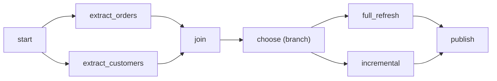

## Introduction

Dependencies turn a bag of tasks into a pipeline. They say which task must finish before another may start, and trigger rules say *how* upstream outcomes are combined.

## Definition

A dependency `a >> b` makes `a` upstream of `b`. A task's **trigger_rule** decides when it may run based on upstream states. Default: `all_success`.

## Why it matters

Wrong dependencies cause data races (loading before extraction finishes) or stuck runs. Trigger rules are how you build cleanup, alerting and "run whichever branch was chosen" logic.

## How it works

- `a >> b` equals `b << a` equals `a.set_downstream(b)`.
- Lists fan out/in: `a >> [b, c] >> d`.
- `chain(a, b, c)` for long linear chains; `cross_downstream([a, b], [c, d])` for all pairs.
- TaskFlow: passing one task's output to another creates the dependency automatically.
- Trigger rules: `all_success`, `all_failed`, `all_done`, `one_success`, `one_failed`, `none_failed`, `none_failed_min_one_success`, `none_skipped`, `always`.
- Branching: `@task.branch` returns the task_id(s) to follow; others are skipped.

## Syntax and configuration

```python-syntax
from datetime import datetime
from airflow import DAG
from airflow.decorators import task
from airflow.models.baseoperator import chain
from airflow.operators.empty import EmptyOperator
from airflow.utils.trigger_rule import TriggerRule

with DAG("deps_demo", start_date=datetime(2024, 1, 1), schedule="@daily", catchup=False):
    start = EmptyOperator(task_id="start")
    orders = EmptyOperator(task_id="extract_orders")
    customers = EmptyOperator(task_id="extract_customers")
    join = EmptyOperator(task_id="join")

    @task.branch
    def choose(ds=None):
        return "full_refresh" if ds.endswith("-01") else "incremental"

    full = EmptyOperator(task_id="full_refresh")
    incr = EmptyOperator(task_id="incremental")
    publish = EmptyOperator(task_id="publish",
                            trigger_rule=TriggerRule.NONE_FAILED_MIN_ONE_SUCCESS)
    cleanup = EmptyOperator(task_id="cleanup", trigger_rule=TriggerRule.ALL_DONE)

    start >> [orders, customers] >> join >> choose() >> [full, incr] >> publish >> cleanup
```

## Examples

`chain` with mixed lists (pairs lists element-wise, which must be equal length):

```python-syntax
chain(start, [orders, customers], [clean_orders, clean_customers], join)
# orders >> clean_orders, customers >> clean_customers
```

Which tasks can run in parallel? Group a graph into "waves" with the stdlib:

```python
from graphlib import TopologicalSorter

deps = {"orders": {"start"}, "customers": {"start"}, "join": {"orders", "customers"}, "publish": {"join"}}
ts = TopologicalSorter(deps)
ts.prepare()
wave = 1
while ts.is_active():
    ready = sorted(ts.get_ready())
    print(f"wave {wave}: {ready}")
    ts.done(*ready)
    wave += 1
```

## Architecture



After a branch, one path is skipped. `publish` needs `none_failed_min_one_success`; with the default `all_success` it would be skipped too.

## Practical example

A team adds a `notify_failure` task downstream of every load with `trigger_rule="one_failed"`, and a `cleanup_tmp` task with `all_done` so temp tables are dropped whether the run succeeds or not.

## Exercises

1. Why is the join after a branch skipped by default?
   <details><summary>Answer</summary>One upstream is `skipped`, and `all_success` treats skipped as not success; skip propagates.</details>
2. Write fan-out from `a` to `b` and `c`, then fan-in to `d`.
   <details><summary>Answer</summary>`a >> [b, c] >> d`.</details>
3. Can you write `[a, b] >> [c, d]`?
   <details><summary>Answer</summary>No, list-to-list is not supported; use `cross_downstream([a, b], [c, d])`.</details>

## Common mistakes

- Forgetting the trigger rule on a join after a branch.
- Using `all_done` for a task that should not run after failures.
- `[a, b] >> [c, d]` (raises a TypeError).
- Hidden dependencies through shared tables with no arrow in the DAG.

## Performance and best practices

- Fan out independent extracts for parallelism; cap with pools.
- Prefer TaskFlow data passing so dependencies cannot drift from data flow.
- Use TaskGroups to keep wide graphs readable.
- Use Datasets for cross-DAG dependencies.

## Interview questions

### What is the default trigger rule?

`all_success`: run only when every direct upstream task succeeded.

### How do you run a task regardless of upstream outcome?

`trigger_rule="all_done"` (after all upstream finish in any state) or `"always"`.

### How does branching work?

A `@task.branch` (or `BranchPythonOperator`) returns task_id(s) to follow; other direct downstream tasks are skipped.

### What is the difference between none_failed and all_success?

`none_failed` allows skipped upstreams; `all_success` does not.

## Quick revision

- `a >> b`: a runs before b.
- Lists for fan-out/fan-in; `chain`, `cross_downstream` for patterns.
- Default rule `all_success`; skip propagates.
- After branch join: `none_failed_min_one_success`.
- Cleanup: `all_done`; alerting: `one_failed`.
- TaskFlow wiring = data flow.
