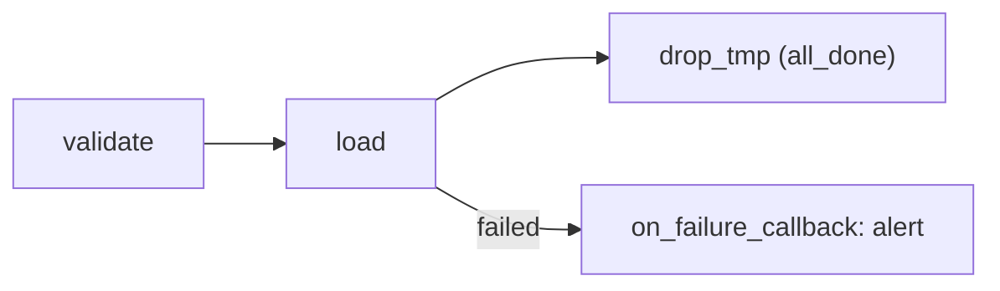

## Introduction

Retries cover transient errors. Everything else needs a plan: who gets told, what gets cleaned up, and how the run is resumed.

## Definition

Airflow's failure tools:

- Callbacks: `on_failure_callback`, `on_retry_callback`, `on_success_callback` (task or DAG level).
- Trigger rules: `one_failed` for alert tasks, `all_done` for cleanup.
- Timeouts: `execution_timeout` (task), `dagrun_timeout` (DAG run).
- Exceptions: `AirflowFailException`, `AirflowSkipException`.
- Manual recovery: clear a task (UI or `airflow tasks clear`) to rerun it and its downstream.

## Why it matters

Silent failures are worse than loud ones. A good DAG fails fast on bad data, alerts the right channel once, and can be resumed from the failing task.

## How it works

- When a task reaches `failed`, its `on_failure_callback(context)` runs, with `context["task_instance"]`, `context["exception"]`, etc.
- A DAG-level `on_failure_callback` runs when the DAG run fails.
- Downstream tasks become `upstream_failed` unless their trigger rule allows otherwise.
- Clearing resets states so the scheduler runs those tasks again in the same DAG run.

## Syntax and configuration

```python-syntax
from datetime import datetime, timedelta
from airflow import DAG
from airflow.decorators import task
from airflow.operators.bash import BashOperator
from airflow.utils.trigger_rule import TriggerRule

def notify_failure(context):
    ti = context["task_instance"]
    send_slack(                                  # your notifier
        f"FAILED {ti.dag_id}.{ti.task_id} run={context['run_id']} "
        f"try={ti.try_number} log={ti.log_url}"
    )

with DAG(
    "failure_demo",
    start_date=datetime(2024, 1, 1),
    schedule="@daily",
    catchup=False,
    dagrun_timeout=timedelta(hours=2),
    default_args={"retries": 2, "on_failure_callback": notify_failure,
                  "execution_timeout": timedelta(minutes=30)},
):
    @task
    def validate(ds=None):
        rows = count_rows("staging_sales", ds)   # your helper
        if rows == 0:
            raise ValueError(f"no rows for {ds}")

    load = BashOperator(task_id="load", bash_command="python /jobs/load.py {{ ds }}")
    cleanup = BashOperator(task_id="drop_tmp", bash_command="python /jobs/drop_tmp.py",
                           trigger_rule=TriggerRule.ALL_DONE)
    validate() >> load >> cleanup
```

Rerun after fixing the cause:

```bash
airflow tasks clear failure_demo -t "^load$" -s 2024-03-01 -e 2024-03-01 --downstream --yes
```

## Examples

Fail fast on bad data instead of retrying:

```python-syntax
from airflow.exceptions import AirflowFailException

@task(retries=3)
def check_schema(columns: list[str]):
    if "order_id" not in columns:
        raise AirflowFailException("schema changed: order_id missing")
```

## Architecture



The callback is not a task in the graph; it is a function run when the task fails. Cleanup runs whatever happens.

## Practical example

A nightly DAG fails at `load` because of a disk-full error. Slack gets one alert with the log link. After space is freed, the engineer clears `load` with downstream for that date; `validate` is not rerun.

## Exercises

1. Callback or alert task: which still works if the worker is killed?
   <details><summary>Answer</summary>Neither is guaranteed in every case; callbacks run where the task ran (or by the scheduler for zombies). For critical alerting also monitor externally.</details>
2. Which trigger rule fits a cleanup task?
   <details><summary>Answer</summary>`all_done`.</details>
3. How do you rerun only the failed part of a run?
   <details><summary>Answer</summary>Clear the failed task with `--downstream` (or "Clear" in the UI).</details>

## Common mistakes

- Alerting on every retry, causing alert fatigue.
- Swallowing exceptions in Python tasks so the task "succeeds".
- No `execution_timeout`, so hung tasks never fail.
- Heavy or failing logic inside callbacks.
- Rerunning a whole DAG when clearing one task suffices.

## Performance and best practices

- Alert on final failure; log retries.
- Include DAG, task, run id and log URL in messages.
- Validate inputs early and raise `AirflowFailException` for permanent problems.
- Keep callbacks short and exception-safe.

## Interview questions

### How do you get notified when a task fails?

Set `on_failure_callback` (task or `default_args`), or email/Slack notifiers, or a task with `trigger_rule="one_failed"`.

### What is the difference between execution_timeout and dagrun_timeout?

`execution_timeout` limits one task attempt; `dagrun_timeout` limits the whole DAG run.

### How do you resume a failed DAG run?

Fix the cause, then clear the failed task and its downstream; successful upstream tasks are kept.

### When should a task skip instead of fail?

When there is legitimately nothing to do, e.g. no file today: raise `AirflowSkipException`.

## Quick revision

- Callbacks: failure, retry, success.
- `one_failed` alert tasks; `all_done` cleanup.
- `execution_timeout` and `dagrun_timeout`.
- `AirflowFailException` = no retry.
- Clear task + downstream to resume.
- Never swallow exceptions.
