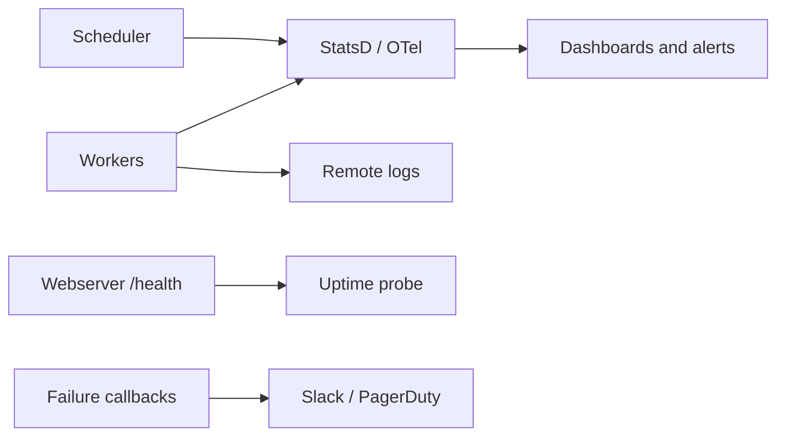

## Introduction

An orchestrator that fails quietly is dangerous. Monitoring Airflow means watching two things: the **pipelines** (did today's data arrive on time?) and the **platform** (is the scheduler alive?).

## Definition

Airflow's monitoring surfaces:

- **UI**: Grid, Graph, Gantt and task duration views, plus task logs.
- **Callbacks / notifiers**: failure, retry and success hooks.
- **SLAs** (2.x): `sla=timedelta(...)` on tasks; misses are recorded and `sla_miss_callback` runs. SLAs were removed in Airflow 3.
- **Metrics**: StatsD or OpenTelemetry (scheduler heartbeat, task durations, pool usage, DAG parse time).
- **Health endpoint**: `/health` on the webserver reports metadata DB and scheduler heartbeat status.

## Why it matters

A run that succeeds three hours late can be as bad as a failure. Platform metrics catch scheduler stalls before every DAG goes late.

## How it works

- Workers write logs per task try (local, or remote to S3/GCS/Elasticsearch).
- The scheduler emits heartbeats; `/health` marks it unhealthy if stale.
- SLA checks compare task completion with logical-date-based deadlines.
- Metrics go to StatsD/OTel and on to Prometheus, Datadog or similar.

## Syntax and configuration

```bash
export AIRFLOW__METRICS__STATSD_ON=True
export AIRFLOW__METRICS__STATSD_HOST=statsd.internal
export AIRFLOW__METRICS__STATSD_PORT=8125
export AIRFLOW__LOGGING__REMOTE_LOGGING=True
export AIRFLOW__LOGGING__REMOTE_BASE_LOG_FOLDER=s3://airflow-logs
export AIRFLOW__LOGGING__REMOTE_LOG_CONN_ID=aws_default

curl -s http://airflow-web:8080/health
airflow jobs check --job-type SchedulerJob --local
airflow dags list-import-errors
```

SLA and callbacks (Airflow 2.x):

```python-syntax
from datetime import datetime, timedelta
from airflow import DAG
from airflow.operators.bash import BashOperator

def sla_missed(dag, task_list, blocking_task_list, slas, blocking_tis):
    send_slack(f"SLA missed in {dag.dag_id}: {task_list}")   # your notifier

with DAG("daily_sales", start_date=datetime(2024, 1, 1), schedule="@daily",
         catchup=False, sla_miss_callback=sla_missed):
    BashOperator(task_id="publish", bash_command="python /jobs/publish.py {{ ds }}",
                 sla=timedelta(hours=7))
```

## Examples

Flag runs whose duration is well above their usual range:

```python
from statistics import mean, pstdev

durations = {"2024-03-01": 610, "2024-03-02": 590, "2024-03-03": 640, "2024-03-04": 1820}
history = list(durations.values())[:-1]
limit = mean(history) + 3 * pstdev(history)
for ds, secs in durations.items():
    flag = "SLOW" if secs > limit else "ok"
    print(ds, secs, flag)
```

## Architecture



Pipeline alerts come from callbacks and SLAs; platform alerts come from metrics and health checks.

## Practical example

The scheduler pod ran out of memory overnight; no task failed, so no callbacks fired. A probe on `/health` alerting on a stale scheduler heartbeat would have paged within minutes. The team adds it plus a metric alert on `dag_processing.total_parse_time`.

## Exercises

1. Why can't failure callbacks detect a dead scheduler?
   <details><summary>Answer</summary>No tasks run, so nothing fails; you need heartbeat/health monitoring.</details>
2. Where should logs go in a multi-worker setup?
   <details><summary>Answer</summary>Remote storage (S3, GCS, Elasticsearch) so the UI can read them after pods die.</details>
3. What replaces SLAs in Airflow 3?
   <details><summary>Answer</summary>SLAs were removed; use timeouts, callbacks and external freshness checks (Airflow 3.1 adds deadline alerts).</details>

## Common mistakes

- Only monitoring task failures, not lateness or freshness.
- Local logs on ephemeral workers.
- Alerting on every retry.
- Ignoring DAG import errors and parse times.
- Relying on SLAs for strict deadlines (they are best-effort).

## Performance and best practices

- Alert on scheduler heartbeat, queued-task backlog and pool saturation.
- Track task duration trends; growth often precedes failures.
- Check data freshness in the target tables, not only task states.
- Clean old metadata with `airflow db clean`.

## Interview questions

### How do you monitor Airflow in production?

Callbacks for task failures, SLAs or freshness checks for lateness, StatsD/OTel metrics for the platform, `/health` probes, and remote logging.

### What does the /health endpoint check?

Metadata database reachability and the latest scheduler (and triggerer) heartbeat.

### What is an SLA miss in Airflow 2?

A task not finished within `sla` after the end of its data interval; it is recorded and triggers `sla_miss_callback`, but does not stop the task.

### Which metrics matter most?

Scheduler heartbeat, DAG parse time, queued/running task counts, pool open slots, task duration and failures.

## Quick revision

- Monitor pipelines and the platform.
- UI views, task logs, callbacks.
- SLAs in 2.x only; best-effort.
- StatsD/OTel metrics to dashboards.
- `/health` for scheduler and DB.
- Remote logs for distributed workers.
