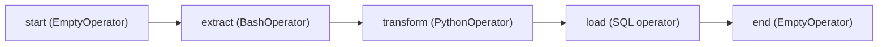

## Introduction

An operator is a reusable template for a kind of task. Instantiating an operator in a DAG creates a task.

## Definition

An **operator** is a class whose `execute(context)` method does the work. Families:

- **Action operators**: `BashOperator`, `PythonOperator`, `SQLExecuteQueryOperator`, `KubernetesPodOperator`.
- **Transfer operators**: move data between systems, e.g. `S3ToRedshiftOperator`.
- **Sensors**: wait for a condition (see [Sensors](/notes/airflow-sensors)).
- **EmptyOperator**: does nothing; used for grouping and join points (replaced `DummyOperator`).

Provider packages (`apache-airflow-providers-postgres`, `-amazon`, `-google`...) add operators and hooks for external systems.

## Why it matters

Picking the right operator keeps DAGs short and puts connection handling, retries and templating in tested code instead of ad-hoc scripts.

## How it works

- Constructor arguments are evaluated at parse time.
- Fields listed in `template_fields` are rendered with Jinja at run time (`{{ ds }}`, `{{ data_interval_start }}`, `{{ params.x }}`).
- `execute()` runs on a worker; its return value is pushed to XCom as `return_value` (for most operators).

## Syntax and configuration

```python-syntax
from datetime import datetime
from airflow import DAG
from airflow.operators.bash import BashOperator
from airflow.operators.python import PythonOperator
from airflow.operators.empty import EmptyOperator
from airflow.providers.common.sql.operators.sql import SQLExecuteQueryOperator

def _transform(**context):
    print("interval", context["data_interval_start"], context["data_interval_end"])

with DAG("ops_demo", start_date=datetime(2024, 1, 1), schedule="@daily", catchup=False):
    start = EmptyOperator(task_id="start")
    extract = BashOperator(
        task_id="extract",
        bash_command="python /opt/jobs/extract.py --date {{ ds }}",
    )
    transform = PythonOperator(task_id="transform", python_callable=_transform)
    load = SQLExecuteQueryOperator(
        task_id="load",
        conn_id="warehouse",
        sql="CALL load_sales('{{ ds }}')",
    )
    end = EmptyOperator(task_id="end")
    start >> extract >> transform >> load >> end
```

## Examples

A custom operator for a repeated pattern:

```python-syntax
from airflow.models.baseoperator import BaseOperator
from airflow.providers.postgres.hooks.postgres import PostgresHook

class RowCountCheckOperator(BaseOperator):
    template_fields = ("table",)

    def __init__(self, table: str, conn_id: str, min_rows: int = 1, **kwargs):
        super().__init__(**kwargs)
        self.table, self.conn_id, self.min_rows = table, conn_id, min_rows

    def execute(self, context):
        count = PostgresHook(postgres_conn_id=self.conn_id).get_first(
            f"SELECT COUNT(*) FROM {self.table}"
        )[0]
        if count < self.min_rows:
            raise ValueError(f"{self.table} has only {count} rows")
        return count
```

## Architecture



EmptyOperators mark clear entry and exit points, which makes fan-in and fan-out easier to wire.

## Practical example

A team calls `psycopg2.connect()` with hard-coded passwords in `PythonOperator`s. Replacing them with `SQLExecuteQueryOperator(conn_id="warehouse")` moves credentials into an Airflow Connection and gets templating for free.

## Exercises

1. Which operator would you use as a no-op join point?
   <details><summary>Answer</summary>`EmptyOperator`.</details>
2. Is `bash_command` templated?
   <details><summary>Answer</summary>Yes, it is in `BashOperator.template_fields`, so `{{ ds }}` renders at run time.</details>
3. Operator or `@task`?
   <details><summary>Answer</summary>Use `@task` for custom Python logic; use an existing operator when one fits the external system.</details>

## Common mistakes

- Calling an operator's logic at parse time (e.g. running a query in the constructor).
- Expecting Jinja in a non-templated argument.
- Using deprecated `DummyOperator` or `airflow.operators.bash_operator` import paths.
- Running heavy pandas jobs on the worker instead of in a warehouse or container.

## Performance and best practices

- Prefer provider operators and hooks over hand-written clients.
- Pin provider versions alongside Airflow constraints.
- Use `KubernetesPodOperator` or similar to isolate heavy or conflicting dependencies.
- Keep operator constructors cheap.

## Interview questions

### What is the difference between an operator and a task?

An operator is a class (template); a task is an instance of it inside a DAG with a `task_id`.

### What is a hook?

A low-level client for an external system that reads credentials from a Connection. Operators usually use hooks internally.

### What is EmptyOperator for?

A task that does nothing: start/end markers, joining branches, or placeholders.

### When are templates rendered?

At task run time on the worker, just before `execute()`, only for fields in `template_fields`.

## Quick revision

- Operator = class; task = its instance.
- Core: BashOperator, PythonOperator, EmptyOperator.
- Providers add system-specific operators and hooks.
- Jinja renders `template_fields` at run time.
- Return value of `execute()` goes to XCom.
- Keep heavy compute outside the worker.
