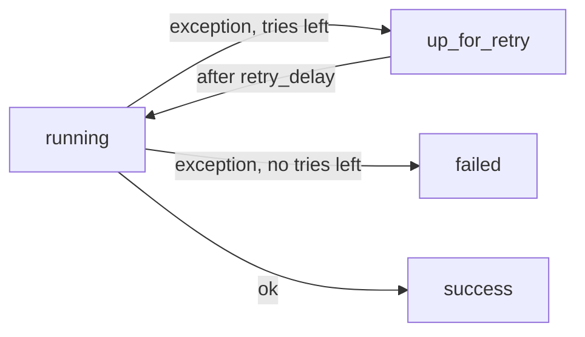

## Introduction

Most pipeline failures are transient: a network blip, a locked table, an API rate limit. Retries let Airflow recover from these without waking anyone.

## Definition

Task-level parameters:

- `retries`: how many extra attempts after the first failure.
- `retry_delay`: wait between attempts (`timedelta`, default 5 minutes).
- `retry_exponential_backoff=True`: grow the delay roughly exponentially per try.
- `max_retry_delay`: cap for the backoff.
- `on_retry_callback`: function called when an attempt fails but will be retried.

## Why it matters

Without retries, every hiccup becomes an incident. With retries on non-idempotent tasks, every hiccup can become duplicated data.

## How it works

1. A task raises an exception.
2. If `try_number <= retries`, its state becomes `up_for_retry`.
3. After the delay it is scheduled again with `try_number + 1`.
4. When retries are exhausted it becomes `failed` and `on_failure_callback` runs.

`AirflowFailException` fails immediately without retrying; `AirflowSkipException` marks the task skipped.

## Syntax and configuration

```python-syntax
from datetime import datetime, timedelta
from airflow import DAG
from airflow.decorators import task
from airflow.exceptions import AirflowFailException

default_args = {
    "retries": 3,
    "retry_delay": timedelta(minutes=2),
    "retry_exponential_backoff": True,
    "max_retry_delay": timedelta(minutes=30),
}

with DAG("retry_demo", start_date=datetime(2024, 1, 1), schedule="@daily",
         catchup=False, default_args=default_args):

    @task(retries=5)            # task-level value overrides default_args
    def call_api():
        resp = fetch()           # your HTTP call
        if resp.status_code == 401:
            raise AirflowFailException("bad credentials: retrying will not help")
        resp.raise_for_status()

    call_api()
```

Global default in config:

```bash
export AIRFLOW__CORE__DEFAULT_TASK_RETRIES=2
```

## Examples

How backoff grows (simplified: delay doubles, capped):

```python
from datetime import timedelta

base, cap = timedelta(minutes=2), timedelta(minutes=30)
for attempt in range(1, 6):
    delay = min(base * 2 ** (attempt - 1), cap)
    print(f"retry {attempt}: wait {delay}")
```

Airflow's real formula also adds jitter so many tasks do not retry at the same instant.

## Architecture



## Practical example

A REST extract fails a few times a week with HTTP 503. Setting `retries=4` with exponential backoff (cap 20 minutes) clears almost all of them, while 401 errors raise `AirflowFailException` to fail fast.

## Exercises

1. With `retries=3`, how many attempts at most?
   <details><summary>Answer</summary>Four: the first try plus three retries.</details>
2. How do you fail without retrying?
   <details><summary>Answer</summary>Raise `AirflowFailException`.</details>
3. What must be true before enabling retries on a load task?
   <details><summary>Answer</summary>The task must be idempotent, e.g. delete-then-insert or MERGE for its interval.</details>

## Common mistakes

- Retrying non-idempotent appends.
- Huge retry counts that hide real failures for hours.
- Retrying permanent errors (bad credentials, schema mismatch).
- No `execution_timeout`, so a hung attempt never fails and never retries.

## Performance and best practices

- Put sane retries in `default_args`; override per task.
- Use exponential backoff for rate-limited APIs.
- Combine with `execution_timeout`.
- Alert on retries via `on_retry_callback` if they spike.

## Interview questions

### How do retries work in Airflow?

A failed attempt goes to `up_for_retry` while tries remain, waits `retry_delay` (optionally exponential), then reruns. Afterwards it is `failed`.

### What is retry_exponential_backoff?

It increases the delay between attempts exponentially (with jitter), up to `max_retry_delay`.

### Why are idempotent tasks essential with retries?

A failed attempt may have partly written data; the retry must not duplicate it.

### Task retries vs clearing a task?

Retries are automatic within one run. Clearing is a manual reset that reruns the task (and optionally downstream) from scratch.

## Quick revision

- `retries`, `retry_delay`, `retry_exponential_backoff`, `max_retry_delay`.
- `retries=3` means up to 4 attempts.
- State `up_for_retry` between attempts.
- `AirflowFailException` skips retries.
- Idempotency first, retries second.
- Pair with `execution_timeout`.
