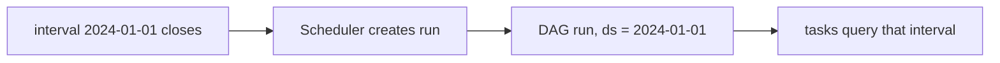

## Introduction

The most confusing Airflow fact for beginners: a daily DAG run for 2024-01-01 starts on 2024-01-02. Airflow schedules **data intervals**, and runs each one after it has closed.

## Definition

- `schedule`: a preset (`"@daily"`, `"@hourly"`), a cron string, a `timedelta`, a Timetable, a list of Datasets, or `None` (manual only).
- **Data interval**: `[data_interval_start, data_interval_end)` the run covers.
- **Logical date** (formerly `execution_date`): equals `data_interval_start`; `{{ ds }}` is its date.

## Why it matters

Incremental loads should filter on the data interval, not on "now". That makes every run, rerun and backfill deterministic.

## How it works

1. Intervals are aligned from `start_date` using the schedule.
2. When `data_interval_end` passes, the scheduler creates the run.
3. `catchup` decides whether missed intervals are created.
4. `max_active_runs` limits concurrent runs of one DAG.
5. Dataset schedules trigger a DAG when upstream tasks update listed Datasets (Airflow 2.4+; renamed Assets in Airflow 3).

## Syntax and configuration

```python-syntax
from datetime import datetime, timedelta
import pendulum
from airflow import DAG
from airflow.datasets import Dataset

with DAG("hourly", start_date=datetime(2024, 1, 1), schedule="@hourly", catchup=False): ...
with DAG("weekdays_6am", start_date=pendulum.datetime(2024, 1, 1, tz="Europe/London"),
         schedule="0 6 * * 1-5", catchup=False): ...
with DAG("every_4h", start_date=datetime(2024, 1, 1), schedule=timedelta(hours=4), catchup=False): ...
with DAG("manual_only", start_date=datetime(2024, 1, 1), schedule=None): ...

orders = Dataset("s3://lake/orders/")
with DAG("consumer", start_date=datetime(2024, 1, 1), schedule=[orders], catchup=False): ...
```

Templated interval in SQL:

```sql-syntax
SELECT *
FROM orders
WHERE updated_at >= '{{ data_interval_start }}'
  AND updated_at <  '{{ data_interval_end }}';
```

## Examples

Compute when daily runs fire and what they cover:

```python
from datetime import datetime, timedelta

start = datetime(2024, 1, 1)
step = timedelta(days=1)
for i in range(3):
    s = start + i * step
    e = s + step
    print(f"logical_date={s.date()} interval=[{s:%Y-%m-%d}, {e:%Y-%m-%d}) runs_after={e:%Y-%m-%d %H:%M}")
```

## Architecture



The run is labelled with the interval start but executes after the interval ends.

## Practical example

An incremental extract uses `WHERE updated_at > now() - interval '1 day'`. A late run misses rows and a rerun picks up different rows. Switching to `data_interval_start`/`data_interval_end` makes each run cover exactly its own slice.

## Exercises

1. A `@daily` DAG's run has `ds` = 2024-03-10. When did it start?
   <details><summary>Answer</summary>Shortly after 2024-03-11 00:00 (in the DAG's timezone).</details>
2. What does `schedule=None` mean?
   <details><summary>Answer</summary>No automatic runs; only manual or API-triggered.</details>
3. How do you run a DAG at 06:00 on weekdays?
   <details><summary>Answer</summary>`schedule="0 6 * * 1-5"`.</details>

## Common mistakes

- Expecting the run for a day to start on that day.
- Filtering on `now()` instead of the data interval.
- `schedule_interval=` in new code (use `schedule=`).
- Naive datetimes and DST surprises; use `pendulum` with a timezone.
- Changing the schedule of a DAG with history without considering catchup.

## Performance and best practices

- Stagger many DAGs instead of scheduling all at `0 0 * * *`.
- Set `max_active_runs=1` for DAGs writing to the same table.
- Prefer Datasets over polling sensors between internal DAGs.
- Use `dagrun_timeout` for runs that must not overlap the next interval.

## Interview questions

### What is the logical date?

The start of the run's data interval. It labels the run; it is not the time the run started.

### Why does Airflow run after the interval ends?

Because the data for an interval is only complete once the interval is over.

### What is data-aware scheduling?

Scheduling a DAG on Datasets: it runs when producer tasks (with `outlets=[dataset]`) update them, instead of on a time schedule.

### Cron vs timedelta schedules?

Cron aligns to wall-clock times; a `timedelta` repeats a fixed duration from the previous interval.

## Quick revision

- `schedule=` preset, cron, timedelta, Datasets or None.
- Run for an interval starts after it ends.
- Logical date = `data_interval_start` = `{{ ds }}`.
- Query by interval, not `now()`.
- `catchup`, `max_active_runs` control run creation.
- Use timezone-aware start dates.
