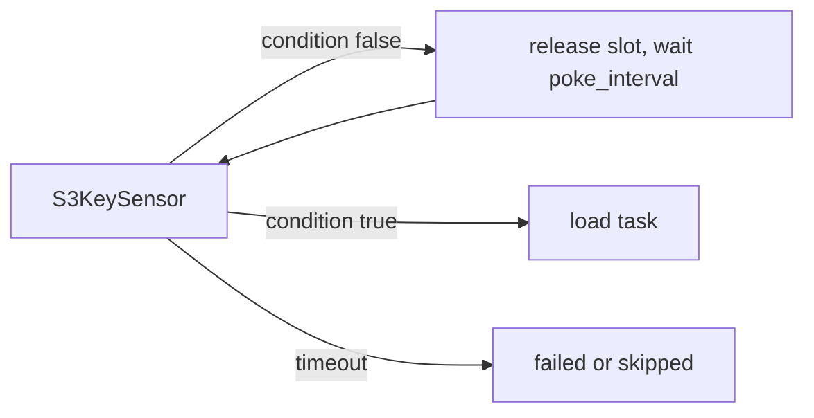

## Introduction

Pipelines often depend on things outside Airflow: a file landing in S3, an upstream table being refreshed, another DAG finishing. Sensors wait for those conditions.

## Definition

A **sensor** is an operator that repeatedly checks a condition (`poke()`) and succeeds when it returns `True`. Common sensors: `FileSensor`, `S3KeySensor`, `ExternalTaskSensor`, `SqlSensor`, `HttpSensor`, `DateTimeSensor`, and the `@task.sensor` decorator.

## Why it matters

A badly configured sensor can occupy a worker slot for hours, starving every other task. Sensors are a classic source of "everything is queued" incidents.

## How it works

- `poke_interval`: seconds between checks.
- `timeout`: total seconds before the sensor fails (default 7 days).
- `mode="poke"` (default): holds a worker slot and sleeps between checks. Fine for short waits.
- `mode="reschedule"`: releases the slot between checks; the task shows `up_for_reschedule`. Use for long waits.
- **Deferrable** sensors (`deferrable=True` where supported) hand waiting to the triggerer process using asyncio, using no worker slot at all.
- `soft_fail=True`: on timeout, mark the sensor `skipped` instead of `failed`.

## Syntax and configuration

```python-syntax
from datetime import datetime, timedelta
from airflow import DAG
from airflow.sensors.filesystem import FileSensor
from airflow.sensors.external_task import ExternalTaskSensor
from airflow.providers.amazon.aws.sensors.s3 import S3KeySensor

with DAG("sensor_demo", start_date=datetime(2024, 1, 1), schedule="@daily", catchup=False):
    wait_file = S3KeySensor(
        task_id="wait_for_export",
        bucket_name="raw-exports",
        bucket_key="sales/{{ ds }}/_SUCCESS",
        aws_conn_id="aws_default",
        mode="reschedule",
        poke_interval=300,
        timeout=6 * 60 * 60,
    )
    wait_upstream = ExternalTaskSensor(
        task_id="wait_for_customers_dag",
        external_dag_id="load_customers",
        external_task_id="load",
        mode="reschedule",
        timeout=3600,
    )
    wait_local = FileSensor(task_id="wait_local", filepath="/data/in/{{ ds }}.csv",
                            fs_conn_id="fs_default", poke_interval=60, timeout=600)
```

## Examples

TaskFlow sensor:

```python-syntax
from airflow.decorators import task
from airflow.sensors.base import PokeReturnValue

@task.sensor(poke_interval=120, timeout=3600, mode="reschedule")
def partition_ready(ds=None) -> PokeReturnValue:
    ready = check_partition_exists("sales", ds)   # your own function
    return PokeReturnValue(is_done=ready, xcom_value=ds)
```

## Architecture



In reschedule mode the "wait" step frees the worker; in poke mode the worker sleeps.

## Practical example

Fifty daily DAGs each start with a poke-mode sensor waiting up to 4 hours. With 32 worker slots, sensors fill every slot and the actual loads cannot start: a deadlock until timeouts. Changing them to `mode="reschedule"` (or deferrable) fixes it.

## Exercises

1. When is poke mode acceptable?
   <details><summary>Answer</summary>When the expected wait is shorter than a minute or so, where rescheduling overhead would dominate.</details>
2. What does `soft_fail=True` change?
   <details><summary>Answer</summary>A timeout marks the sensor `skipped`, so downstream tasks are skipped instead of `upstream_failed`.</details>
3. What must match for `ExternalTaskSensor` to find the other run?
   <details><summary>Answer</summary>The logical date; use `execution_delta` or `execution_date_fn` when schedules differ.</details>

## Common mistakes

- Long waits in `poke` mode.
- Leaving the default 7-day timeout.
- `ExternalTaskSensor` with mismatched schedules, so it waits forever.
- Very short `poke_interval` that hammers S3 or a database.

## Performance and best practices

- Use `mode="reschedule"` or deferrable sensors for anything longer than a few minutes.
- Always set `timeout` to a business-meaningful value.
- Consider data-aware scheduling (Datasets, called Assets in Airflow 3) instead of sensors between your own DAGs.
- Put sensors in a dedicated pool.

## Interview questions

### What is the difference between poke and reschedule mode?

Poke keeps the worker slot and sleeps between checks. Reschedule ends the attempt, frees the slot and is rescheduled after `poke_interval`.

### What are deferrable operators?

Operators that suspend themselves and hand waiting to the triggerer process (asyncio), using no worker slot until the event fires.

### How do you make a DAG wait for another DAG?

`ExternalTaskSensor` with aligned logical dates, or better, Dataset-based scheduling where the producer updates a Dataset and the consumer is scheduled on it.

### What happens when a sensor times out?

It fails (or is skipped with `soft_fail=True`). Retries apply if configured.

## Quick revision

- Sensors wait for external conditions.
- `poke_interval`, `timeout`, `mode`.
- Reschedule or deferrable for long waits.
- Always set a realistic timeout.
- `soft_fail` skips instead of failing.
- Datasets can replace cross-DAG sensors.
