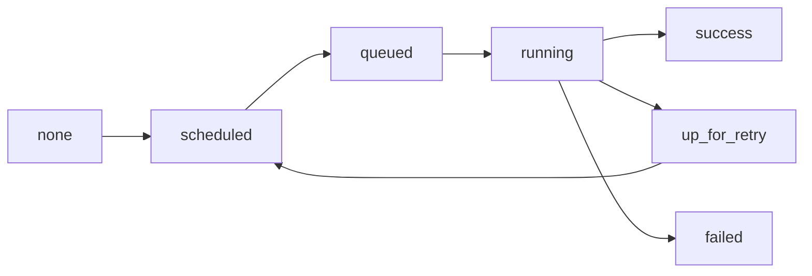

## Introduction

A task is one unit of work in a DAG: run a query, call an API, copy a file. Tasks are created from operators or from `@task`-decorated Python functions.

## Definition

A **task** is a node in a DAG with a unique `task_id`. A **task instance** is that task for one DAG run, with a state such as `scheduled`, `queued`, `running`, `success`, `failed`, `up_for_retry`, `skipped` or `upstream_failed`.

## Why it matters

Airflow retries and reruns tasks, sometimes on a different worker. Tasks therefore must be **atomic** (all or nothing) and **idempotent** (rerunning for the same interval gives the same result).

## How it works

- `none` → `scheduled` when upstream dependencies are satisfied.
- `scheduled` → `queued` when the executor accepts it.
- `queued` → `running` on a worker.
- `running` → `success`, or `failed` / `up_for_retry` if it raises.
- Downstream tasks of a failed task become `upstream_failed` under the default `all_success` rule.

Tasks of a DAG run may run on different machines, so they share data only via XCom or external storage, never via local variables or files.

## Syntax and configuration

```python-syntax
from datetime import timedelta
from airflow.decorators import task
from airflow.operators.python import PythonOperator

def _clean(ds: str) -> None:
    print(f"cleaning partition {ds}")

clean = PythonOperator(
    task_id="clean",
    python_callable=_clean,
    op_kwargs={"ds": "{{ ds }}"},
    retries=3,
    execution_timeout=timedelta(minutes=30),
    pool="warehouse",
)

@task(retries=2)
def count_rows(table: str) -> int:
    return 42
```

## Examples

Idempotent load for one partition: delete then insert for the run's date, inside one transaction.

```python-syntax
from airflow.decorators import task
from airflow.providers.postgres.hooks.postgres import PostgresHook

@task
def load_day(ds=None):
    hook = PostgresHook(postgres_conn_id="warehouse")
    hook.run(
        [
            "DELETE FROM fact_sales WHERE sale_date = %(ds)s",
            "INSERT INTO fact_sales SELECT * FROM staging_sales WHERE sale_date = %(ds)s",
        ],
        autocommit=False,
        parameters={"ds": ds},
    )
```

## Architecture



The retry loop sends a task back to `scheduled` after `retry_delay` until retries run out, then it is `failed`.

## Practical example

A task that appends rows with `INSERT` is retried after a timeout and loads the data twice. Rewriting it as "delete partition for `{{ ds }}` then insert" (or `MERGE`) makes retries and backfills safe.

## Exercises

1. Two tasks need the same 2 GB DataFrame. How should they share it?
   <details><summary>Answer</summary>Write it to object storage or a table; pass only the path via XCom.</details>
2. What state do downstream tasks get when an upstream task fails?
   <details><summary>Answer</summary>`upstream_failed` with the default `all_success` trigger rule.</details>
3. What does `execution_timeout` do?
   <details><summary>Answer</summary>Fails the task attempt if it runs longer than the given timedelta; retries may follow.</details>

## Common mistakes

- Non-idempotent appends that duplicate data on retry.
- Using `datetime.now()` inside tasks instead of the run's `ds` / data interval.
- Sharing data through worker-local files.
- Giant tasks doing extract, transform and load in one step, so a failure reruns everything.
- Duplicate `task_id`s in one DAG.

## Performance and best practices

- Make tasks small enough to retry cheaply, large enough to avoid scheduling overhead.
- Set `execution_timeout` on everything that calls external systems.
- Use pools to cap concurrency against shared resources.
- Parameterise by the data interval, not wall-clock time.

## Interview questions

### What is the difference between a task and a task instance?

A task is the definition in the DAG; a task instance is that task for a specific DAG run, with its own state, try number and logs.

### Why must tasks be idempotent?

Airflow retries, clears and backfills tasks. Rerunning for the same interval must not duplicate or corrupt data.

### How do tasks share data?

Small values via XCom (TaskFlow return values); large data via external storage, passing only a reference.

### What does upstream_failed mean?

An upstream task failed, so this task did not run because its trigger rule (`all_success` by default) cannot be met.

## Quick revision

- Task = definition; task instance = task for one run.
- States: scheduled, queued, running, success, failed, up_for_retry, skipped, upstream_failed.
- Atomic + idempotent tasks.
- Use `ds` / data interval, not `now()`.
- Share via XCom or storage, never local files.
- Set `execution_timeout`.
