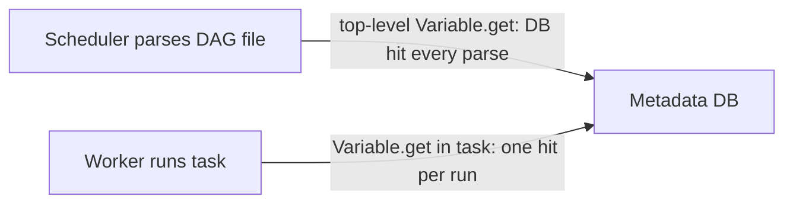

## Introduction

Some settings change without code deploys: a bucket name, a feature flag, a list of regions. Airflow Variables hold such configuration.

## Definition

A **Variable** is a global key/value pair (string, or JSON with `deserialize_json=True`). Like Connections, Variables resolve from a secrets backend, then `AIRFLOW_VAR_<KEY>` env vars, then the metadata DB.

## Why it matters

Reading Variables in the wrong place is a common performance bug: top-level `Variable.get()` queries the database every time the scheduler parses the file, which is every few seconds per file.

## How it works

- `Variable.get("key")` does a lookup when it executes.
- At top level, that is parse time, on the scheduler, repeatedly.
- Inside a task or a Jinja template (`{{ var.value.key }}`, `{{ var.json.key.field }}`), it happens only at run time on the worker.

## Syntax and configuration

```bash
airflow variables set raw_bucket s3://lake-raw
airflow variables set etl_config '{"regions": ["eu", "us"], "batch_size": 5000}'
airflow variables get raw_bucket
airflow variables import variables.json
export AIRFLOW_VAR_RAW_BUCKET=s3://lake-raw
```

Bad vs good:

```python-syntax
from datetime import datetime
from airflow import DAG
from airflow.decorators import task
from airflow.models import Variable
from airflow.operators.bash import BashOperator

# BAD: runs on every DAG file parse
# bucket = Variable.get("raw_bucket")

with DAG("vars_demo", start_date=datetime(2024, 1, 1), schedule="@daily", catchup=False):
    # GOOD: template, rendered at run time
    copy = BashOperator(
        task_id="copy",
        bash_command="aws s3 cp /tmp/out.csv {{ var.value.raw_bucket }}/{{ ds }}/",
    )

    # GOOD: read inside the task
    @task
    def plan():
        cfg = Variable.get("etl_config", deserialize_json=True)
        return cfg["regions"]

    copy >> plan()
```

## Examples

Use one JSON Variable instead of many small ones:

```python-syntax
batch_size = "{{ var.json.etl_config.batch_size }}"
```

## Architecture



The same call costs very different amounts depending on where it sits.

## Practical example

200 DAG files each call `Variable.get` three times at top level. The metadata DB sees thousands of queries per minute and DAG parsing slows. Moving reads into templates fixed it.

## Exercises

1. How do you read a JSON field in a template?
   <details><summary>Answer</summary>`{{ var.json.etl_config.batch_size }}`.</details>
2. Why not store passwords in Variables?
   <details><summary>Answer</summary>Use Connections or a secrets backend; Variables are for config, though names containing "password"/"secret" are masked.</details>
3. XCom or Variable for a row count produced by today's run?
   <details><summary>Answer</summary>XCom: it is per-run data.</details>

## Common mistakes

- `Variable.get` at module top level.
- Using Variables to pass data between tasks.
- Many tiny Variables instead of one JSON config.
- Missing default: `Variable.get("k", default_var=None)` avoids `KeyError`.

## Performance and best practices

- Read in templates or inside tasks.
- Use env vars or a secrets backend for read-heavy values (no DB hit).
- Group related settings in JSON.
- Version-control Variable definitions (`airflow variables import`).

## Interview questions

### Why should you not call Variable.get at the top level of a DAG file?

The file is parsed continuously by the scheduler, so each parse queries the backend, slowing parsing and loading the metadata DB.

### Variables vs Connections?

Connections hold credentials for external systems with structured fields; Variables hold general configuration.

### Variables vs XCom?

Variables are global and long-lived; XComs are per DAG run and pass runtime values between tasks.

### How do you read a Variable without a DB query?

Define it as `AIRFLOW_VAR_<KEY>` or in a secrets backend; those are checked before the DB.

## Quick revision

- Variable = global config key/value.
- Lookup: secrets backend, `AIRFLOW_VAR_` env, DB.
- Never `Variable.get` at top level.
- Templates: `{{ var.value.x }}`, `{{ var.json.x.y }}`.
- Not for secrets, not for task data.
- One JSON Variable beats many.
