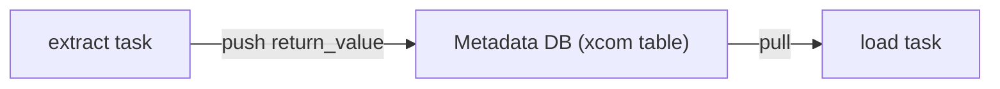

## Introduction

Tasks run in separate processes, often on separate machines. XCom ("cross-communication") is Airflow's built-in way to hand a small value from one task to another.

## Definition

An **XCom** is a key/value record stored in the metadata DB, scoped to a DAG run, task and map index. The default key for a task's return value is `return_value`.

## Why it matters

It replaces fragile tricks like shared local files. Misused, it bloats the metadata DB and slows the scheduler.

## How it works

- A returned value from `PythonOperator` or `@task` is pushed automatically (`do_xcom_push=True` by default).
- `ti.xcom_push(key=..., value=...)` pushes explicitly.
- `ti.xcom_pull(task_ids=..., key=...)` reads it.
- In TaskFlow, passing `extract()` into `load(...)` is an implicit pull plus a dependency.
- Values must be JSON-serialisable (or supported by the serialiser). Large objects belong in storage; a custom XCom backend can store them in S3/GCS transparently.

## Syntax and configuration

```python-syntax
from datetime import datetime
from airflow import DAG
from airflow.operators.python import PythonOperator
from airflow.operators.bash import BashOperator

def _extract(ti):
    ti.xcom_push(key="row_count", value=1250)
    return "s3://lake/raw/orders/2024-01-01.parquet"   # pushed as return_value

def _load(ti):
    path = ti.xcom_pull(task_ids="extract")
    count = ti.xcom_pull(task_ids="extract", key="row_count")
    print(f"loading {count} rows from {path}")

with DAG("xcom_classic", start_date=datetime(2024, 1, 1), schedule="@daily", catchup=False):
    extract = PythonOperator(task_id="extract", python_callable=_extract)
    load = PythonOperator(task_id="load", python_callable=_load)
    echo = BashOperator(task_id="echo",
                        bash_command="echo {{ ti.xcom_pull(task_ids='extract') }}")
    extract >> [load, echo]
```

## Examples

TaskFlow, including multiple outputs:

```python-syntax
import pendulum
from airflow.decorators import dag, task

@dag(schedule="@daily", start_date=pendulum.datetime(2024, 1, 1, tz="UTC"), catchup=False)
def xcom_taskflow():
    @task(multiple_outputs=True)
    def extract(ds=None) -> dict:
        return {"path": f"s3://lake/raw/{ds}.parquet", "rows": 1250}

    @task
    def load(path: str, rows: int):
        print(f"{rows} rows from {path}")

    out = extract()
    load(out["path"], out["rows"])

xcom_taskflow()
```

Check that a payload is XCom-friendly (JSON and small):

```python
import json

payload = {"path": "s3://lake/raw/2024-01-01.parquet", "rows": 1250}
encoded = json.dumps(payload)
print(len(encoded.encode()), "bytes")
assert len(encoded) < 48_000, "too big: store it externally and pass a path"
```

## Architecture



The value travels through the database, not directly between workers.

## Practical example

A task returned a 200 MB DataFrame; the metadata DB grew quickly and the UI slowed down. The fix: write Parquet to object storage and return only the URI.

## Exercises

1. What key does a return value use?
   <details><summary>Answer</summary>`return_value`.</details>
2. How do you stop a BashOperator pushing its last output line?
   <details><summary>Answer</summary>`do_xcom_push=False`.</details>
3. What do you pass instead of a big DataFrame?
   <details><summary>Answer</summary>A path or table name where the data was written.</details>

## Common mistakes

- Passing large data through XCom.
- Pulling from a task that is not upstream (value may not exist yet).
- Non-serialisable return values (DB connections, open files).
- Expecting XComs to persist across DAG runs: they are per run.

## Performance and best practices

- Keep XComs to IDs, paths, counts and small dicts.
- Use a custom object-storage XCom backend if large values are unavoidable.
- Prefer TaskFlow so dependencies and data flow stay in sync.
- Clean old XComs with `airflow db clean`.

## Interview questions

### What is XCom and where is it stored?

A small key/value message between tasks of a DAG run, stored in the metadata database (or a custom backend).

### How does TaskFlow use XCom?

A `@task` return value is pushed; passing it to another `@task` pulls it at run time and creates the dependency.

### Why not use XCom for big data?

It lives in the metadata DB, which is not built for large blobs; it slows the scheduler and UI.

### XCom vs Variable?

XCom is per DAG run and task, for runtime data. A Variable is global configuration.

## Quick revision

- XCom = small task-to-task values in the metadata DB.
- Return value pushed as `return_value`.
- `ti.xcom_push` / `ti.xcom_pull`.
- TaskFlow passes XComs via arguments.
- Pass references, not datasets.
- Scoped to one DAG run.
