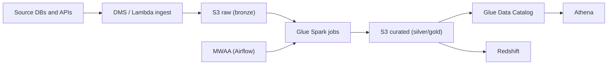

## Introduction

AWS has hundreds of services. A data platform on AWS usually touches about ten of them. This note maps those ten to the jobs they do, so the names stop being noise.

## Definition

Amazon Web Services (AWS) is a public cloud. You rent storage, compute and managed services by the second or by the request, in a **region** (a geographic area) made of several **availability zones** (isolated data centres). Resources live in an **account**, and accounts are grouped under **AWS Organizations**.

## Why it matters

Many data engineering job descriptions name AWS services directly. Interviewers expect you to pick the right service for ingestion, storage, transformation and serving, and to explain why.

## How it works

| Job | AWS service | Notes |
|---|---|---|
| Object storage / data lake | S3 | Buckets, prefixes, storage classes |
| Catalog | Glue Data Catalog | Hive-compatible table metadata |
| Batch ETL (serverless Spark) | Glue jobs | Spark or Python shell, billed per DPU-time |
| Managed Spark/Hadoop clusters | EMR (on EC2, EKS or Serverless) | More control than Glue |
| Ad-hoc SQL on the lake | Athena | Serverless, billed by data scanned |
| Warehouse | Redshift (provisioned or Serverless) | Columnar MPP; Spectrum queries S3 |
| Streaming | Kinesis Data Streams, Amazon Data Firehose, MSK (Kafka) | |
| Event functions | Lambda | Short, event-driven code |
| Orchestration | MWAA (managed Airflow), Step Functions | |
| Database replication / CDC | DMS | Full load plus ongoing changes |
| Governance | Lake Formation | Table/column permissions on the catalog |
| Monitoring | CloudWatch, CloudTrail | Metrics/logs vs API audit |
| Identity | IAM | Users, roles, policies |

## Syntax and configuration

The AWS CLI uses a named profile and a region:

```bash
aws configure --profile data-dev          # stores keys or SSO settings
aws sts get-caller-identity --profile data-dev
aws s3 ls s3://acme-raw/orders/ --profile data-dev
aws glue start-job-run --job-name orders-to-silver
aws athena start-query-execution \
  --query-string "SELECT count(*) FROM silver.orders" \
  --work-group primary
```

Prefer SSO (`aws configure sso`) or roles over long-lived access keys.

## Examples

Upload a file and start a Glue job with boto3:

```python-syntax
import boto3

s3 = boto3.client("s3")
s3.upload_file("orders.csv", "acme-raw", "orders/dt=2024-06-01/orders.csv")

glue = boto3.client("glue")
run = glue.start_job_run(JobName="orders-to-silver",
                         Arguments={"--run_date": "2024-06-01"})
print(run["JobRunId"])
```

## Architecture

A typical AWS batch lakehouse: raw files land in S3, Glue transforms them, Athena and Redshift serve them, MWAA schedules it all.



## Practical example

Nightly orders pipeline:

1. DMS replicates the `orders` table from RDS PostgreSQL into `s3://acme-raw/orders/` as Parquet.
2. An MWAA DAG runs a Glue job that deduplicates and writes `s3://acme-curated/orders/` partitioned by `order_date`.
3. A Glue crawler or the job itself updates the catalog table `silver.orders`.
4. Analysts query it in Athena; the gold aggregates are loaded into Redshift with `COPY`.
5. CloudWatch alarms fire on Glue job failure.

## Exercises

1. Which service would you use for a 30-second file-validation step triggered when a file lands in S3?
<details><summary>Answer</summary>Lambda with an S3 event notification. Short, event-driven and no cluster to manage.</details>

2. Athena or Redshift for a dashboard hit hundreds of times an hour on the same gold tables?
<details><summary>Answer</summary>Redshift. Athena bills per data scanned and has no persistent compute; a warehouse with caching and provisioned or serverless capacity suits frequent, repeated queries.</details>

3. Name the AWS service that records who deleted a bucket.
<details><summary>Answer</summary>CloudTrail, which logs AWS API calls. CloudWatch holds metrics and application logs.</details>

## Common mistakes

- Using IAM users with access keys in code instead of roles.
- Running everything in one account; separate dev and prod accounts limit blast radius.
- Forgetting that S3, Glue and Redshift must be in the same region to avoid cross-region transfer charges and latency.
- Choosing EMR for small jobs that Glue or even Lambda would handle.

## Performance and best practices

- Store lake data as Parquet with partitions; Athena and Spectrum scan less.
- Tag every resource (`team`, `env`, `pipeline`) for cost allocation.
- Use Infrastructure as Code (CloudFormation, CDK or Terraform), not console clicks.
- Use VPC endpoints for S3 so private subnets do not route through a NAT gateway.

## Interview questions

### What is the difference between Glue and EMR?

Both run Spark. Glue is serverless: you submit a job and AWS manages the workers. EMR gives you clusters (or EMR Serverless applications) with more control over versions, instance types and other frameworks such as Hive, Presto or Flink.

### When would you use Athena instead of Redshift?

Athena for ad-hoc or infrequent SQL over S3 with no infrastructure. Redshift for heavy, concurrent BI workloads that benefit from loaded, sorted and distributed data.

### What is the difference between CloudWatch and CloudTrail?

CloudWatch collects metrics, logs and alarms about how resources behave. CloudTrail records API calls: who did what, when, from where.

### How does a Glue job get permission to read S3?

Through an IAM role attached to the job. The role's policies grant `s3:GetObject` on the bucket; no keys are stored in the script.

## Quick revision

- S3 = lake storage; Glue Catalog = table metadata.
- Glue = serverless Spark; EMR = managed clusters.
- Athena = serverless SQL on S3; Redshift = warehouse.
- Kinesis/MSK = streaming; DMS = database CDC.
- MWAA = managed Airflow; Step Functions = state machines.
- IAM roles, not keys. CloudTrail = audit, CloudWatch = metrics/logs.
