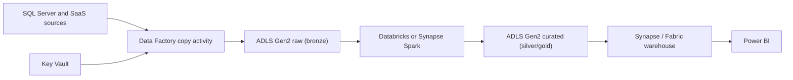

## Introduction

Azure is common in enterprises that already run Microsoft software. Its data stack centres on ADLS Gen2 for storage, Data Factory for movement and Synapse, Databricks or Fabric for compute.

## Definition

Microsoft Azure is a public cloud. Resources sit in **resource groups**, which sit in **subscriptions**, which sit under **management groups** and one **Microsoft Entra ID** tenant (formerly Azure Active Directory). Each resource is deployed to a **region**; many regions have **availability zones**.

## Why it matters

The hierarchy decides billing, policy and access. The service names differ from AWS, but the jobs are the same, so you should be able to translate a design between clouds.

## How it works

| Job | Azure service | AWS equivalent |
|---|---|---|
| Lake storage | ADLS Gen2 (Blob Storage with hierarchical namespace) | S3 |
| Data movement / ETL orchestration | Azure Data Factory (ADF) | Glue + MWAA |
| Spark | Azure Databricks, Synapse Spark pools | EMR / Glue |
| Warehouse | Synapse dedicated SQL pools, Fabric Warehouse | Redshift |
| Serverless SQL on the lake | Synapse serverless SQL pool | Athena |
| Streaming | Event Hubs (Kafka-compatible), Stream Analytics | Kinesis / MSK |
| Functions | Azure Functions | Lambda |
| Secrets | Key Vault | Secrets Manager |
| Governance / catalog | Microsoft Purview, Unity Catalog (Databricks) | Lake Formation / Glue Catalog |
| Monitoring | Azure Monitor, Log Analytics | CloudWatch |
| Identity for workloads | Managed identities | IAM roles |

Microsoft Fabric bundles lake storage (OneLake), Spark, warehouse, pipelines and Power BI into one SaaS product. Many new projects evaluate Fabric next to Synapse.

## Syntax and configuration

```bash
az login
az account set --subscription "data-prod"
az group create --name rg-data-prod --location westeurope
az storage account create --name acmedatalake --resource-group rg-data-prod \
  --sku Standard_LRS --kind StorageV2 --hns true      # --hns enables ADLS Gen2
az storage fs create --name raw --account-name acmedatalake --auth-mode login
az datafactory pipeline create-run --factory-name adf-acme \
  --resource-group rg-data-prod --name pl_orders_daily
```

## Examples

Write a file to ADLS Gen2 with the Python SDK and a managed identity (or your `az login` session locally):

```python-syntax
from azure.identity import DefaultAzureCredential
from azure.storage.filedatalake import DataLakeServiceClient

cred = DefaultAzureCredential()
svc = DataLakeServiceClient("https://acmedatalake.dfs.core.windows.net", credential=cred)
fs = svc.get_file_system_client("raw")
f = fs.get_file_client("orders/dt=2024-06-01/orders.csv")
with open("orders.csv", "rb") as data:
    f.upload_data(data, overwrite=True)
```

`DefaultAzureCredential` tries environment variables, managed identity and developer logins in turn, so the same code runs locally and in Azure.

## Architecture



## Practical example

On-premises SQL Server to Power BI:

1. A self-hosted integration runtime lets ADF reach the on-premises server.
2. An ADF copy activity lands tables as Parquet in `raw/` daily.
3. ADF triggers a Databricks notebook that merges into Delta tables in `curated/`.
4. Synapse serverless SQL or a Fabric warehouse exposes gold tables to Power BI.
5. ADF reads the source password from Key Vault; ADF and Databricks reach storage with managed identities.

## Exercises

1. What turns a normal Azure storage account into ADLS Gen2?
<details><summary>Answer</summary>Enabling the hierarchical namespace. It gives real directories, atomic renames and POSIX-like ACLs.</details>

2. ADF needs to copy from a database inside a corporate data centre. What component is needed?
<details><summary>Answer</summary>A self-hosted integration runtime installed on a machine that can reach the database.</details>

3. Which Azure feature replaces storing a storage key in a Function's settings?
<details><summary>Answer</summary>A managed identity for the Function, granted an RBAC role such as Storage Blob Data Contributor on the account.</details>

## Common mistakes

- Creating a storage account without hierarchical namespace, then needing ADLS features later.
- Using storage account keys or SAS tokens everywhere instead of Entra ID and RBAC.
- Mixing dev and prod in one resource group with no naming convention.
- Putting heavy transformations in ADF data flows when a Spark notebook or dbt would be clearer.

## Performance and best practices

- Organise by subscription per environment and resource group per workload.
- Use Azure Policy to enforce tags, regions and encryption settings.
- Use private endpoints for storage and Key Vault in regulated setups.
- Deploy with Bicep, ARM templates or Terraform, and keep ADF pipelines in Git.

## Interview questions

### What is ADLS Gen2 and how does it differ from Blob Storage?

It is Blob Storage with the hierarchical namespace enabled. You get directories, atomic directory renames and ACLs, which analytics engines need, while keeping Blob tiers and pricing model.

### What does Azure Data Factory do?

It orchestrates and moves data: pipelines of activities (copy, notebook, stored procedure, web), triggers on schedules or events, and integration runtimes that run the copies.

### What is a managed identity?

An Entra ID identity that Azure creates for a resource. The resource gets tokens automatically; you grant it RBAC roles and never handle a secret. System-assigned identities live and die with the resource; user-assigned ones are standalone and can be shared.

### Synapse dedicated pool vs serverless pool?

Dedicated pools are provisioned MPP warehouses billed for capacity while running. Serverless pools query files in the lake on demand and bill by data processed.

## Quick revision

- Tenant > management group > subscription > resource group > resource.
- ADLS Gen2 = Blob + hierarchical namespace.
- ADF = movement and orchestration; integration runtimes run copies.
- Databricks/Synapse Spark = transforms; Synapse/Fabric = warehouse.
- Event Hubs = streaming; Functions = event code.
- Managed identities + RBAC, secrets in Key Vault.
