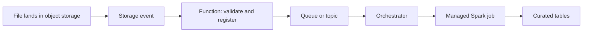

## Introduction

"Where does this code run?" has many answers in the cloud. The trade-off is control versus operations: VMs give full control and full responsibility, serverless gives neither.

## Definition

| Model | AWS | Azure | Google Cloud | Good for |
|---|---|---|---|---|
| Virtual machines | EC2 | Virtual Machines | Compute Engine | Legacy tools, full control |
| Containers (orchestrated) | ECS, EKS | AKS, Container Apps | GKE | Long-running services, custom images |
| Serverless containers / jobs | Fargate, AWS Batch | Container Apps jobs, Container Instances | Cloud Run (services and jobs) | Batch scripts in containers |
| Functions | Lambda | Azure Functions | Cloud Run functions | Short event-driven tasks |
| Managed Spark | Glue, EMR, EMR Serverless | Databricks, Synapse Spark, Fabric Spark | Dataproc, Dataproc Serverless | Large distributed transforms |
| Beam / streaming | Managed Service for Apache Flink | Stream Analytics | Dataflow | Streaming pipelines |

## Why it matters

The wrong choice is either expensive (a cluster idling for a 2-minute job) or fragile (a function hitting its time limit on a large file).

## How it works

- **Functions** start on an event (file upload, message, HTTP), run briefly, then stop. They have a maximum duration and memory limit and may have a cold start. Lambda caps a single invocation at 15 minutes.
- **Serverless containers** run your image on demand; jobs can run longer than functions and scale to zero.
- **Managed Spark** allocates a cluster of driver and executors per job or keeps one running.
- **Spot / preemptible capacity** (EC2 Spot, Azure Spot VMs, Spot VMs on Google Cloud) is spare capacity sold at a discount that the provider can reclaim with short notice. It suits fault-tolerant batch executors, not drivers or databases.

## Syntax and configuration

A minimal Lambda handler triggered by an S3 upload:

```python-syntax
import json, urllib.parse
import boto3

s3 = boto3.client("s3")

def handler(event, context):
    rec = event["Records"][0]["s3"]
    bucket = rec["bucket"]["name"]
    key = urllib.parse.unquote_plus(rec["object"]["key"])
    head = s3.head_object(Bucket=bucket, Key=key)
    if head["ContentLength"] == 0:
        raise ValueError(f"empty file {key}")
    return {"statusCode": 200, "body": json.dumps({"validated": key})}
```

Deploy a containerised batch job on Cloud Run:

```bash
gcloud run jobs create orders-loader \
  --image=europe-west1-docker.pkg.dev/acme/etl/orders-loader:1.4 \
  --region=europe-west1 --tasks=1 --max-retries=2 \
  --service-account=orders-loader@acme-data-prod.iam.gserviceaccount.com
gcloud run jobs execute orders-loader --region=europe-west1
```

An Azure Functions blob trigger binding (`function.json`, classic model):

```json
{
  "bindings": [{
    "name": "blob",
    "type": "blobTrigger",
    "direction": "in",
    "path": "raw/orders/{name}",
    "connection": "LakeStorage"
  }]
}
```

## Examples

Decision guide:

| Job | Choice |
|---|---|
| Validate each uploaded file, under a minute | Function |
| Pull a REST API every hour, 10 minutes | Serverless container job |
| Join 2 TB of Parquet nightly | Managed Spark (Glue, Databricks, Dataproc) |
| Transform data already in the warehouse | SQL/dbt in the warehouse, no extra compute |
| Always-on Kafka consumer | Container on Kubernetes or a managed streaming service |

## Architecture

Event-driven ingestion: a function validates small files fast, and heavy work goes to Spark.



## Practical example

A team runs a 5-node always-on Spark cluster for jobs that total 2 hours per day. Moving to job clusters (Glue jobs, Databricks job clusters with auto-termination, or Dataproc Serverless) means compute runs only during those 2 hours. Executors on spot capacity cut cost further, with retries covering reclaimed nodes.

## Exercises

1. Why is a function a poor fit for converting a 40 GB file?
<details><summary>Answer</summary>Functions have time, memory and temporary-disk limits. Use a container job or Spark.</details>

2. Which part of a Spark job should not run on spot capacity?
<details><summary>Answer</summary>The driver. Losing it fails the whole job; losing an executor only retries its tasks.</details>

3. What is a cold start?
<details><summary>Answer</summary>Extra latency when the platform must create a new execution environment before running your function, for example after idle time or during scale-out.</details>

## Common mistakes

- Always-on clusters for short daily jobs.
- Functions that call each other in long chains instead of using an orchestrator.
- Hard-coded credentials in container images instead of an attached role, managed identity or service account.
- Ignoring function concurrency limits, which can overwhelm a downstream database.

## Performance and best practices

- Push SQL transforms down to the warehouse when data is already there.
- Right-size executors; check CPU and memory metrics before adding nodes.
- Use autoscaling and auto-termination.
- Make every job idempotent so retries after spot interruptions are safe.
- Pin container image versions for reproducible runs.

## Interview questions

### Lambda vs Glue for ETL?

Lambda for small, short, event-driven tasks within its time and memory limits. Glue for distributed Spark over large data. Many pipelines use Lambda to trigger or validate, and Glue to transform.

### What are spot or preemptible instances and when are they safe?

Discounted spare capacity that can be reclaimed at short notice. Safe for stateless, retryable work such as Spark executors or batch tasks; unsafe for drivers, databases or anything with a strict deadline and no fallback.

### What is the difference between Cloud Run services and Cloud Run jobs?

Services handle HTTP requests and scale with traffic. Jobs run containers to completion, with task counts and retries, which suits batch ETL.

### How do you choose between Kubernetes and serverless containers?

Kubernetes gives control over networking, scheduling and long-running workloads at the cost of cluster operations. Serverless containers remove cluster management and scale to zero, but with fewer knobs.

## Quick revision

- VMs > containers > serverless containers > functions: less control, less ops.
- Functions: short, event-driven, time-limited.
- Managed Spark for big transforms: Glue/EMR, Databricks/Synapse, Dataproc.
- Spot for executors, never the driver.
- Scale to zero; auto-terminate clusters.
- Prefer in-warehouse SQL when data is already there.
