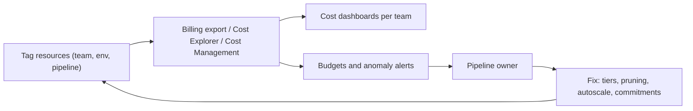

## Introduction

Cloud bills grow quietly: a forgotten cluster, a dashboard that scans a full table every five minutes, raw data kept hot forever. Cost management is mostly engineering, not finance.

## Definition

Cloud costs come from a few meters. Prices change, so learn the meters, not the numbers:

| Meter | Examples | Lever |
|---|---|---|
| Storage per GB-month | S3, ADLS, GCS, warehouse storage | Tiers, lifecycle, compression, retention |
| Requests | PUT/GET/LIST per object | Fewer, larger files |
| Compute time | VMs, Spark clusters, DWUs, Redshift nodes | Autoscale, auto-pause, right-size, spot |
| Data scanned | Athena, BigQuery on-demand, Synapse serverless | Columnar formats, partition pruning, clustering |
| Data transfer | Internet egress, cross-region, NAT processing | Same region, private endpoints, caching |
| Commitments | Reserved instances, Savings Plans, Azure reservations, Google committed use discounts, BigQuery slot commitments | Commit for steady baseline only |

## Why it matters

Engineers make the decisions that set cost: file formats, partition keys, schedules and cluster sizes. FinOps practices make those costs visible and owned.

## How it works

- **Pay-as-you-go vs commitment:** commitments trade flexibility for a discount on a baseline you know you will use. Cover the steady base, leave spikes on demand or spot.
- **Scanned-bytes engines** bill by data read, so pruning and column selection directly cut cost.
- **Provisioned engines** bill while running, so pausing, auto-suspend and right-sizing matter more than query shape.
- **Showback/chargeback:** tags or labels on resources let billing reports split cost by team, environment and pipeline.

## Syntax and configuration

Tagging and budgets:

```bash
aws resourcegroupstaggingapi tag-resources \
  --resource-arn-list arn:aws:glue:eu-west-1:123456789012:job/orders-to-silver \
  --tags team=data,env=prod,pipeline=orders

az consumption budget create --budget-name data-prod-monthly --amount 5000 \
  --category cost --time-grain monthly \
  --start-date 2025-01-01 --end-date 2026-12-31 --resource-group rg-data-prod

gcloud billing budgets create --billing-account=XXXXXX-XXXXXX-XXXXXX \
  --display-name="data-prod" --budget-amount=5000 \
  --threshold-rule=percent=0.8 --threshold-rule=percent=1.0
```

The budget amounts above are placeholders; set them from your own baseline.

GCS lifecycle rule (JSON) moving old objects to a colder class:

```json
{
  "rule": [
    {"action": {"type": "SetStorageClass", "storageClass": "COLDLINE"},
     "condition": {"age": 90, "matchesPrefix": ["raw/"]}},
    {"action": {"type": "Delete"},
     "condition": {"age": 730, "matchesPrefix": ["raw/"]}}
  ]
}
```

## Examples

Scan less in BigQuery or Athena:

```sql-syntax
-- Expensive: all columns, all partitions
SELECT * FROM sales.fact_sales;

-- Cheaper: two columns, one month of partitions
SELECT customer_id, amount
FROM sales.fact_sales
WHERE sale_date BETWEEN '2024-06-01' AND '2024-06-30';
```

Find the costliest queries on BigQuery from job metadata:

```sql-syntax
SELECT user_email, SUM(total_bytes_billed) / POW(1024, 4) AS tib_billed
FROM `region-eu`.INFORMATION_SCHEMA.JOBS
WHERE creation_time > TIMESTAMP_SUB(CURRENT_TIMESTAMP(), INTERVAL 30 DAY)
GROUP BY user_email
ORDER BY tib_billed DESC
LIMIT 10;
```

## Architecture

Cost feedback loop: tag, measure, alert, fix.



## Practical example

A monthly review finds three problems:

1. A dev Databricks or EMR cluster with no auto-termination runs all weekend. Fix: auto-terminate after idle minutes and use job clusters.
2. A dashboard refreshes every 5 minutes with a query scanning a whole unpartitioned table on BigQuery on-demand. Fix: partition by date, cluster, require a partition filter, and refresh hourly from a pre-aggregated table or materialized view.
3. Five years of raw JSON sit in the hot tier. Fix: convert to Parquet, keep recent data hot, lifecycle older data to cold/archive, delete beyond retention.

Only after the waste is gone, buy commitments for the remaining steady baseline.

## Exercises

1. Why buy commitments last, not first?
<details><summary>Answer</summary>A commitment locks in today's usage. Removing waste first avoids committing to capacity you would have turned off.</details>

2. Which lever matters most for an on-demand scanned-bytes engine?
<details><summary>Answer</summary>Reading less: columnar formats, selecting only needed columns, and partition pruning/clustering.</details>

3. Name two hidden network costs in data pipelines.
<details><summary>Answer</summary>NAT gateway data processing and cross-region or internet egress. Keep compute and data in one region and use private endpoints.</details>

## Common mistakes

- No tags, so nobody owns the bill.
- Archiving data that is read often, paying retrieval fees.
- `SELECT *` and `LIMIT` assumptions on scanned-bytes engines.
- Committing to capacity before right-sizing.
- Ignoring idle provisioned warehouses and clusters.
- Copying the same data into many regions or tools.

## Performance and best practices

- Parquet/ORC with compression; compact small files.
- Partition and cluster by real filter columns.
- Autoscaling, auto-pause and auto-termination everywhere.
- Spot capacity for retryable batch executors.
- Budgets with alerts at thresholds, plus anomaly detection.
- Export billing data to the warehouse and build cost dashboards per pipeline.

## Interview questions

### How would you reduce a BigQuery or Athena bill?

Scan less: partition and cluster tables, select only needed columns, require partition filters, store Parquet, pre-aggregate hot queries. Then consider capacity pricing (BigQuery reservations, provisioned capacity) if usage is steady.

### Reserved instances vs savings plans vs spot?

Reserved instances and committed use discounts lock specific capacity or spend for a term in exchange for a discount. Savings Plans commit to a spend level with more flexibility across instance types. Spot is unused capacity at a discount that can be reclaimed; it suits interruptible work.

### How do you make cloud costs visible to teams?

Enforce tags or labels through policy, export billing data, build dashboards per team and pipeline, set budgets with alerts, and review monthly with owners.

### What drives data transfer costs?

Data leaving the provider to the internet, moving between regions or zones, and traffic processed by NAT gateways. Ingress is usually free; egress is not.

## Quick revision

- Learn the meters: storage, requests, compute, scanned bytes, transfer.
- Tiers + lifecycle for storage.
- Pruning + columnar for scanned-bytes engines.
- Auto-pause/terminate + spot for compute.
- Commit only for steady baseline, after removing waste.
- Tags, budgets and dashboards create ownership.
