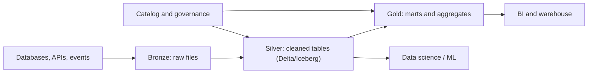

## Introduction

A data lake stores raw and processed data as files in object storage. Without structure it turns into a "data swamp". Layers, a catalog and a table format turn it into a lakehouse you can query like a warehouse.

## Definition

- **Data lake:** files in object storage (S3, ADLS Gen2, GCS), any format, schema applied on read.
- **Catalog:** metadata mapping table names to file locations and schemas (Glue Data Catalog, Hive metastore, Unity Catalog, BigQuery/BigLake, Dataplex, Purview).
- **Open table format:** Delta Lake, Apache Iceberg or Apache Hudi. They add a transaction log over Parquet files, giving ACID commits, `MERGE`, schema evolution and time travel.
- **Lakehouse:** a lake with a table format and catalog, serving both BI and data science.

## Why it matters

Lakes are cheap and flexible. Table formats remove the classic lake problems: half-written outputs, no updates or deletes (needed for GDPR), and no reliable schema.

## How it works

The medallion layout:

| Layer | Content | Typical rules |
|---|---|---|
| Bronze (raw) | Data as received, append-only | Keep source fidelity; add ingest timestamp and source file |
| Silver (clean) | Typed, deduplicated, conformed | Enforce schema, fix keys, apply CDC merges |
| Gold (curated) | Business aggregates and dimensional models | Shaped for BI; often loaded into a warehouse |

A table-format write: the engine writes new Parquet files, then atomically commits a log entry listing added and removed files. Readers use the latest committed snapshot, so they never see partial writes.

## Syntax and configuration

Register an external Parquet table over the lake (Athena / Spark SQL style):

```sql-syntax
CREATE EXTERNAL TABLE silver.orders (
  order_id    BIGINT,
  customer_id STRING,
  amount      DECIMAL(12,2)
)
PARTITIONED BY (order_date DATE)
STORED AS PARQUET
LOCATION 's3://acme-lake/silver/orders/';
```

An Iceberg table in Athena:

```sql-syntax
CREATE TABLE silver.orders_iceberg (
  order_id BIGINT, customer_id STRING, amount DECIMAL(12,2), order_date DATE)
PARTITIONED BY (day(order_date))
LOCATION 's3://acme-lake/silver/orders_iceberg/'
TBLPROPERTIES ('table_type' = 'ICEBERG');
```

## Examples

Bronze to silver upsert with Delta Lake in PySpark:

```python-syntax
from delta.tables import DeltaTable
from pyspark.sql import functions as F

bronze = (spark.read.format("json").load("s3://acme-lake/bronze/orders/dt=2024-06-01/")
          .withColumn("_ingested_at", F.current_timestamp()))
clean = (bronze.dropDuplicates(["order_id"])
               .withColumn("amount", F.col("amount").cast("decimal(12,2)")))

silver = DeltaTable.forPath(spark, "s3://acme-lake/silver/orders/")
(silver.alias("t")
   .merge(clean.alias("s"), "t.order_id = s.order_id")
   .whenMatchedUpdateAll()
   .whenNotMatchedInsertAll()
   .execute())
```

## Architecture



Cloud mapping: storage is S3, ADLS Gen2 or GCS; compute is Glue/EMR, Databricks/Synapse Spark/Fabric, or Dataproc/BigQuery; the catalog is Glue Catalog + Lake Formation, Unity Catalog/Purview, or Dataplex/BigLake.

## Practical example

GDPR delete in a lakehouse: with plain Parquet you would rewrite whole partitions by hand. With Delta or Iceberg you run `DELETE FROM silver.customers WHERE customer_id = 'X'`; the engine rewrites only affected files and commits. Old files remain for time travel until you run `VACUUM` (Delta) or expire snapshots (Iceberg), so plan retention to meet the deletion deadline.

## Exercises

1. Which layer should you rebuild silver from if a cleaning bug is found?
<details><summary>Answer</summary>Bronze. It keeps raw data unchanged, which is why it is append-only.</details>

2. What problem does a table format solve that partitioned Parquet alone does not?
<details><summary>Answer</summary>Atomic commits and row-level changes: readers never see partial writes, and MERGE/UPDATE/DELETE work without hand-rewriting partitions.</details>

3. Why might time travel conflict with deletion requests?
<details><summary>Answer</summary>Deleted rows remain in old data files referenced by earlier snapshots until those snapshots are expired or vacuumed.</details>

## Common mistakes

- No catalog: every team guesses paths and schemas.
- Transforming in bronze, losing the ability to replay.
- Over-partitioning, which creates small files.
- Skipping compaction and snapshot cleanup on table-format tables.
- Giving everyone bucket-level access instead of table/column grants.

## Performance and best practices

- Compact small files (`OPTIMIZE` in Delta, `rewrite_data_files` in Iceberg).
- Cluster or Z-order on frequent filter columns.
- Iceberg hidden partitioning (`day(ts)`) avoids users having to filter on a separate partition column.
- Use one table format per platform where possible to limit tooling sprawl.
- Govern access through the catalog (Lake Formation, Unity Catalog, BigLake) rather than raw storage permissions.

## Interview questions

### What is the difference between a data lake and a data warehouse?

A lake stores files of any format in object storage with schema-on-read. A warehouse stores structured tables in a managed engine with schema-on-write and strong SQL performance. A lakehouse adds warehouse-like transactions and governance to the lake.

### Explain bronze, silver and gold.

Bronze is raw, append-only source data. Silver is cleaned, typed and deduplicated. Gold is business-ready aggregates and models. Each layer can be rebuilt from the previous one.

### Delta Lake vs Iceberg?

Both add ACID transaction logs over Parquet. Delta is native to Databricks and widely supported in Spark. Iceberg is engine-neutral with hidden partitioning and partition evolution, and is supported by Athena, Snowflake, BigQuery and others. Interoperability between them keeps improving.

### How do you avoid a data swamp?

A catalog with owners and descriptions, enforced layers, schema checks at silver, data quality tests, and access controls through the catalog.

## Quick revision

- Lake = files in object storage + schema on read.
- Bronze raw, silver clean, gold business.
- Catalog maps tables to files.
- Delta / Iceberg / Hudi = ACID, MERGE, time travel.
- Compact small files; clean old snapshots.
- Govern via catalog grants, not bucket ACLs.
