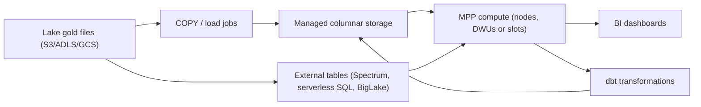

## Introduction

Cloud warehouses run analytical SQL over billions of rows without you managing hardware. The three big ones are Amazon Redshift, Azure Synapse Analytics (with Microsoft Fabric Warehouse as its newer sibling) and Google BigQuery. Snowflake and Databricks SQL run on all three clouds.

## Definition

A cloud data warehouse is a managed, columnar, massively parallel processing (MPP) SQL engine. Data is split across many workers, each scans its share, and results are combined.

| | Redshift | Synapse dedicated SQL pool | BigQuery |
|---|---|---|---|
| Compute model | Provisioned RA3 clusters or Serverless | Provisioned DWUs, pausable | Serverless slots (on-demand or reservations) |
| Storage | Managed storage on S3, separate from compute (RA3/Serverless) | Managed storage | Separate managed columnar storage |
| Data layout | `DISTKEY`, `SORTKEY` | `DISTRIBUTION = HASH/ROUND_ROBIN/REPLICATE`, clustered columnstore | `PARTITION BY`, `CLUSTER BY` |
| Lake queries | Redshift Spectrum | Serverless SQL pool, external tables | External / BigLake tables |
| Bulk load | `COPY` from S3 | `COPY INTO` from ADLS | Load jobs from GCS, Storage Write API |

## Why it matters

Layout choices (distribution, sort, partition, cluster) decide whether a query reads 1% or 100% of a table and whether joins shuffle data across the network. Those choices drive both latency and cost.

## How it works

1. Data is stored column by column, compressed, in blocks with min/max statistics.
2. Queries read only the referenced columns and skip blocks or partitions whose statistics exclude the filter (pruning).
3. Joins are fastest when matching rows sit on the same worker (co-located distribution) or when the small table is copied to every worker (broadcast/replicate).
4. Separating storage from compute lets you scale or pause compute without moving data.

## Syntax and configuration

Redshift:

```sql-syntax
CREATE TABLE fact_sales (
  sale_id     BIGINT,
  customer_id INT,
  sale_date   DATE,
  amount      DECIMAL(12,2)
)
DISTKEY (customer_id)
SORTKEY (sale_date);

COPY fact_sales
FROM 's3://acme-lake/gold/fact_sales/'
IAM_ROLE 'arn:aws:iam::123456789012:role/redshift-load'
FORMAT AS PARQUET;
```

Synapse dedicated pool:

```sql-syntax
CREATE TABLE dbo.fact_sales (
  sale_id BIGINT, customer_id INT, sale_date DATE, amount DECIMAL(12,2))
WITH (DISTRIBUTION = HASH(customer_id), CLUSTERED COLUMNSTORE INDEX);

COPY INTO dbo.fact_sales
FROM 'https://acmelake.dfs.core.windows.net/gold/fact_sales/*.parquet'
WITH (FILE_TYPE = 'PARQUET', CREDENTIAL = (IDENTITY = 'Managed Identity'));
```

BigQuery:

```sql-syntax
CREATE TABLE sales.fact_sales (
  sale_id INT64, customer_id INT64, sale_date DATE, amount NUMERIC)
PARTITION BY sale_date
CLUSTER BY customer_id
OPTIONS (require_partition_filter = TRUE);
```

## Examples

The same pruned query everywhere. It reads one month of partitions/sort blocks instead of the whole table:

```sql-syntax
SELECT customer_id, SUM(amount) AS revenue
FROM fact_sales
WHERE sale_date >= DATE '2024-06-01' AND sale_date < DATE '2024-07-01'
GROUP BY customer_id;
```

The same idea on the local Northwind database: filter on the date column first, aggregate second.

```sql
SELECT o.customer_id, COUNT(*) AS orders
FROM orders o
WHERE o.order_date >= DATE '1997-01-01' AND o.order_date < DATE '1998-01-01'
GROUP BY o.customer_id
ORDER BY orders DESC, o.customer_id
LIMIT 5;
```

## Architecture



## Practical example

Star schema on Redshift: `fact_sales` is large, `dim_customer` medium, `dim_date` tiny.

- `fact_sales DISTKEY(customer_id)` and `dim_customer DISTKEY(customer_id)` co-locate the big join.
- `dim_date DISTSTYLE ALL` copies the small table to every node.
- `SORTKEY(sale_date)` lets date filters skip blocks.

On BigQuery you would instead partition `fact_sales` by `sale_date`, cluster by `customer_id`, and let the engine choose broadcast or shuffle joins.

## Exercises

1. In BigQuery on-demand billing, why does `SELECT *` cost more than selecting two columns?
<details><summary>Answer</summary>Storage is columnar and on-demand billing counts bytes read from the referenced columns. `LIMIT` does not reduce bytes scanned on a non-clustered table.</details>

2. What Redshift distribution style suits a 500-row dimension?
<details><summary>Answer</summary>`DISTSTYLE ALL`, so every node has a full copy and joins need no redistribution. `AUTO` often picks this too.</details>

3. How does `require_partition_filter` protect a BigQuery table?
<details><summary>Answer</summary>Queries without a filter on the partition column fail, preventing accidental full scans.</details>

## Common mistakes

- Row-by-row `INSERT`s instead of bulk `COPY` or load jobs.
- Distributing on a skewed key, leaving one node doing most of the work.
- Wrapping the partition column in a function in `WHERE`, which can disable pruning.
- Treating the warehouse like OLTP with many small updates.
- Leaving a provisioned pool running all weekend with no workload.

## Performance and best practices

- Bulk-load columnar files from object storage.
- Choose partition/sort keys from real filter patterns.
- Use materialized views or pre-aggregated gold tables for hot dashboards.
- Separate workloads (workload management queues in Redshift, workload groups in Synapse, reservations in BigQuery).
- Monitor scanned bytes and long-running queries.

## Interview questions

### What does separation of storage and compute give you?

You scale compute up, down or to zero without moving data, run several compute clusters on the same data, and pay for storage and compute separately.

### How do Redshift DISTKEY and SORTKEY differ?

`DISTKEY` decides which node stores each row, which affects join redistribution. `SORTKEY` decides row order within a node, which lets range filters skip blocks.

### What is partition pruning?

The engine skips partitions whose values cannot match the filter, so it reads less data. It needs a direct filter on the partition column.

### When would you query the lake directly instead of loading the warehouse?

For infrequent, exploratory or very large raw data, using Spectrum, Synapse serverless or BigLake external tables. Load into the warehouse when queries are frequent and latency matters.

## Quick revision

- Columnar + MPP + pruning = fast scans.
- Redshift: DISTKEY/SORTKEY. Synapse: HASH/REPLICATE + columnstore. BigQuery: PARTITION/CLUSTER.
- Bulk load with `COPY` / `COPY INTO` / load jobs.
- Storage and compute scale separately.
- Filter directly on partition columns.
- Replicate small dimensions, co-locate big joins.
