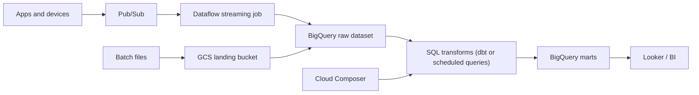

## Introduction

Google Cloud's data stack is built around BigQuery. Many teams load data into BigQuery early and do most transformation there in SQL, with GCS, Pub/Sub and Dataflow around it.

## Definition

Google Cloud (GCP) is a public cloud. Resources belong to a **project**, projects sit in **folders** under an **organization**, and billing is attached through a **billing account**. Resources are regional, zonal or multi-regional (for example the BigQuery `US` and `EU` multi-regions).

## Why it matters

The project is the unit of access, quota and billing, so project layout is an early design decision. BigQuery's serverless model changes how you think about cost: you pay for data scanned or for reserved slots, not for a running cluster.

## How it works

| Job | Google Cloud service | AWS / Azure equivalent |
|---|---|---|
| Object storage | Cloud Storage (GCS) | S3 / ADLS Gen2 |
| Warehouse | BigQuery | Redshift / Synapse |
| Stream and batch pipelines (Apache Beam) | Dataflow | Kinesis Data Analytics / Stream Analytics, Glue |
| Managed Spark/Hadoop | Dataproc (clusters or Serverless) | EMR / HDInsight, Databricks |
| Messaging | Pub/Sub | Kinesis, SNS/SQS / Event Hubs, Service Bus |
| Managed Airflow | Cloud Composer | MWAA / ADF (Airflow option) |
| Containers and functions | Cloud Run, Cloud Run functions | Lambda / Azure Functions |
| CDC replication | Datastream | DMS / ADF |
| Governance | Dataplex, BigQuery policy tags | Lake Formation / Purview |
| Monitoring | Cloud Monitoring, Cloud Logging | CloudWatch / Azure Monitor |
| Workload identity | Service accounts | IAM roles / managed identities |

## Syntax and configuration

```bash
gcloud auth login
gcloud config set project acme-data-prod
gcloud storage buckets create gs://acme-raw --location=europe-west1 \
  --uniform-bucket-level-access
gcloud storage cp orders.csv gs://acme-raw/orders/dt=2024-06-01/
bq load --source_format=CSV --autodetect raw.orders \
  "gs://acme-raw/orders/dt=2024-06-01/*.csv"
bq query --use_legacy_sql=false --dry_run \
  'SELECT COUNT(*) FROM raw.orders'          # dry run reports bytes to be scanned
```

## Examples

Load from GCS into BigQuery with the Python client:

```python-syntax
from google.cloud import bigquery

client = bigquery.Client(project="acme-data-prod")
job_config = bigquery.LoadJobConfig(
    source_format=bigquery.SourceFormat.PARQUET,
    write_disposition="WRITE_APPEND",
)
job = client.load_table_from_uri(
    "gs://acme-raw/orders/dt=2024-06-01/*.parquet",
    "acme-data-prod.raw.orders",
    job_config=job_config,
)
job.result()   # wait
print(client.get_table("acme-data-prod.raw.orders").num_rows)
```

The client uses Application Default Credentials: your `gcloud auth application-default login` locally, the attached service account in the cloud.

## Architecture



## Practical example

Clickstream analytics:

1. Web events publish to a Pub/Sub topic.
2. A Dataflow streaming job validates events and writes to a partitioned BigQuery table.
3. Daily order exports land in GCS and are loaded with `bq load`.
4. Cloud Composer runs dbt models that build marts in BigQuery.
5. Each component runs as its own service account with only the roles it needs.

## Exercises

1. What is the unit of billing and access isolation in Google Cloud?
<details><summary>Answer</summary>The project. IAM policies, quotas and billing linkage attach to it.</details>

2. How can you see how much data a BigQuery query will scan before running it?
<details><summary>Answer</summary>Use a dry run (`bq query --dry_run` or `dry_run=True` in the client), or read the estimate in the console.</details>

3. Dataflow or Dataproc for an existing PySpark codebase?
<details><summary>Answer</summary>Dataproc. It runs Spark as-is. Dataflow runs Apache Beam pipelines, so Spark code would need a rewrite.</details>

## Common mistakes

- Running `SELECT *` on large BigQuery tables under on-demand billing.
- Using the default compute service account, which often has broad roles.
- Downloading service account JSON keys instead of using attached service accounts or workload identity federation.
- Creating datasets in a different location from the GCS bucket; BigQuery load jobs need compatible locations.

## Performance and best practices

- Partition BigQuery tables by date and cluster by common filter columns.
- Use separate projects per environment, grouped in folders.
- Set custom query quotas or budgets to stop runaway scans.
- Prefer `gcloud storage` over the older `gsutil` for new scripts.

## Interview questions

### How is BigQuery different from Redshift?

BigQuery is serverless: storage and compute are separate and you do not size a cluster. You pay per bytes scanned (on-demand) or buy slot capacity. Redshift provisioned clusters have nodes you size; Redshift Serverless narrows this gap.

### When would you choose Dataflow?

For unified batch and streaming pipelines written in Apache Beam, especially with windowing, late data and autoscaling needs. For SQL-only transforms on data already in BigQuery, plain SQL or dbt is simpler.

### What is a service account?

An identity for a workload rather than a person. You attach it to a VM, Cloud Run service or Composer environment and grant it IAM roles; the code gets short-lived tokens automatically.

### What does Pub/Sub provide?

Durable, at-least-once message delivery between publishers and subscribers, with push or pull subscriptions. Consumers must handle duplicates.

## Quick revision

- Organization > folders > projects > resources.
- GCS = objects; BigQuery = serverless warehouse.
- Dataflow = Beam; Dataproc = Spark/Hadoop.
- Pub/Sub = messaging; Datastream = CDC.
- Composer = managed Airflow; Cloud Run = containers/functions.
- Service accounts, no JSON keys where avoidable.
