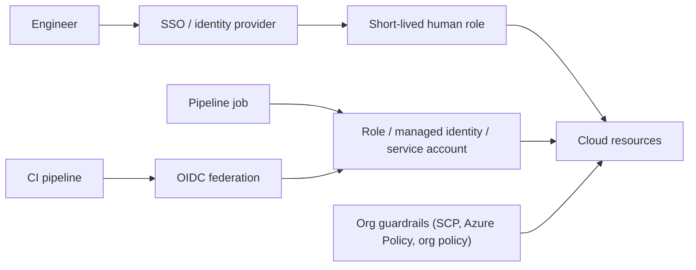

## Introduction

Every cloud API call answers one question: is this principal allowed to do this action on this resource? IAM is how you write the answer. It is also the most common interview topic in cloud security.

## Definition

| Concept | AWS | Azure | Google Cloud |
|---|---|---|---|
| Human identity | IAM Identity Center users, federated users | Entra ID users and groups | Google accounts, Cloud Identity groups, workforce federation |
| Workload identity | IAM role (assumed via STS) | Managed identity (system- or user-assigned) | Service account |
| Permission set | Policy (JSON statements) | Role definition | Role (predefined or custom) |
| Attachment | Identity policy on role/user; resource policy on bucket, key, etc. | Role assignment at a scope | IAM policy binding on resource hierarchy |
| Scope hierarchy | Organization > OU > account > resource | Management group > subscription > resource group > resource | Organization > folder > project > resource |

## Why it matters

Too little access breaks pipelines; too much turns one leaked credential into a full breach. Least privilege with short-lived credentials is the target.

## How it works

- **AWS:** a request is allowed only if some policy allows it and nothing denies it. Explicit `Deny` always wins. Identity policies, resource policies, permission boundaries and service control policies are all evaluated. Workloads **assume a role** and get temporary credentials from STS.
- **Azure RBAC:** a role assignment = principal + role definition + scope. Assignments inherit down the scope hierarchy. Data access (for example blob read) uses data-plane roles such as Storage Blob Data Reader, separate from management roles such as Contributor.
- **Google Cloud:** a policy binding = member + role on a resource. Bindings inherit down from organization to folder to project to resource. Deny policies and IAM conditions add restrictions.
- **Federation:** external workloads (GitHub Actions, another cloud, Kubernetes) exchange their own OIDC tokens for short-lived cloud credentials: IAM OIDC providers, Entra workload identity federation, Google workload identity federation.

## Syntax and configuration

AWS: a least-privilege policy for a job that reads raw and writes curated:

```json
{
  "Version": "2012-10-17",
  "Statement": [
    {"Effect": "Allow", "Action": ["s3:GetObject"],
     "Resource": "arn:aws:s3:::acme-lake/raw/orders/*"},
    {"Effect": "Allow", "Action": ["s3:PutObject", "s3:DeleteObject"],
     "Resource": "arn:aws:s3:::acme-lake/curated/orders/*"},
    {"Effect": "Allow", "Action": ["s3:ListBucket"],
     "Resource": "arn:aws:s3:::acme-lake",
     "Condition": {"StringLike": {"s3:prefix": ["raw/orders/*", "curated/orders/*"]}}}
  ]
}
```

A role trust policy that lets Glue assume the role:

```json
{
  "Version": "2012-10-17",
  "Statement": [{"Effect": "Allow",
                 "Principal": {"Service": "glue.amazonaws.com"},
                 "Action": "sts:AssumeRole"}]
}
```

Azure and Google Cloud equivalents:

```bash
# Azure: give a Data Factory's managed identity data access to one container
az role assignment create --assignee <adf-principal-id> \
  --role "Storage Blob Data Contributor" \
  --scope "/subscriptions/<sub>/resourceGroups/rg-data/providers/Microsoft.Storage/storageAccounts/acmelake/blobServices/default/containers/curated"

# Google Cloud: let a service account write to one bucket
gcloud storage buckets add-iam-policy-binding gs://acme-curated \
  --member="serviceAccount:etl@acme-data-prod.iam.gserviceaccount.com" \
  --role="roles/storage.objectAdmin"
```

## Examples

Assuming a role in another account with boto3 (cross-account read):

```python-syntax
import boto3

creds = boto3.client("sts").assume_role(
    RoleArn="arn:aws:iam::222233334444:role/lake-reader",
    RoleSessionName="orders-sync",
)["Credentials"]
s3 = boto3.client("s3",
                  aws_access_key_id=creds["AccessKeyId"],
                  aws_secret_access_key=creds["SecretAccessKey"],
                  aws_session_token=creds["SessionToken"])
```

The database version of the same idea, roles and grants (syntax only):

```sql-syntax
CREATE ROLE analyst NOLOGIN;
GRANT SELECT ON orders, customers TO analyst;
GRANT analyst TO alice;
```

## Architecture



## Practical example

Access design for a lake:

- Groups: `data-engineers` (write silver/gold in dev, read prod), `analysts` (read gold only), `platform-admins` (break-glass, MFA, alerted).
- One workload identity per pipeline, scoped to its prefixes or datasets.
- No long-lived keys: CI uses OIDC federation; jobs use attached identities.
- Quarterly access review using access analyzers (IAM Access Analyzer, Entra access reviews, Google IAM Recommender).

## Exercises

1. An AWS identity policy allows `s3:GetObject` but the bucket policy explicitly denies it. Result?
<details><summary>Answer</summary>Denied. An explicit Deny always overrides an Allow.</details>

2. An Azure Function's managed identity has Contributor on the storage account but cannot read blobs with Entra auth. Why?
<details><summary>Answer</summary>Contributor is a management-plane role. Reading blob data needs a data-plane role such as Storage Blob Data Reader.</details>

3. What replaces a downloaded service account key in GitHub Actions deploying to Google Cloud?
<details><summary>Answer</summary>Workload identity federation: GitHub's OIDC token is exchanged for short-lived credentials impersonating the service account.</details>

## Common mistakes

- `"Action": "*"` and `"Resource": "*"` in job policies.
- Granting roles to individuals instead of groups.
- Long-lived access keys or JSON keys in CI secrets.
- One shared service account for every pipeline, which hides who did what.
- Granting at organization or subscription scope when a bucket or dataset would do.

## Performance and best practices

- Least privilege, scoped to prefixes, datasets or containers.
- Short-lived credentials everywhere: roles, managed identities, attached service accounts, federation.
- Use permission boundaries or org guardrails to cap what admins can grant.
- Review unused permissions with the built-in analyzers.
- Manage IAM in IaC so changes are reviewed.

## Interview questions

### Compare an AWS IAM role, an Azure managed identity and a Google service account.

All three are identities for workloads that obtain short-lived tokens without stored secrets. An IAM role is assumed by a trusted principal via STS and carries policies. A managed identity is an Entra ID identity tied to an Azure resource and granted RBAC roles at a scope. A service account is a Google identity attached to a resource and granted roles via policy bindings; other principals can impersonate it if allowed.

### What is least privilege?

Give each identity only the actions and resources it needs, for only as long as it needs them, and review regularly.

### How does AWS evaluate policies?

Start from implicit deny. If any applicable policy has an explicit Deny, the request is denied. Otherwise it is allowed only if an identity or resource policy allows it and no boundary or SCP blocks it.

### Why avoid long-lived access keys?

They leak through code, logs and laptops, and stay valid until someone rotates them. Temporary credentials expire automatically.

## Quick revision

- Principal + action + resource (+ condition).
- AWS roles / Azure managed identities / Google service accounts.
- Explicit Deny wins on AWS.
- Azure: management vs data-plane roles.
- Scopes inherit downward on Azure and Google Cloud.
- Federation and short-lived tokens, never static keys.
