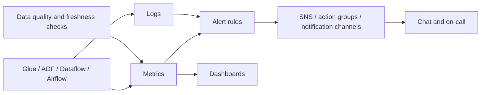

## Introduction

A pipeline that fails silently is worse than one that fails loudly. Cloud monitoring services collect metrics and logs from every managed service; your job is to choose the signals that matter and alert on them.

## Definition

| Need | AWS | Azure | Google Cloud |
|---|---|---|---|
| Metrics and alarms | CloudWatch metrics, alarms | Azure Monitor metrics, alert rules | Cloud Monitoring metrics, alerting policies |
| Logs and queries | CloudWatch Logs, Logs Insights | Log Analytics workspace (KQL) | Cloud Logging, Log Analytics |
| API audit | CloudTrail | Activity log | Cloud Audit Logs |
| Events | EventBridge | Event Grid | Eventarc, Pub/Sub log sinks |
| Notifications | SNS | Action groups | Notification channels |
| Tracing | X-Ray | Application Insights | Cloud Trace |

## Why it matters

Stakeholders notice stale dashboards before engineers notice failed jobs, unless monitoring covers both job health and **data health**.

## How it works

Three layers of signals:

1. **Infrastructure / job:** job failed, duration, retries, CPU, memory, queue depth.
2. **Data:** freshness (latest timestamp), volume (row counts), schema changes, quality test results.
3. **Cost:** bytes scanned, compute hours, unexpected spend spikes.

Managed services publish metrics automatically (Glue job metrics, ADF pipeline run metrics, BigQuery job metadata). You add **custom metrics** for data signals and route alerts to chat or paging.

## Syntax and configuration

A CloudWatch alarm on Glue job failures:

```bash
aws cloudwatch put-metric-alarm --alarm-name orders-glue-failed \
  --namespace Glue --metric-name glue.driver.aggregate.numFailedTasks \
  --dimensions Name=JobName,Value=orders-to-silver Name=JobRunId,Value=ALL Name=Type,Value=count \
  --statistic Sum --period 300 --evaluation-periods 1 --threshold 0 \
  --comparison-operator GreaterThanThreshold \
  --alarm-actions arn:aws:sns:eu-west-1:123456789012:data-alerts
```

An EventBridge rule for failed Glue job state changes (often simpler than metrics):

```json
{
  "source": ["aws.glue"],
  "detail-type": ["Glue Job State Change"],
  "detail": {"state": ["FAILED", "TIMEOUT"]}
}
```

Azure Log Analytics (KQL) query for failed ADF runs:

```text
ADFPipelineRun
| where Status == "Failed"
| summarize failures = count() by PipelineName, bin(TimeGenerated, 1h)
```

## Examples

Publish a freshness metric from a pipeline step:

```python-syntax
import boto3, datetime as dt

lag_minutes = (dt.datetime.now(dt.timezone.utc) - latest_loaded_at).total_seconds() / 60
boto3.client("cloudwatch").put_metric_data(
    Namespace="DataPlatform",
    MetricData=[{"MetricName": "OrdersFreshnessMinutes",
                 "Dimensions": [{"Name": "Table", "Value": "silver.orders"}],
                 "Value": lag_minutes, "Unit": "None"}],
)
```

The freshness query itself, on Northwind:

```sql
SELECT MAX(order_date) AS latest_order,
       COUNT(*) FILTER (WHERE order_date >= DATE '1998-12-01') AS orders_last_month
FROM orders;
```

On Google Cloud, BigQuery job metadata is queryable for cost and failure monitoring (syntax only):

```sql-syntax
SELECT user_email, job_id, total_bytes_processed, error_result.reason
FROM `region-eu`.INFORMATION_SCHEMA.JOBS
WHERE creation_time > TIMESTAMP_SUB(CURRENT_TIMESTAMP(), INTERVAL 1 DAY)
ORDER BY total_bytes_processed DESC
LIMIT 20;
```

## Architecture



## Practical example

Alert set for a daily `orders` pipeline:

- Job failed or timed out (event rule) - page during business hours.
- `silver.orders` freshness over 26 hours - alert even if no job "failed".
- Row count below 50% of the 7-day average - likely partial extract.
- Daily scanned bytes or compute hours above twice normal - cost alert.
- Logs retained for a defined period, with error logs searchable by run id.

## Exercises

1. A job succeeds but loads zero rows because the source file was empty. Which signal catches it?
<details><summary>Answer</summary>A data volume check, such as row count compared with a recent average, not a job-status alarm.</details>

2. Where do you look to find who changed a pipeline's IAM role?
<details><summary>Answer</summary>The audit log: CloudTrail, Azure Activity log or Cloud Audit Logs.</details>

3. Why alert on freshness and not only on failures?
<details><summary>Answer</summary>A job that never starts (broken schedule, paused DAG, stuck sensor) produces no failure event. Freshness catches missing runs.</details>

## Common mistakes

- Alerting on everything, so people ignore alerts.
- Only job-level monitoring, no data checks.
- Logs with no run id or partition, impossible to correlate.
- Unlimited log retention, which grows cost; or too short retention for audits.
- Alerts going to an unmonitored email inbox.

## Performance and best practices

- Define SLAs per table (freshness, completeness) and alert on them.
- Use structured JSON logs with `pipeline`, `run_id`, `partition`.
- Set log retention per log group/workspace/bucket.
- Route alerts by severity; include a runbook link.
- Review dashboards for trends: duration creep often predicts failures.

## Interview questions

### How do you monitor a data pipeline in the cloud?

Job status and duration from the service's metrics or events, data freshness and volume as custom metrics or tests, logs with run ids, and alerts routed to on-call with runbooks. Cost signals too.

### CloudWatch vs Azure Monitor vs Cloud Monitoring?

They are each cloud's native metrics, logs and alerting service. CloudWatch pairs with CloudWatch Logs; Azure Monitor stores logs in Log Analytics workspaces queried with KQL; Cloud Monitoring pairs with Cloud Logging.

### What is data observability?

Monitoring the data itself: freshness, volume, schema, distribution and lineage, so you detect bad or missing data, not only failed jobs.

### How would you detect a stuck pipeline?

Freshness alerts on the output table, plus timeouts on tasks and an alert when a run exceeds its usual duration.

## Quick revision

- CloudWatch / Azure Monitor / Cloud Monitoring.
- Audit: CloudTrail / Activity log / Audit Logs.
- Monitor jobs, data and cost.
- Freshness catches runs that never happened.
- Structured logs with run ids.
- Few actionable alerts with runbooks.
