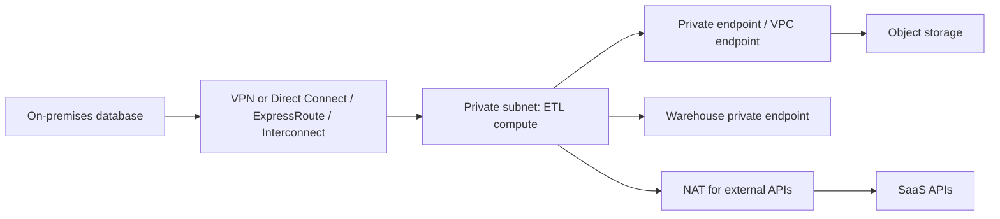

## Introduction

"The job can't reach the database" is the most common cloud pipeline failure that is not a code bug. Knowing a few networking building blocks lets you debug it and design private, cheaper data paths.

## Definition

| Concept | AWS | Azure | Google Cloud |
|---|---|---|---|
| Private network | VPC (regional) | VNet (regional) | VPC (global, subnets regional) |
| Subnet | Per availability zone | Per VNet, spans zones | Per region |
| Instance firewall | Security groups (stateful) | Network security groups | VPC firewall rules / policies |
| Outbound internet for private hosts | NAT gateway | NAT Gateway | Cloud NAT |
| Private access to managed services | VPC endpoints (gateway for S3/DynamoDB, interface via PrivateLink) | Private endpoints (Private Link), service endpoints | Private Google Access, Private Service Connect |
| Network-to-network | VPC peering, Transit Gateway | VNet peering, Virtual WAN | VPC peering, Network Connectivity Center |
| Hybrid | Site-to-Site VPN, Direct Connect | VPN Gateway, ExpressRoute | Cloud VPN, Cloud Interconnect |

## Why it matters

Pipelines move large volumes between storage, compute and databases. The route decides security (public internet or not), reliability and cost: NAT and cross-region or internet egress are charged per GB.

## How it works

- A network has an address range in CIDR notation, for example `10.20.0.0/16`, split into subnets such as `10.20.1.0/24`.
- **Public subnets** route to an internet gateway; **private subnets** have no inbound route from the internet and reach out via NAT.
- **Security groups / NSGs / firewall rules** allow traffic by port, protocol and source. Security groups are stateful: return traffic is allowed automatically.
- **Private endpoints** put a managed service (storage, warehouse, Key Vault) on a private IP in your network, with private DNS resolving the service name to it.
- **DNS** matters: a private endpoint only works if the job resolves the service hostname to the private IP.

## Syntax and configuration

AWS: an S3 gateway endpoint so private subnets reach S3 without NAT:

```bash
aws ec2 create-vpc-endpoint --vpc-id vpc-0abc --service-name com.amazonaws.eu-west-1.s3 \
  --vpc-endpoint-type Gateway --route-table-ids rtb-0priv1 rtb-0priv2
```

Azure: a private endpoint for a storage account's `dfs` sub-resource:

```bash
az network private-endpoint create --name pe-lake-dfs --resource-group rg-data \
  --vnet-name vnet-data --subnet snet-private \
  --private-connection-resource-id $(az storage account show -n acmelake -g rg-data --query id -o tsv) \
  --group-id dfs --connection-name lake-dfs
```

Google Cloud: enable Private Google Access on a subnet:

```bash
gcloud compute networks subnets update etl-subnet --region=europe-west1 \
  --enable-private-ip-google-access
```

A security group rule as IaC (CloudFormation YAML) allowing PostgreSQL only from the ETL security group:

```yaml
DbIngress:
  Type: AWS::EC2::SecurityGroupIngress
  Properties:
    GroupId: !Ref DatabaseSG
    IpProtocol: tcp
    FromPort: 5432
    ToPort: 5432
    SourceSecurityGroupId: !Ref EtlJobSG
```

## Examples

Debugging "connection timed out" from a Glue job to RDS PostgreSQL:

1. Is the Glue connection in the same VPC and a subnet that routes to the database subnet?
2. Does the database security group allow port 5432 from the Glue security group?
3. Does the Glue security group have the self-referencing rule Glue requires?
4. Does the job also need S3? Then the subnet needs an S3 endpoint or NAT.

A timeout usually means network path or firewall; "connection refused" or "password authentication failed" means you reached the host.

## Architecture



## Practical example

A nightly Spark job in private subnets reads 2 TB from S3. Without an endpoint, traffic goes through a NAT gateway that charges per GB processed. Adding the S3 gateway endpoint routes S3 traffic privately and removes the NAT processing charge for that traffic. Azure private endpoints and Private Google Access solve the same problem on the other clouds, though their pricing mechanisms differ.

## Exercises

1. Two VPCs both use `10.0.0.0/16`. Can you peer them?
<details><summary>Answer</summary>No. Peered networks need non-overlapping address ranges. Plan CIDRs up front.</details>

2. A job in a private subnet must call a public SaaS API. What does it need?
<details><summary>Answer</summary>A NAT gateway (or Cloud NAT / Azure NAT Gateway) route for outbound traffic, plus firewall rules allowing egress.</details>

3. A private endpoint exists for a storage account but the job still uses a public IP. Likely cause?
<details><summary>Answer</summary>DNS. The private DNS zone is not linked to the network, so the hostname resolves to the public address.</details>

## Common mistakes

- Overlapping CIDR ranges that block later peering or hybrid links.
- Opening `0.0.0.0/0` on database ports to "make it work".
- Sending large S3/GCS/ADLS traffic through NAT instead of private endpoints.
- Forgetting private DNS for private endpoints.
- Putting compute and storage in different regions.

## Performance and best practices

- Keep data, compute and warehouse in one region.
- Use private endpoints for storage, warehouses, secret stores and databases.
- Reference security groups instead of IP ranges where possible.
- Use dedicated links (Direct Connect, ExpressRoute, Interconnect) for large steady hybrid transfers.
- Turn on flow logs to debug connectivity.

## Interview questions

### What is the difference between a public and a private subnet?

A public subnet has a route to an internet gateway, so resources with public IPs are reachable. A private subnet does not; resources reach the internet only outbound via NAT, if at all.

### What is a VPC endpoint / private endpoint?

A private path from your network to a managed service, so traffic stays on the provider's network and the service can be locked to that path. AWS gateway endpoints cover S3 and DynamoDB; interface endpoints (PrivateLink) and Azure private endpoints give the service a private IP.

### Security group vs network ACL on AWS?

Security groups are stateful and attach to network interfaces with allow rules only. Network ACLs are stateless, attach to subnets and support allow and deny rules.

### How do you connect a cloud pipeline to an on-premises database?

Site-to-site VPN for modest volume, or a dedicated link such as Direct Connect, ExpressRoute or Cloud Interconnect. Allow the cloud subnet in on-prem firewalls and set up DNS. Azure Data Factory can also use a self-hosted integration runtime inside the data centre.

## Quick revision

- VPC / VNet / VPC (global on Google Cloud).
- Private subnets + NAT for outbound.
- Security groups, NSGs, firewall rules.
- Private endpoints keep storage traffic private and off NAT.
- Plan non-overlapping CIDRs.
- Timeout = network path; refused/auth error = reached host.
