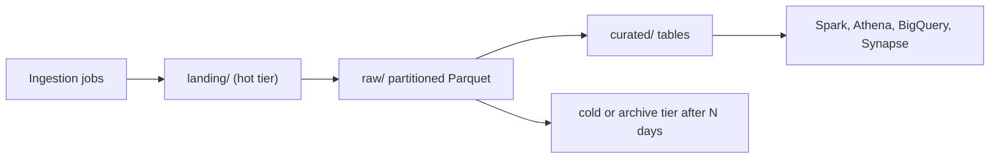

## Introduction

Almost every cloud data platform starts with object storage. It is cheap, durable and effectively unlimited, and every engine (Spark, Athena, BigQuery, Synapse) can read it.

## Definition

Object storage keeps data as **objects**: a byte blob, a **key** (name) and metadata, inside a **bucket** (S3, GCS) or **container** (Azure Blob / ADLS Gen2). There is no in-place update: you write a whole object or replace it.

| Concept | AWS S3 | Azure ADLS Gen2 | Google Cloud Storage |
|---|---|---|---|
| Top level | Bucket | Storage account > container | Bucket |
| Path scheme | `s3://bucket/key` | `abfss://container@account.dfs.core.windows.net/path` | `gs://bucket/object` |
| Directories | Key prefixes (flat) | Real directories (hierarchical namespace) | Prefixes (flat; optional hierarchical namespace on new buckets) |
| Tiers | Standard, Intelligent-Tiering, Standard-IA, Glacier classes | Hot, Cool, Cold, Archive | Standard, Nearline, Coldline, Archive |

## Why it matters

File layout in object storage decides how fast and how cheaply every downstream query runs. Tiers and lifecycle rules decide a large part of the storage bill.

## How it works

- **Durability:** data is replicated across devices and, depending on the redundancy option, zones or regions.
- **Consistency:** S3, GCS and Azure Blob all offer strong read-after-write consistency for object writes and lists today.
- **Listing:** listing a prefix is an API call that pages through keys; millions of tiny files make listing slow.
- **Renames:** on flat namespaces a "rename" is copy plus delete per object, so renaming a directory is not atomic. ADLS Gen2 hierarchical namespace makes directory renames atomic.
- **Tiers:** colder tiers cost less to store but more to read, and may have minimum storage durations and retrieval delays.

## Syntax and configuration

The same task on each cloud:

```bash
aws s3 cp orders.parquet s3://acme-lake/raw/orders/dt=2024-06-01/
az storage fs file upload --account-name acmelake --file-system raw \
  --path orders/dt=2024-06-01/orders.parquet --source orders.parquet --auth-mode login
gcloud storage cp orders.parquet gs://acme-lake/raw/orders/dt=2024-06-01/
```

An S3 lifecycle rule that moves old raw data to a colder class and expires it later:

```json
{
  "Rules": [{
    "ID": "raw-orders-tiering",
    "Filter": {"Prefix": "raw/orders/"},
    "Status": "Enabled",
    "Transitions": [{"Days": 30, "StorageClass": "STANDARD_IA"},
                    {"Days": 180, "StorageClass": "GLACIER"}],
    "Expiration": {"Days": 730}
  }]
}
```

## Examples

List one partition's objects with boto3, paging correctly:

```python-syntax
import boto3

s3 = boto3.client("s3")
paginator = s3.get_paginator("list_objects_v2")
total = 0
for page in paginator.paginate(Bucket="acme-lake", Prefix="raw/orders/dt=2024-06-01/"):
    for obj in page.get("Contents", []):
        total += obj["Size"]
print(f"{total / 1e6:.1f} MB")
```

## Architecture

Files flow from a landing prefix to curated prefixes; lifecycle rules age the raw copies into cold tiers.



## Practical example

Layout for an orders feed:

```text
s3://acme-lake/raw/orders/dt=2024-06-01/part-0000.parquet
s3://acme-lake/raw/orders/dt=2024-06-02/part-0000.parquet
s3://acme-lake/curated/orders/order_date=2024-06-01/...
```

- `key=value` folders are Hive-style partitions; engines prune on them.
- Aim for files in the roughly 100 MB to 1 GB range rather than thousands of kilobyte files.
- Write to a temporary prefix and publish via a table format commit (Delta, Iceberg) or a manifest, so readers never see half-written output.

## Exercises

1. Why is renaming a "folder" in S3 slow and non-atomic?
<details><summary>Answer</summary>S3 has no folders, only key prefixes. A rename copies and deletes each object separately.</details>

2. A job writes 50,000 files of 10 KB per day. What problems follow?
<details><summary>Answer</summary>Slow listing, high per-request cost, and slow queries because engines open many tiny files. Compact into larger files.</details>

3. When is an archive tier a bad choice?
<details><summary>Answer</summary>When data is read often or needs fast access. Archive tiers charge for retrieval, may take hours to restore and have minimum storage durations.</details>

## Common mistakes

- Public buckets or containers by accident; block public access at account level.
- Tiny files from streaming or over-partitioning.
- Partitioning by a high-cardinality column such as `customer_id`.
- Moving data to cold tiers that are still queried daily.
- Assuming a directory rename is atomic on S3 or GCS flat buckets.

## Performance and best practices

- Columnar formats (Parquet, ORC) with compression.
- Partition by date or another low-cardinality filter column.
- Use lifecycle rules, versioning for important buckets and object lock or retention policies for compliance data.
- Keep compute and storage in the same region.
- Use VPC endpoints / private endpoints / Private Google Access to reach storage privately.

## Interview questions

### What is the difference between block, file and object storage?

Block storage gives raw disk volumes to one machine. File storage gives a shared POSIX file system. Object storage gives an HTTP API over whole objects with keys and metadata; it scales furthest and is cheapest, but has no in-place edits.

### Why does a data lake prefer Parquet over CSV in object storage?

Parquet is columnar and compressed and stores statistics, so engines read only needed columns and skip row groups. CSV must be read in full and has no types.

### What does the ADLS Gen2 hierarchical namespace add?

Real directories, atomic directory renames and deletes, and POSIX-style ACLs, which make commits and permissioning for analytics engines simpler.

### How do lifecycle policies save money?

They move objects to colder tiers or delete them automatically based on age or prefix, so you do not pay hot-tier prices for data no one reads.

## Quick revision

- Bucket/container + key + bytes; no in-place updates.
- S3 / ADLS Gen2 / GCS; paths `s3://`, `abfss://`, `gs://`.
- Strong read-after-write consistency on all three.
- Hive-style `key=value` prefixes enable partition pruning.
- Avoid tiny files; target large Parquet files.
- Lifecycle rules + tiers control storage cost.
