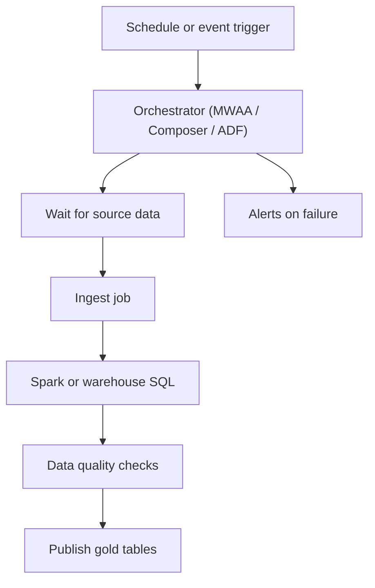

## Introduction

Pipelines are many steps with dependencies, schedules and retries. Orchestrators run those steps in order and tell you when something breaks. Every cloud offers managed Airflow plus a native option.

## Definition

| Need | AWS | Azure | Google Cloud |
|---|---|---|---|
| Managed Airflow | MWAA | Workflow Orchestration Manager in ADF (managed Airflow), or Airflow on AKS | Cloud Composer |
| Native pipeline service | Glue workflows, Step Functions | Azure Data Factory / Fabric Data Factory pipelines | Workflows, Cloud Scheduler |
| Event triggers | EventBridge | Event Grid, ADF storage event triggers | Eventarc, Pub/Sub |

## Why it matters

Orchestration choice affects how pipelines are written (Python DAGs vs visual pipelines vs JSON state machines), how they are tested, and how portable they are between clouds.

## How it works

- **Managed Airflow:** the provider runs the scheduler, web server, metadata database and workers. You upload DAG files to a bucket (S3 for MWAA, GCS for Composer); the scheduler parses them.
- **ADF:** pipelines are JSON definitions of activities with dependency conditions (succeeded, failed, completed), triggered by schedule, tumbling window or storage events.
- **Step Functions / Workflows:** state machines described in JSON or YAML; good for short service-to-service flows with branching and retries.
- The orchestrator should **trigger and monitor** heavy work (Spark, warehouse SQL), not do it on its own workers.

## Syntax and configuration

Deploy a DAG to MWAA and to Composer:

```bash
aws s3 cp dags/orders_daily.py s3://acme-mwaa-dags/dags/
gcloud composer environments storage dags import \
  --environment=acme-composer --location=europe-west1 --source=dags/orders_daily.py
```

A Step Functions state with retry (Amazon States Language):

```json
{
  "StartAt": "RunGlue",
  "States": {
    "RunGlue": {
      "Type": "Task",
      "Resource": "arn:aws:states:::glue:startJobRun.sync",
      "Parameters": {"JobName": "orders-to-silver"},
      "Retry": [{"ErrorEquals": ["States.ALL"], "IntervalSeconds": 60,
                 "MaxAttempts": 2, "BackoffRate": 2.0}],
      "End": true
    }
  }
}
```

A Google Cloud Workflows definition:

```yaml
main:
  steps:
    - load:
        call: googleapis.bigquery.v2.jobs.insert
        args:
          projectId: acme-data-prod
          body:
            configuration:
              query:
                query: CALL marts.build_daily_sales()
                useLegacySql: false
        result: job
    - done:
        return: ${job.jobReference.jobId}
```

## Examples

An Airflow DAG that runs on MWAA or Composer, triggering cloud services through provider operators:

```python-syntax
from datetime import datetime
from airflow import DAG
from airflow.providers.amazon.aws.operators.glue import GlueJobOperator
from airflow.providers.amazon.aws.sensors.s3 import S3KeySensor

with DAG("orders_daily", start_date=datetime(2024, 1, 1),
         schedule="@daily", catchup=False,
         default_args={"retries": 2}) as dag:
    wait = S3KeySensor(task_id="wait_for_file",
                       bucket_key="s3://acme-raw/orders/dt={{ ds }}/_SUCCESS",
                       mode="reschedule", timeout=6 * 3600)
    transform = GlueJobOperator(task_id="to_silver", job_name="orders-to-silver",
                                script_args={"--run_date": "{{ ds }}"})
    wait >> transform
```

On Composer the equivalents are `GCSObjectExistenceSensor` and `DataprocSubmitJobOperator` or `BigQueryInsertJobOperator`.

## Architecture



## Practical example

Choosing for three teams:

- Team A already writes Airflow DAGs and runs on Google Cloud: Cloud Composer.
- Team B is mostly copying SaaS and SQL Server data on Azure, with few engineers: Data Factory pipelines.
- Team C needs a 4-step flow (Lambda, Glue, notification) with branching: Step Functions; adding Airflow would be overkill.

## Exercises

1. Why use `mode="reschedule"` on a long sensor in managed Airflow?
<details><summary>Answer</summary>It frees the worker slot between checks, so a sensor waiting hours does not block other tasks.</details>

2. Where do DAG files live in MWAA and Composer?
<details><summary>Answer</summary>In a storage bucket: S3 for MWAA, GCS for Composer. The scheduler syncs them from there.</details>

3. A DAG task loads a 5 GB CSV with pandas on the Airflow worker. What is wrong?
<details><summary>Answer</summary>The orchestrator is doing heavy compute. Workers are small and shared; push the work to Spark, a container job or the warehouse.</details>

## Common mistakes

- Heavy processing on Airflow workers.
- Top-level code in DAG files that calls APIs or databases on every parse.
- No retries or timeouts, or retries on non-idempotent tasks.
- Mixing several orchestrators for one pipeline without clear ownership.
- Hard-coding environment names instead of using connections and variables.

## Performance and best practices

- Keep DAGs and ADF pipelines in Git with CI deployment.
- Make every task idempotent and parameterised by the run date.
- Use deferrable operators or reschedule-mode sensors.
- Size managed Airflow environments by number of DAGs and concurrent tasks; they bill while running even when idle.
- Send failures to alerts, not only to the UI.

## Interview questions

### MWAA vs Step Functions?

MWAA runs Airflow: Python DAGs, rich scheduling, backfills and a large operator ecosystem, but an always-on environment. Step Functions is a serverless state machine billed per transition or duration, better for short event-driven flows with branching.

### What is an ADF integration runtime?

The compute that runs ADF copy and data flow activities: Azure-hosted, self-hosted (on your machines for private networks) or Azure-SSIS for legacy SSIS packages.

### Should the orchestrator transform data?

No. It should trigger and monitor compute engines and record state. Doing heavy work on orchestrator workers makes scheduling slow and fragile.

### How does Cloud Composer relate to Airflow?

It is a managed Airflow environment on Google Cloud. You write standard Airflow DAGs; Google manages the scheduler, database, web server and workers on GKE.

## Quick revision

- Managed Airflow: MWAA, Composer, ADF Workflow Orchestration Manager.
- Native: Step Functions, ADF pipelines, Google Cloud Workflows.
- DAGs deployed via a bucket.
- Orchestrate, do not compute.
- Idempotent, parameterised, retried tasks.
- Reschedule or deferrable sensors.
