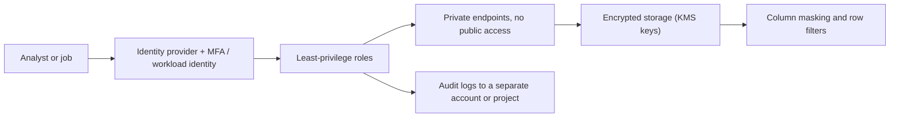

## Introduction

Data platforms concentrate an organisation's most sensitive data in one place. Security is a set of layers: identity, network, encryption, secrets, data-level controls and audit.

## Definition

Under the **shared responsibility model**, the provider secures the physical data centres, hardware and managed service internals. You secure your identities, permissions, network exposure, data classification, encryption key choices and application code.

| Control | AWS | Azure | Google Cloud |
|---|---|---|---|
| Key management | KMS | Key Vault (keys), Managed HSM | Cloud KMS |
| Secrets | Secrets Manager, SSM Parameter Store | Key Vault (secrets) | Secret Manager |
| API audit | CloudTrail | Activity log, resource logs | Cloud Audit Logs |
| Threat detection / posture | GuardDuty, Security Hub | Microsoft Defender for Cloud | Security Command Center |
| Sensitive data discovery | Macie | Purview | Sensitive Data Protection |
| Org guardrails | Service control policies | Azure Policy | Organization policies |

## Why it matters

Most cloud data breaches come from misconfiguration: public buckets, leaked keys, over-broad permissions. These are on the customer side of the shared responsibility line.

## How it works

- **Encryption at rest** is on by default for S3, Azure Storage and GCS. Customer-managed keys (CMK/CMEK) let you control rotation, access and revocation of the key.
- **Envelope encryption:** data is encrypted with a data key; the data key is encrypted with a master key in KMS. Revoking the master key makes data unreadable.
- **Encryption in transit:** TLS for all endpoints; enforce it with policies.
- **Secrets** live in a secret store and are fetched at runtime by an identity, never committed to Git.
- **Data-level controls:** column masking, row-level security and tag-based policies in Lake Formation, Unity Catalog, Synapse/Fabric or BigQuery policy tags.

## Syntax and configuration

S3 bucket policy that denies non-TLS access:

```json
{
  "Version": "2012-10-17",
  "Statement": [{
    "Sid": "DenyInsecureTransport",
    "Effect": "Deny",
    "Principal": "*",
    "Action": "s3:*",
    "Resource": ["arn:aws:s3:::acme-lake", "arn:aws:s3:::acme-lake/*"],
    "Condition": {"Bool": {"aws:SecureTransport": "false"}}
  }]
}
```

Block public access and set default KMS encryption:

```bash
aws s3api put-public-access-block --bucket acme-lake \
  --public-access-block-configuration \
  BlockPublicAcls=true,IgnorePublicAcls=true,BlockPublicPolicy=true,RestrictPublicBuckets=true
aws s3api put-bucket-encryption --bucket acme-lake --server-side-encryption-configuration \
  '{"Rules":[{"ApplyServerSideEncryptionByDefault":{"SSEAlgorithm":"aws:kms","KMSMasterKeyID":"alias/lake"}}]}'
```

## Examples

Read a database password at runtime on each cloud:

```python-syntax
# AWS
import boto3
pw = boto3.client("secretsmanager").get_secret_value(SecretId="prod/orders-db")["SecretString"]

# Azure
from azure.identity import DefaultAzureCredential
from azure.keyvault.secrets import SecretClient
pw = SecretClient("https://kv-acme.vault.azure.net", DefaultAzureCredential()).get_secret("orders-db").value

# Google Cloud
from google.cloud import secretmanager
c = secretmanager.SecretManagerServiceClient()
pw = c.access_secret_version(name="projects/acme/secrets/orders-db/versions/latest").payload.data.decode()
```

PostgreSQL row-level security shows the same idea locally (syntax only):

```sql-syntax
ALTER TABLE orders ENABLE ROW LEVEL SECURITY;
CREATE POLICY region_rep ON orders
  USING (ship_country = current_setting('app.country'));
```

## Architecture

Defence in depth around a lake:



## Practical example

Handling a customer table with emails and phone numbers:

1. Tag the columns as PII in the catalog (Lake Formation LF-tags, Purview classifications, BigQuery policy tags).
2. Grant raw access only to a small group; others see masked or hashed values.
3. Encrypt the bucket with a customer-managed key limited to pipeline roles.
4. Send audit logs to a separate security account/project with retention locks.
5. Alert on access from unexpected principals.

## Exercises

1. Is encrypting S3 with the default key enough to stop an over-permissioned IAM role reading data?
<details><summary>Answer</summary>No. Default encryption protects disks; anyone authorised to read the object gets it decrypted. Access control is still IAM and bucket policy. A CMK adds a second gate through its key policy.</details>

2. Where should a pipeline's database password live?
<details><summary>Answer</summary>In Secrets Manager, Key Vault or Secret Manager, fetched at runtime by the job's role, managed identity or service account.</details>

3. Why send audit logs to a separate account or project?
<details><summary>Answer</summary>An attacker who compromises the data account cannot delete or alter the evidence.</details>

## Common mistakes

- Public buckets, or SAS tokens and presigned URLs with very long expiry.
- Secrets in environment files, notebooks or Git history.
- One admin role used by every pipeline.
- Copying production PII into dev without masking.
- Turning off audit logs to save money.

## Performance and best practices

- Enforce guardrails centrally (SCPs, Azure Policy, organization policies).
- Rotate secrets and keys; prefer identities that need no secrets.
- Classify data and apply column/row controls in the catalog.
- Use private networking for storage, warehouses and secret stores.
- Scan IaC for misconfigurations in CI.
- KMS calls add a small latency and request cost; S3 Bucket Keys reduce KMS request volume.

## Interview questions

### What is the shared responsibility model?

The provider secures the cloud infrastructure; the customer secures what they put in it: identities, permissions, configuration, data and code. Managed services shift more responsibility to the provider, but data access stays with you.

### What is envelope encryption?

Data is encrypted with a data key, and that data key is encrypted by a master key held in KMS. Only the small data key goes to KMS for decryption, and revoking the master key cuts off access to all data it protects.

### How would you protect PII in a warehouse?

Classify and tag columns, apply masking or column-level security, row-level policies where needed, restrict raw access to few roles, tokenise or hash where analysis does not need raw values, and audit access.

### How do you keep secrets out of code?

Store them in a managed secret store, grant the workload identity read access, fetch at runtime, and scan repositories for leaked secrets.

## Quick revision

- Shared responsibility: you own identity, config and data.
- Encryption at rest is default; CMKs add control.
- Secrets in Secrets Manager / Key Vault / Secret Manager.
- Block public access; enforce TLS.
- Column masking and row filters for PII.
- Audit logs (CloudTrail, Activity log, Audit Logs) kept separate.
