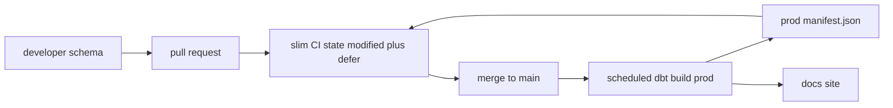

## Introduction

A dbt project on a laptop is not a pipeline. Deployment means running the same code in separate environments, testing pull requests cheaply, and scheduling production builds that stop on bad data.

## Definition

dbt deployment is the set of practices for running dbt outside development:

- **Targets**: per-environment connections in `profiles.yml` (`dev`, `ci`, `prod`), chosen with `--target`.
- **Jobs**: scheduled commands such as `dbt build`, run by dbt Cloud, Airflow, Dagster, GitHub Actions or cron.
- **Slim CI**: build only changed models and their children, using `--select state:modified+` and `--defer` against production artifacts.

## Why it matters

Building the whole project on every pull request is slow and expensive. Building nothing lets broken SQL reach production. Slim CI gives fast, isolated checks.

## How it works

1. Each developer uses their own schema (`dbt_alice`). CI uses a temporary schema per pull request (`dbt_ci_pr_123`). Production uses `analytics`.
2. Every production run writes `target/manifest.json`. Save it as an artifact.
3. In CI, `--state path/to/prod_artifacts` lets dbt compare the PR's manifest with production's. `state:modified` selects nodes whose SQL, config or macros changed.
4. `--defer` makes `ref()` to unbuilt, unchanged parents resolve to production relations instead of failing.
5. `dbt build` runs seeds, models, snapshots and tests in DAG order and skips children of failures.
6. `dbt retry` (1.6+) re-runs only the nodes that failed or were skipped in the last run.

## Syntax and configuration

`profiles.yml` with environment variables:

```yaml
northwind:
  target: dev
  outputs:
    dev:
      type: postgres
      host: localhost
      user: "{{ env_var('DBT_USER') }}"
      password: "{{ env_var('DBT_PASSWORD') }}"
      port: 5432
      dbname: northwind
      schema: "dbt_{{ env_var('DBT_USER') }}"
      threads: 4
    prod:
      type: postgres
      host: "{{ env_var('DBT_HOST') }}"
      user: "{{ env_var('DBT_USER') }}"
      password: "{{ env_var('DBT_PASSWORD') }}"
      port: 5432
      dbname: northwind
      schema: analytics
      threads: 8
```

Selectors in `selectors.yml`:

```yaml
selectors:
  - name: nightly
    definition:
      union:
        - method: tag
          value: daily
        - method: source
          value: northwind
          children: true
      # exclude slow tables from the nightly job
  - name: no_heavy
    definition:
      exclude:
        - method: tag
          value: heavy
```

Commands:

```bash
# production job
dbt deps
dbt source freshness
dbt build --target prod --selector nightly
dbt docs generate --target prod

# slim CI on a pull request
dbt deps
dbt build --target ci --select state:modified+ --defer --state ./prod-artifacts

# useful selection syntax
dbt build --select "tag:daily,config.materialized:incremental"   # intersection
dbt build --select fct_orders+ --exclude tag:heavy
dbt build --select result:error+ --state ./target                 # failures and children
dbt retry
```

GitHub Actions job outline:

```yaml
name: dbt-ci
on: pull_request
jobs:
  slim-ci:
    runs-on: ubuntu-latest
    steps:
      - uses: actions/checkout@v4
      - run: pip install dbt-postgres
      - run: aws s3 cp s3://dbt-artifacts/prod/manifest.json prod-artifacts/manifest.json
      - run: dbt deps
      - run: dbt build --target ci --select state:modified+ --defer --state prod-artifacts
        env:
          DBT_PASSWORD: ${{ secrets.DBT_PASSWORD }}
```

## Examples

Model contracts (1.5+) guard public models in production. The build fails if the SQL's columns or types do not match:

```yaml
models:
  - name: fct_orders
    config:
      contract:
        enforced: true
    columns:
      - name: order_id
        data_type: integer
        constraints:
          - type: not_null
          - type: primary_key
      - name: order_date
        data_type: date
```

A post-run check a job might query in production, rows built per year:

```sql
SELECT EXTRACT(YEAR FROM order_date)::int AS order_year, COUNT(*) AS orders
FROM orders
GROUP BY 1
ORDER BY 1;
```

## Architecture



## Practical example

An Airflow DAG with three tasks: `dbt source freshness`, `dbt build --selector nightly`, then `dbt docs generate` and upload artifacts. Each task is a `BashOperator`, or use Astronomer Cosmos to render each dbt model as its own Airflow task for per-model retries.

## Exercises

1. Why does slim CI need `--defer`?
   <details><summary>Answer</summary>Only modified models are built in the CI schema. Their unmodified parents do not exist there, so `--defer` resolves those `ref()`s to production relations.</details>
2. What does `state:modified+` select?
   <details><summary>Answer</summary>Nodes whose definition differs from the manifest given by `--state`, plus all their descendants.</details>
3. A nightly run failed halfway. How do you resume without rebuilding everything?
   <details><summary>Answer</summary>`dbt retry`, or `dbt build --select result:error+ result:skipped+ --state target`.</details>

## Common mistakes

- Sharing one schema between developers and CI.
- Using `dbt run` in production without tests.
- Not storing production `manifest.json`, which makes state comparison impossible.
- Committing credentials instead of using `env_var()`.
- Running `--full-refresh` on huge incremental models in CI by accident; set `full_refresh: false` on them.

## Performance and best practices

- Tag models by schedule (`daily`, `hourly`) and run each tag in its own job.
- Use slim CI and drop CI schemas after the PR closes.
- Run `dbt source freshness` first and skip the build when sources are stale.
- Raise `threads` in prod to the warehouse's concurrency limit.
- Enforce contracts and versions on models other teams depend on.

## Interview questions

### How would you set up CI for a dbt project?

On each pull request, build into a temporary schema with `dbt build --select state:modified+ --defer --state <prod artifacts>`, so only changed models and their children are built and tested while unchanged parents come from production.

### What are targets?

Named outputs in `profiles.yml`, one per environment, with their own connection and schema. `--target` picks one, and `target.name` is available in Jinja.

### How do you schedule dbt in production?

With dbt Cloud jobs or an orchestrator such as Airflow, Dagster or GitHub Actions running `dbt deps`, `dbt source freshness`, `dbt build` and `dbt docs generate`, storing artifacts after each run.

### What do selectors and YAML selectors give you?

A way to choose nodes by name, path, tag, config, state or result, with graph operators (`+`, `@`) and set logic (union, intersection, exclude). `selectors.yml` names reusable definitions.

## Quick revision

- Separate targets and schemas for dev, CI and prod.
- Production: `dbt build`, not `run` then `test`.
- Slim CI: `--select state:modified+ --defer --state <prod>`.
- Store `manifest.json` from every prod run.
- `selectors.yml` for reusable selections; `dbt retry` after failures.
- Credentials via `env_var()`; contracts for public models.
