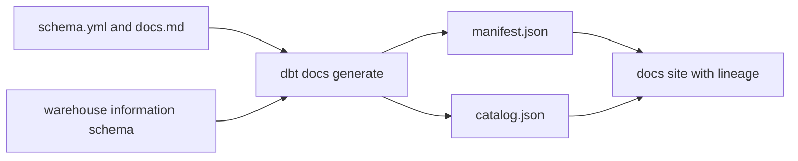

## Introduction

Analysts need to know what `fct_orders.order_amount` means and where it comes from. dbt keeps documentation next to the code and generates a browsable site with a lineage graph.

## Definition

dbt documentation consists of:

- `description:` fields on models, columns, sources, seeds, snapshots and macros in YAML.
- **docs blocks**: ` ... ` in `.md` files, referenced with `{{ doc('name') }}`.
- `meta:` for custom key-value data such as owner or PII flags.
- The generated site: `dbt docs generate` writes `manifest.json` and `catalog.json`; `dbt docs serve` hosts them.

## Why it matters

Docs that live in a wiki go stale. Docs in the same pull request as the SQL get reviewed together. The lineage graph shows impact before you change a model.

## How it works

1. `dbt docs generate` compiles the project into `target/manifest.json` (nodes, descriptions, lineage).
2. It queries the warehouse's information schema for `target/catalog.json` (column types, row counts).
3. `index.html` in `target/` reads both files. `dbt docs serve` runs a local web server for it.
4. `persist_docs` can also write descriptions as database comments.

## Syntax and configuration

`models/marts/schema.yml`:

```yaml
version: 2

models:
  - name: fct_orders
    description: "{{ doc('fct_orders') }}"
    meta:
      owner: analytics-team
      contains_pii: false
    columns:
      - name: order_id
        description: Primary key. One row per order.
        data_tests: [unique, not_null]
      - name: order_amount
        description: "{{ doc('order_amount') }}"
```

`models/marts/docs.md`:

```jinja

One row per Northwind order with its net amount.

Built from `stg_orders` and `stg_order_details`. Excludes test customers.



Sum of `unit_price * quantity * (1 - discount)` across the order's lines, before freight.

```

Write descriptions to the database:

```yaml
models:
  northwind_analytics:
    +persist_docs:
      relation: true
      columns: true
```

```bash
dbt docs generate
dbt docs serve --port 8080
```

## Examples

With `persist_docs` on PostgreSQL, dbt runs `comment on` statements, which you can read back from the catalog:

```sql
SELECT c.relname AS table_name,
       COALESCE(obj_description(c.oid, 'pg_class'), '(no description)') AS description
FROM pg_class c
JOIN pg_namespace n ON n.oid = c.relnamespace
WHERE n.nspname = 'public' AND c.relkind = 'r'
ORDER BY c.relname
LIMIT 5;
```

## Architecture



## Practical example

In CI, run `dbt docs generate` after `dbt build` and publish `target/index.html`, `manifest.json` and `catalog.json` to static hosting such as S3 or GitHub Pages. Use `dbt-codegen`'s `generate_model_yaml` to scaffold column lists so nobody starts from a blank YAML file.

## Exercises

1. Which two JSON files does the docs site need?
   <details><summary>Answer</summary>`manifest.json` (project structure and descriptions) and `catalog.json` (warehouse metadata).</details>
2. The same long description applies to `customer_id` in five models. How do you avoid copying it?
   <details><summary>Answer</summary>Write one `` block and use `description: "{{ doc('customer_id') }}"` in each.</details>

## Common mistakes

- Documenting only models and not columns.
- Forgetting quotes around `"{{ doc('x') }}"` in YAML.
- Running `docs serve` in production instead of hosting static files.
- Descriptions that repeat the column name instead of explaining meaning and grain.

## Performance and best practices

- Always state the grain: "one row per order line".
- Track owners and PII in `meta`.
- Enforce documentation in CI with packages like `dbt-checkpoint` or `dbt_project_evaluator`.
- `catalog.json` generation can be slow on huge warehouses; limit with `--select` in dbt 1.7+ (`dbt docs generate --select`).

## Interview questions

### How do you document a dbt project?

With `description` fields and docs blocks in YAML and Markdown, `meta` for metadata, then `dbt docs generate` to build a site with lineage, optionally `persist_docs` to the warehouse.

### What is a docs block?

A reusable Markdown block defined with `` and referenced with `{{ doc('name') }}` in any description.

### What does the lineage graph show?

The DAG from sources and seeds through models to exposures, built from `ref` and `source` calls, used for impact analysis.

## Quick revision

- `description:` in YAML; docs blocks for long or shared text.
- `meta:` for owner and PII flags.
- `dbt docs generate` makes manifest + catalog; `dbt docs serve` hosts locally.
- `persist_docs` writes comments to the database.
- Always describe grain and primary key.
