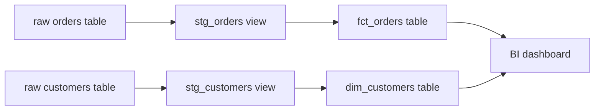

## Introduction

dbt (data build tool) is the "T" in ELT. Raw data is already loaded into the warehouse. You write `SELECT` statements, and dbt turns them into tables and views in the right order, tests them and documents them.

## Definition

dbt is a command-line tool (dbt Core) and a hosted service (dbt Cloud). It compiles Jinja-templated SQL files called **models** into plain SQL and runs them against a warehouse such as PostgreSQL, Snowflake, BigQuery or Databricks. dbt never moves data between systems. All work happens inside the warehouse.

## Why it matters

Before dbt, transformations lived in stored procedures, cron scripts or ad-hoc views. They had no version control, no tests and no dependency graph. dbt brings software engineering practice to SQL: Git, code review, automated tests, environments and generated docs. "Analytics engineer" as a job title grew out of it.

## How it works

1. You write models as `SELECT` statements in `models/*.sql`.
2. Models reference each other with `{{ ref('model_name') }}` and raw tables with `{{ source('src', 'table') }}`.
3. dbt parses every file and builds a DAG (directed acyclic graph) from those calls.
4. `dbt run` compiles each model to SQL and wraps it in DDL (`CREATE VIEW AS` or `CREATE TABLE AS`), in DAG order.
5. `dbt test` runs assertions. `dbt build` runs models, tests, seeds and snapshots together, in DAG order.

The connection details live outside the project, in `profiles.yml`, so the same code runs against dev and prod.

## Syntax and configuration

A minimal project:

```text
my_project/
  dbt_project.yml
  models/
    staging/
      _sources.yml
      stg_orders.sql
    marts/
      fct_orders.sql
      schema.yml
  seeds/
  snapshots/
  macros/
  tests/
```

`dbt_project.yml`:

```yaml
name: northwind_analytics
version: "1.0.0"
config-version: 2
profile: northwind

model-paths: ["models"]
seed-paths: ["seeds"]
snapshot-paths: ["snapshots"]
macro-paths: ["macros"]
test-paths: ["tests"]

models:
  northwind_analytics:
    staging:
      +materialized: view
    marts:
      +materialized: table
```

`~/.dbt/profiles.yml` (PostgreSQL adapter):

```yaml
northwind:
  target: dev
  outputs:
    dev:
      type: postgres
      host: localhost
      port: 5432
      user: analyst
      password: "{{ env_var('DBT_PASSWORD') }}"
      dbname: northwind
      schema: dbt_dev
      threads: 4
```

Core commands:

```bash
pip install dbt-postgres          # installs dbt-core plus the adapter
dbt init northwind_analytics      # scaffold a project
dbt debug                         # check profile and connection
dbt deps                          # install packages from packages.yml
dbt run                           # build models
dbt test                          # run tests
dbt build                         # seeds + models + snapshots + tests in DAG order
dbt compile --select fct_orders   # write compiled SQL to target/compiled
```

## Examples

A staging model, `models/staging/stg_orders.sql`:

```jinja
select
    order_id,
    customer_id,
    employee_id,
    order_date,
    shipped_date,
    freight
from {{ source('northwind', 'orders') }}
```

A mart that depends on it:

```jinja
select
    customer_id,
    count(*)     as order_count,
    sum(freight) as total_freight
from {{ ref('stg_orders') }}
group by customer_id
```

The compiled SQL (dbt replaces `ref` with the schema-qualified relation) is plain PostgreSQL. Here it is against the raw table:

```sql
SELECT customer_id,
       COUNT(*)     AS order_count,
       SUM(freight) AS total_freight
FROM (
  SELECT order_id, customer_id, employee_id, order_date, shipped_date, freight
  FROM orders
) AS stg_orders
GROUP BY customer_id
ORDER BY order_count DESC, customer_id
LIMIT 5;
```

## Architecture

Raw tables are loaded by an EL tool. dbt reads them as sources, builds staging views, then marts that BI tools read.



## Practical example

Layer a Northwind project the conventional way:

- `staging/`: one model per source table, renaming and casting only (`stg_orders`, `stg_customers`, `stg_order_details`).
- `intermediate/`: reusable joins (`int_order_lines`).
- `marts/`: business-facing facts and dimensions (`fct_orders`, `dim_customers`).

Run `dbt build --select +fct_orders` to build `fct_orders` and everything upstream of it, with tests.

## Exercises

1. Which file tells dbt how to connect to the warehouse, and why is it outside the project?
   <details><summary>Answer</summary>`profiles.yml`, usually in `~/.dbt/`. It holds credentials and differs per developer and environment, so it is kept out of Git.</details>
2. What does dbt do with a model file that contains only a `SELECT`?
   <details><summary>Answer</summary>It compiles the Jinja, then wraps the SELECT in DDL for the configured materialization, for example `create view ... as select ...`, and runs it.</details>
3. How does dbt know that `fct_orders` must run after `stg_orders`?
   <details><summary>Answer</summary>`fct_orders` calls `{{ ref('stg_orders') }}`. dbt adds that edge to the DAG while parsing.</details>

## Common mistakes

- Hard-coding `analytics.stg_orders` instead of `{{ ref('stg_orders') }}`. The DAG loses the edge and environments break.
- Writing `CREATE TABLE` or `INSERT` in a model. Models are `SELECT` only; dbt writes the DDL.
- Ending a model with a semicolon. dbt wraps the query, and a trailing `;` can break the wrapped statement.
- Putting business logic in staging models. Keep staging thin.

## Performance and best practices

- Use views for staging and tables for marts by default.
- Use `--select` to build only what changed during development.
- Set `threads` so independent models run in parallel.
- One source table maps to one staging model.

## Interview questions

### What is dbt and where does it fit in a data stack?

dbt is a transformation tool for ELT. Data is loaded raw into the warehouse by another tool, and dbt runs version-controlled SQL `SELECT` models inside the warehouse to build clean tables. It does not extract or load data.

### What does ref() do?

It resolves to the target relation of another model (database.schema.name for the current environment) and records a dependency in the DAG, so dbt runs models in the right order.

### What is the difference between dbt run, dbt test and dbt build?

`run` builds models only. `test` runs tests only. `build` runs seeds, models, snapshots and tests together in DAG order, and skips downstream nodes when an upstream test fails.

### dbt Core vs dbt Cloud?

dbt Core is the open-source CLI. dbt Cloud is a hosted product that adds an IDE, job scheduler, CI and hosted docs on top of the same engine.

## Quick revision

- dbt = the T in ELT; SQL runs inside the warehouse.
- Models are `SELECT` statements; dbt writes the DDL.
- `ref()` and `source()` build the DAG.
- `dbt_project.yml` configures the project; `profiles.yml` holds connections.
- `dbt build` = seeds + models + snapshots + tests in order.
- Layer as staging, intermediate, marts.
