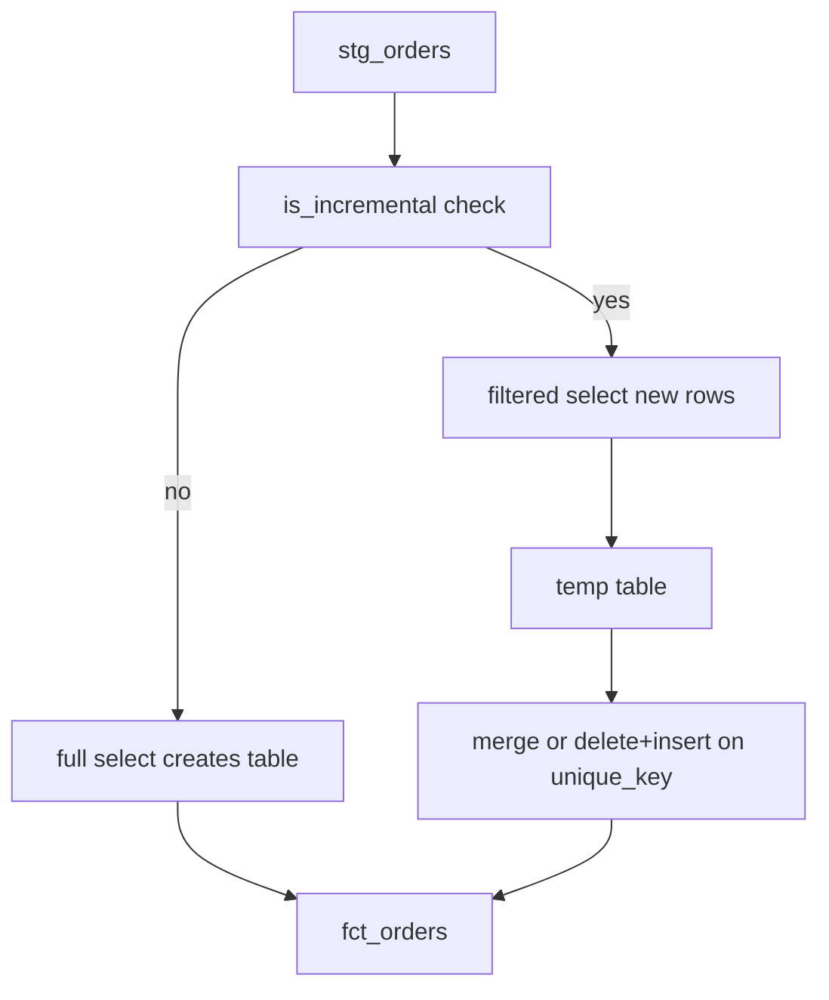

## Introduction

Rebuilding a billion-row fact table every hour is slow and expensive. An incremental model builds the full table once, then on each run processes only new or changed rows and adds them.

## Definition

An **incremental model** uses `materialized='incremental'`. On the first run (or with `--full-refresh`) dbt creates the table from the whole query. On later runs `is_incremental()` is true, your filter limits the query to new rows, and dbt inserts or merges them into the existing table `{{ this }}`.

## Why it matters

It is the main lever for cost and runtime on large event and fact tables. It is also a top interview topic because it is easy to get subtly wrong: late-arriving data, duplicates and schema changes.

## How it works

`is_incremental()` returns true only when all are true: the table already exists, it is a table, the model is incremental, and `--full-refresh` was not passed.

Then dbt:

1. Runs the filtered query into a temp table.
2. Applies the **incremental strategy**:
   - `append`: insert all rows. No `unique_key`.
   - `merge`: match on `unique_key`, update matches, insert the rest (default on Snowflake, BigQuery, Databricks; available on PostgreSQL 15+ in dbt 1.6+).
   - `delete+insert`: delete target rows whose `unique_key` is in the batch, then insert (default on PostgreSQL when `unique_key` is set).
   - `insert_overwrite`: replace whole partitions (BigQuery, Spark).
3. `on_schema_change` decides what happens when columns change: `ignore` (default), `append_new_columns`, `sync_all_columns`, `fail`.

## Syntax and configuration

```jinja
{{ config(
    materialized         = 'incremental',
    unique_key           = 'order_id',
    incremental_strategy = 'delete+insert',
    on_schema_change     = 'append_new_columns'
) }}

select
    order_id,
    customer_id,
    order_date,
    shipped_date,
    freight
from {{ ref('stg_orders') }}


  -- 3-day lookback for late-arriving rows; unique_key removes duplicates
  where order_date >= (select max(order_date) - interval '3 days' from {{ this }})

```

Composite key:

```yaml
models:
  - name: fct_order_lines
    config:
      materialized: incremental
      unique_key: [order_id, product_id]
```

```bash
dbt run --select fct_orders                 # incremental run
dbt run --select fct_orders --full-refresh  # rebuild from scratch
```

## Examples

The incremental-run SQL, simulated on Northwind. `this_table` plays the existing target, holding orders up to 1998-06-30:

```sql
WITH this_table AS (
  SELECT * FROM orders WHERE order_date <= DATE '1998-06-30'
)
SELECT order_id, customer_id, order_date, freight
FROM orders
WHERE order_date >= (SELECT MAX(order_date) - INTERVAL '3 days' FROM this_table)
ORDER BY order_date
LIMIT 5;
```

A `delete+insert` run then issues roughly:

```sql-syntax
delete from analytics.fct_orders
where order_id in (select order_id from fct_orders__dbt_tmp);

insert into analytics.fct_orders (order_id, customer_id, order_date, shipped_date, freight)
select order_id, customer_id, order_date, shipped_date, freight
from fct_orders__dbt_tmp;
```

Use `updated_at`-style columns when rows change after insert. Northwind's `shipped_date` is filled after the order, so the filter should include it:

```sql
WITH this_table AS (
  SELECT * FROM orders WHERE order_date <= DATE '1998-06-30'
)
SELECT COUNT(*) AS rows_to_process
FROM orders
WHERE GREATEST(order_date, COALESCE(shipped_date, order_date))
      >= (SELECT MAX(GREATEST(order_date, COALESCE(shipped_date, order_date))) FROM this_table);
```

## Architecture



## Practical example

Schedule `dbt build --select fct_orders` hourly, and a weekly `--full-refresh` (or a wider lookback) to fix any drift. Add a `unique` test on `order_id`: if the strategy or key is wrong, duplicates show up immediately.

## Exercises

1. What does `is_incremental()` return on the first run?
   <details><summary>Answer</summary>False, because the target table does not exist yet. The full query runs.</details>
2. Rows arrive up to two days late. The filter is `where order_date > (select max(order_date) from {{ this }})`. What breaks and how do you fix it?
   <details><summary>Answer</summary>Late rows older than the max are skipped forever. Use a lookback (`>= max - interval '3 days'`) plus a `unique_key` so reprocessed rows replace, not duplicate.</details>
3. You added a column to an incremental model. Existing rows show NULL for it. Why?
   <details><summary>Answer</summary>Only new batches compute it. With `on_schema_change='append_new_columns'` the column is added but old rows are not backfilled; run `--full-refresh` to fill history.</details>

## Common mistakes

- No `unique_key` with a lookback: duplicates.
- Filtering on a column that does not change when the row changes.
- Using `{{ this }}` outside `is_incremental()`; on the first run the table does not exist.
- Making small tables incremental. The complexity is not worth it under a few million rows.
- Non-deterministic logic (window functions over the whole history) in an incremental model; the batch only sees new rows.

## Performance and best practices

- Index or cluster the target on `unique_key` and the filter column.
- Prefer `merge` or `delete+insert` with a key; use `append` only for immutable events.
- Keep the lookback as small as the data allows.
- Plan periodic full refreshes; protect huge tables with `full_refresh: false` config.

## Interview questions

### How does an incremental model work in dbt?

It builds the table in full once. On later runs `is_incremental()` is true, so a WHERE filter selects only new rows, and dbt merges or inserts them into the existing table based on the strategy and `unique_key`.

### What is unique_key for?

It identifies a row so dbt can update or replace existing rows instead of appending duplicates. It enables merge and delete+insert.

### How do you handle late-arriving data?

Reprocess a lookback window and rely on `unique_key` to replace re-read rows; periodically full-refresh.

### When is is_incremental() false?

When the table does not exist, when it exists as a view, when `--full-refresh` is passed, or when the model is not incremental.

### What does on_schema_change do?

It controls how dbt reacts when the model's columns differ from the table: ignore, append new columns, sync all columns, or fail.

## Quick revision

- `materialized='incremental'` + `` filter.
- `{{ this }}` = existing target table.
- `unique_key` for merge / delete+insert; none for append.
- Lookback window for late data.
- `--full-refresh` rebuilds; `on_schema_change` handles new columns.
- Test `unique` on the key.
