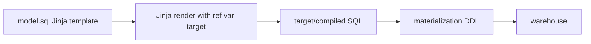

## Introduction

dbt models are not pure SQL. They are Jinja templates that render into SQL. Jinja gives you variables, loops and conditionals, so you can generate repetitive SQL and change behaviour per environment.

## Definition

**Jinja** is a Python templating language. In dbt:

- `{{ ... }}` is an **expression**: its value is printed into the SQL.
- `` is a **statement**: control flow such as `if`, `for`, `set`, `macro`.
- `{# ... #}` is a **comment** that does not appear in compiled SQL.

dbt adds its own context: `ref`, `source`, `config`, `var`, `env_var`, `target`, `this`, `is_incremental`, `run_query`, `log` and more.

## Why it matters

It removes copy-paste. A pivot over 8 categories becomes a 3-line loop. Environment-specific filters (sample data in dev) become one `if`.

## How it works

1. dbt parses the project and renders each file in two phases: parse (to find `ref`, `source`, `config`) and execute (to produce final SQL).
2. Jinja runs first; the database only sees the rendered SQL.
3. `dbt compile` writes the result to `target/compiled/`, which is the first place to look when debugging.
4. Code inside `` runs only in the execute phase, which matters for `run_query`.

## Syntax and configuration

```jinja
{# variables #}


{# conditionals #}

  where order_date >= current_date - interval '30 days'


{# loops; loop.last avoids a trailing comma #}

  sum(case when method = '{{ m }}' then amount else 0 end) as {{ m }}_amount,


{# project variables and env vars #}
where order_date >= '{{ var("start_date", "1996-01-01") }}'
-- password: {{ env_var('DBT_PASSWORD') }}

{# whitespace control #}
 trimmed 
```

```yaml
# dbt_project.yml
vars:
  start_date: "1996-01-01"
```

```bash
dbt run --select fct_orders --vars '{start_date: "1997-01-01"}'
dbt compile --select mart_category_pivot
```

## Examples

Pivot freight by shipper with a loop:

```jinja


select
    date_trunc('year', order_date)::date as order_year,
    
    sum(case when ship_via = {{ s }} then freight else 0 end) as shipper_{{ s }}_freight
    ,
    
from {{ ref('stg_orders') }}
group by 1
```

Compiled:

```sql
SELECT date_trunc('year', order_date)::date AS order_year,
       SUM(CASE WHEN ship_via = 1 THEN freight ELSE 0 END) AS shipper_1_freight,
       SUM(CASE WHEN ship_via = 2 THEN freight ELSE 0 END) AS shipper_2_freight,
       SUM(CASE WHEN ship_via = 3 THEN freight ELSE 0 END) AS shipper_3_freight
FROM orders
GROUP BY 1
ORDER BY 1;
```

Make the list dynamic with `run_query`:

```jinja
select distinct category_name from {{ source('northwind', 'categories') }} order by 1

  

  

```

## Architecture



## Practical example

Limit dev builds to recent data but build everything in prod:

```jinja
select *
from {{ source('northwind', 'orders') }}

where order_date >= date '1998-01-01'

```

```sql
SELECT COUNT(*) AS dev_rows FROM orders WHERE order_date >= DATE '1998-01-01';
```

## Exercises

1. What is the difference between `{{ }}` and ``?
   <details><summary>Answer</summary>`{{ }}` prints a value into the SQL; `` runs logic (if, for, set, macro) and prints nothing itself.</details>
2. Your loop produces `..., shipper_3_freight, from`. Fix it.
   <details><summary>Answer</summary>Add the comma only when `not loop.last`.</details>
3. Why wrap `run_query` in ``?
   <details><summary>Answer</summary>During parsing dbt does not run queries; `run_query` returns None, so accessing its result would error.</details>

## Common mistakes

- Forgetting quotes: `'{{ var("start_date") }}'` needs SQL quotes around a string.
- Debugging the template instead of reading `target/compiled`.
- Too much logic in Jinja. If the SQL is unreadable, move it into a macro or simplify.
- Using `{{ }}` inside ``: write ``, not ``.

## Performance and best practices

- Prefer readable SQL over clever Jinja.
- Use `{# #}` comments; SQL `--` comments still appear in compiled SQL.
- Avoid `run_query` in many models; each call is a round trip at compile time.
- Use `-` whitespace control to keep compiled SQL tidy.

## Interview questions

### What is Jinja used for in dbt?

To template SQL: references (`ref`, `source`), configuration, variables, loops, conditionals and reusable macros. It renders to plain SQL before execution.

### What is the target variable?

Information about the active profile target: `target.name`, `target.schema`, `target.type` and so on. It lets code behave differently in dev and prod.

### What does the execute flag mean?

It is False while dbt parses the project and True when it actually runs nodes. Database queries in Jinja must be guarded by it.

## Quick revision

- `{{ }}` expression, `` statement, `{# #}` comment.
- dbt context: ref, source, config, var, env_var, target, this.
- `loop.last` for commas in loops.
- `var()` with defaults; override with `--vars`.
- `run_query` inside ``.
- Read `target/compiled` to debug.
