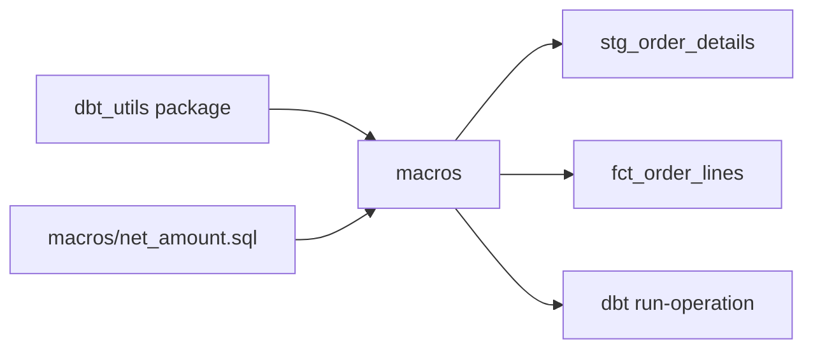

## Introduction

When the same SQL fragment appears in many models, such as a currency conversion, a cents-to-dollars cast or a surrogate key, put it in a macro. Macros are dbt's functions.

## Definition

A **macro** is a named Jinja block, ` ... `, in a `.sql` file under `macros/`. Calling `{{ name(args) }}` inserts its rendered SQL. Generic tests, materializations and dbt's own internals (such as `generate_schema_name`) are macros too.

## Why it matters

- One definition, many uses: a fix lands everywhere.
- Packages share macros across teams (`dbt_utils`, `dbt_expectations`, `codegen`).
- You can override dbt's built-in behaviour, for example schema naming.

## How it works

1. dbt loads all macros from the project and installed packages before rendering models.
2. A call renders the macro body with the given arguments and returns a string of SQL.
3. Macros can call other macros, `ref`, `run_query`, and `return()` values such as lists.
4. `dbt run-operation macro_name --args '{...}'` runs a macro on its own, for admin tasks like grants.
5. `adapter.dispatch` lets a macro have per-database implementations.

## Syntax and configuration

`macros/net_amount.sql`:

```jinja

    round(({{ price }} * {{ qty }} * (1 - {{ discount }}))::numeric, {{ scale }})

```

`packages.yml`:

```yaml
packages:
  - package: dbt-labs/dbt_utils
    version: [">=1.1.0", "<2.0.0"]
```

```bash
dbt deps
dbt run-operation grant_select --args '{role: reporter}'
```

Override schema naming so `+schema: marts` produces `marts` in prod:

```jinja

    
        {{ custom_schema_name | trim }}
    
        {{ target.schema }}_{{ custom_schema_name | trim }}
    
        {{ target.schema }}
    

```

## Examples

Use the macro in a model:

```jinja
select
    order_id,
    product_id,
    {{ net_amount('unit_price', 'quantity', 'discount') }} as net_amount
from {{ source('northwind', 'order_details') }}
```

Compiled:

```sql
SELECT order_id, product_id,
       ROUND((unit_price * quantity * (1 - discount))::numeric, 2) AS net_amount
FROM order_details
ORDER BY net_amount DESC
LIMIT 5;
```

`dbt_utils.generate_surrogate_key` hashes columns into one key:

```jinja
select
    {{ dbt_utils.generate_surrogate_key(['order_id', 'product_id']) }} as order_line_key,
    *
from {{ ref('stg_order_details') }}
```

Its PostgreSQL output is roughly:

```sql
SELECT md5(COALESCE(CAST(order_id AS text), '_dbt_utils_surrogate_key_null_')
           || '-' ||
           COALESCE(CAST(product_id AS text), '_dbt_utils_surrogate_key_null_')) AS order_line_key,
       order_id, product_id
FROM order_details
LIMIT 3;
```

## Architecture



## Practical example

A grant macro run after every deploy:

```jinja

  
    grant usage on schema {{ target.schema }} to {{ role }};
    grant select on all tables in schema {{ target.schema }} to {{ role }};
  
  
  {{ log("Granted select on " ~ target.schema ~ " to " ~ role, info=True) }}

```

In dbt 1.7+ the simpler option is the `grants` config: `+grants: {select: ['reporter']}`.

## Exercises

1. Where do macros live and how do you call one?
   <details><summary>Answer</summary>In `.sql` files under `macros/`; call with `{{ macro_name(args) }}`.</details>
2. A macro should return a Python list, not SQL text. How?
   <details><summary>Answer</summary>Use `{{ return(my_list) }}` inside the macro.</details>
3. How do you make `+schema: marts` produce exactly `marts` in production?
   <details><summary>Answer</summary>Override `generate_schema_name` to return the custom schema unchanged when `target.name == 'prod'`.</details>

## Common mistakes

- Passing column names unquoted: `net_amount(unit_price, ...)` passes undefined Jinja variables. Pass strings: `'unit_price'`.
- Hiding core business logic in macros so models become unreadable.
- Not pinning package versions in `packages.yml`.
- Forgetting `dbt deps` in CI.

## Performance and best practices

- Keep macros small and documented in a `macros/schema.yml`.
- Use `adapter.dispatch` for cross-database macros.
- Prefer built-in config (`grants`, `indexes`, hooks) over hand-written admin macros.
- Check compiled SQL after changing a widely used macro.

## Interview questions

### What is a macro in dbt?

A reusable Jinja function that returns SQL (or values). It is defined with `` in `macros/` and called from models, tests, hooks or `run-operation`.

### What is dbt_utils?

The most popular dbt package. It provides macros such as `generate_surrogate_key`, `star`, `date_spine`, `pivot` and extra generic tests.

### What is run-operation?

A command that runs a single macro outside of any model, for maintenance tasks such as grants or dropping old schemas.

### Why override generate_schema_name?

The default appends the custom schema to the target schema. Teams override it so production uses clean schema names while dev stays isolated.

## Quick revision

- `...` in `macros/`.
- Call with `{{ name('col') }}`; pass column names as strings.
- `return()` for non-SQL values.
- Packages via `packages.yml` + `dbt deps`.
- `dbt run-operation` for admin tasks.
- `generate_schema_name` controls schema naming.
