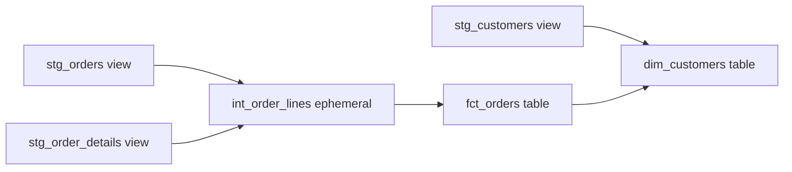

## Introduction

A model is the basic unit of dbt: one `.sql` file holding one `SELECT`. The file name becomes the relation name, and the materialization decides whether that relation is a view, a table or something else.

## Definition

A **model** is a `SELECT` statement in `models/` that dbt compiles and builds as a database object. Its **materialization** is one of:

| Materialization | What dbt builds | Rebuild cost |
|---|---|---|
| `view` (default) | `CREATE VIEW` | none; computed at query time |
| `table` | `CREATE TABLE AS` | full rebuild each run |
| `incremental` | table, then insert/merge new rows | only new or changed rows |
| `ephemeral` | nothing; inlined as a CTE in downstream models | none |
| `materialized_view` | `CREATE MATERIALIZED VIEW` (adapter support required, dbt 1.6+) | database refresh |

## Why it matters

Choosing the materialization is a cost and freshness trade-off. Views are always fresh but recompute every query. Tables are fast to read but stale until the next run. Interviewers often ask when to use each.

## How it works

1. dbt reads the model and its config (from `config()`, `schema.yml` or `dbt_project.yml`; the most specific wins).
2. It renders Jinja: `ref()` becomes a relation name such as `"northwind"."dbt_dev"."stg_orders"`.
3. The materialization macro wraps the SELECT. For `table`, dbt builds a temp relation and then swaps it in, so readers never see a half-built table.
4. Ephemeral models are never built; their SQL is injected as a CTE named `__dbt__cte__<model>`.

## Syntax and configuration

In-file config:

```jinja
{{ config(
    materialized = 'table',
    schema       = 'marts',
    alias        = 'fct_orders',
    tags         = ['daily'],
    post_hook    = "analyze {{ this }}"
) }}

select ...
from {{ ref('stg_orders') }}
```

Folder-level config in `dbt_project.yml`:

```yaml
models:
  northwind_analytics:
    staging:
      +materialized: view
    intermediate:
      +materialized: ephemeral
    marts:
      +materialized: table
      +schema: marts
```

By default `+schema: marts` produces `<target_schema>_marts`, for example `dbt_dev_marts`. Override the `generate_schema_name` macro to change this.

Select and run models:

```bash
dbt run --select stg_orders          # one model
dbt run --select +fct_orders         # model and all parents
dbt run --select stg_orders+         # model and all children
dbt run --select staging             # a folder
dbt run --select tag:daily           # by tag
dbt run --full-refresh --select fct_orders
```

## Examples

`models/staging/stg_order_details.sql`:

```jinja
select
    order_id,
    product_id,
    unit_price,
    quantity,
    discount,
    unit_price * quantity * (1 - discount) as line_amount
from {{ source('northwind', 'order_details') }}
```

`models/marts/fct_orders.sql`:

```jinja
{{ config(materialized='table') }}

with lines as (
    select order_id, sum(line_amount) as order_amount
    from {{ ref('stg_order_details') }}
    group by order_id
)

select
    o.order_id,
    o.customer_id,
    o.order_date,
    lines.order_amount
from {{ ref('stg_orders') }} as o
join lines using (order_id)
```

Compiled and run on Northwind:

```sql
WITH stg_order_details AS (
  SELECT order_id, product_id,
         unit_price * quantity * (1 - discount) AS line_amount
  FROM order_details
), lines AS (
  SELECT order_id, SUM(line_amount) AS order_amount
  FROM stg_order_details
  GROUP BY order_id
)
SELECT o.order_id, o.customer_id, o.order_date,
       ROUND(lines.order_amount::numeric, 2) AS order_amount
FROM orders AS o
JOIN lines USING (order_id)
ORDER BY o.order_date
LIMIT 5;
```

## Architecture

Ephemeral intermediate models are inlined; only the staging views and the mart table exist in the database.



## Practical example

Build `dim_customers` with lifetime metrics, keeping customers who never ordered:

```jinja
select
    c.customer_id,
    c.company_name,
    c.country,
    count(f.order_id)                 as lifetime_orders,
    coalesce(sum(f.order_amount), 0)  as lifetime_value,
    min(f.order_date)                 as first_order_date
from {{ ref('stg_customers') }} as c
left join {{ ref('fct_orders') }} as f using (customer_id)
group by 1, 2, 3
```

```sql
SELECT c.customer_id, c.company_name, c.country,
       COUNT(o.order_id) AS lifetime_orders,
       MIN(o.order_date) AS first_order_date
FROM customers c
LEFT JOIN orders o USING (customer_id)
GROUP BY 1, 2, 3
ORDER BY lifetime_orders, c.customer_id
LIMIT 5;
```

FISSA and PARIS appear with 0 orders, which is why the mart uses a `LEFT JOIN`.

## Exercises

1. A staging model is queried by ten marts every hour. Should it be a view or a table?
   <details><summary>Answer</summary>Usually a view: it is a thin rename layer and marts read it only when they rebuild. Make it a table only if it is expensive and read often.</details>
2. What happens to an ephemeral model when you run `dbt run`?
   <details><summary>Answer</summary>Nothing is created in the database. Its SQL is inlined as a CTE into every model that refs it.</details>
3. Write the selector that builds `fct_orders` and everything downstream of it.
   <details><summary>Answer</summary>`dbt run --select fct_orders+`</details>

## Common mistakes

- Making everything a table "for speed". Build time and storage grow, and data is only as fresh as the last run.
- Overusing ephemeral models. They cannot be queried directly, which makes debugging hard, and deep chains create huge compiled SQL.
- Two models with the same file name in different folders. Model names must be unique in a project.
- Forgetting that `+schema` is appended to the target schema, not used as-is.

## Performance and best practices

- Staging: view. Marts: table. Large append-only facts: incremental.
- Do joins and heavy aggregations once, in a table, not in a view read by many dashboards.
- Use `post_hook` to add indexes or `analyze` on PostgreSQL, or use the adapter's `indexes` config.
- Name models by layer prefix: `stg_`, `int_`, `fct_`, `dim_`.

## Interview questions

### What materializations does dbt support?

View, table, incremental, ephemeral and, on supporting adapters, materialized view. You can also write custom materializations as macros.

### When would you choose ephemeral?

For small, reusable logic that only feeds a few models and that nobody queries directly. It avoids creating an object but makes debugging harder.

### How does dbt avoid downtime when rebuilding a table model?

It builds the new table under a temporary name, then renames the old one away and the new one into place inside a transaction, and drops the old one.

### Where can model config be set, and which wins?

In `dbt_project.yml`, in a `schema.yml` `config:` block, or in the model's `config()` call. The most specific (the in-file `config()`) wins.

## Quick revision

- Model = one SELECT in one file; file name = relation name.
- Materializations: view, table, incremental, ephemeral, materialized_view.
- Config precedence: `config()` > `schema.yml` > `dbt_project.yml`.
- `+model`, `model+` select parents and children.
- Staging views, mart tables, large facts incremental.
- No DDL and no trailing semicolons in models.
