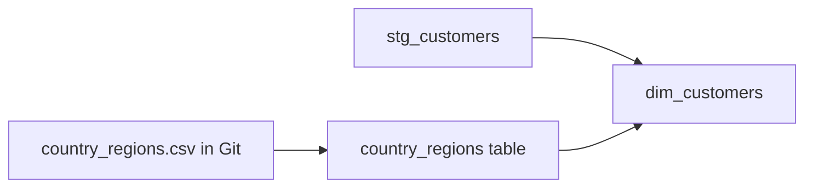

## Introduction

Some reference data never arrives from a source system: a country-to-region mapping, a list of test accounts, a category-to-department lookup. Seeds let you keep that data as a CSV in Git and load it with dbt.

## Definition

A **seed** is a CSV file in `seeds/`. `dbt seed` creates a table with the file's name and loads the rows. Models reference it with `{{ ref('seed_name') }}`, exactly like a model.

## Why it matters

The mapping becomes code-reviewed, versioned and testable. Without seeds, teams hard-code long `CASE` expressions or keep spreadsheets that someone loads by hand.

## How it works

1. dbt infers column types from the CSV, unless you set `column_types`.
2. On first run it creates the table and inserts rows. On later runs it truncates and reloads.
3. If columns change, use `dbt seed --full-refresh` to drop and recreate the table.
4. Seeds are nodes in the DAG, so `dbt build` loads them before models that ref them.

## Syntax and configuration

`seeds/country_regions.csv`:

```text
country,sales_region
Germany,EMEA
France,EMEA
UK,EMEA
USA,Americas
Brazil,Americas
Mexico,Americas
```

`dbt_project.yml`:

```yaml
seeds:
  northwind_analytics:
    +schema: reference
    country_regions:
      +column_types:
        country: varchar(40)
        sales_region: varchar(20)
```

`seeds/schema.yml`:

```yaml
version: 2

seeds:
  - name: country_regions
    description: Maps customer country to sales region.
    columns:
      - name: country
        data_tests: [unique, not_null]
      - name: sales_region
        data_tests:
          - accepted_values:
              values: ["EMEA", "Americas", "APAC"]
```

```bash
dbt seed
dbt seed --select country_regions
dbt seed --full-refresh
```

## Examples

```jinja
select
    c.customer_id,
    c.country,
    coalesce(r.sales_region, 'Unmapped') as sales_region
from {{ ref('stg_customers') }} as c
left join {{ ref('country_regions') }} as r using (country)
```

Compiled, with the seed shown as a `VALUES` list:

```sql
WITH country_regions(country, sales_region) AS (
  VALUES ('Germany', 'EMEA'), ('France', 'EMEA'), ('UK', 'EMEA'),
         ('USA', 'Americas'), ('Brazil', 'Americas'), ('Mexico', 'Americas')
)
SELECT COALESCE(r.sales_region, 'Unmapped') AS sales_region,
       COUNT(*)                             AS customers
FROM customers c
LEFT JOIN country_regions r USING (country)
GROUP BY 1
ORDER BY customers DESC;
```

## Architecture



## Practical example

Exclude internal test customers in every mart through one seed:

```jinja
select o.*
from {{ ref('stg_orders') }} as o
where o.customer_id not in (select customer_id from {{ ref('test_customers') }})
```

Adding a test account becomes a one-line CSV change in a pull request.

## Exercises

1. A team wants to load a 2 GB daily export through a seed. Good idea?
   <details><summary>Answer</summary>No. Seeds are for small, slowly changing reference data. Load large or frequently changing data with an EL tool and declare it as a source.</details>
2. You added a column to a seed CSV and `dbt seed` fails. What do you run?
   <details><summary>Answer</summary>`dbt seed --full-refresh --select <seed>` to drop and recreate the table.</details>

## Common mistakes

- Using seeds for raw data or anything with secrets or PII. The data sits in Git.
- Relying on type inference for codes such as `00123`. Leading zeros vanish; set `column_types`.
- Forgetting the `LEFT JOIN` and `COALESCE`, so unmapped rows disappear.

## Performance and best practices

- Keep seeds to at most a few thousand rows.
- Test seeds like models: `unique` on the key, `accepted_values` on codes.
- Put seeds in their own schema with `+schema`.

## Interview questions

### What are dbt seeds for?

Small, static reference data that is maintained by people, such as mappings, lookup tables and exclusion lists, loaded from CSV with `dbt seed`.

### How do you reference a seed in a model?

With `{{ ref('seed_name') }}`, the same as a model.

### Why not load raw source data with seeds?

They are slow for large files, fully reloaded each time, stored in Git and not designed for frequently changing data.

## Quick revision

- CSV in `seeds/`, loaded by `dbt seed`.
- Referenced with `ref()`.
- Set `column_types` to avoid inference surprises.
- `--full-refresh` after column changes.
- Small reference data only; never PII or raw loads.
