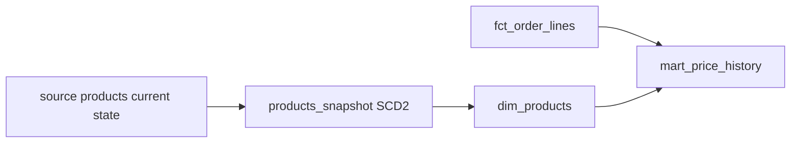

## Introduction

Source tables usually hold only the current state. When a customer moves from Berlin to Munich, the old city is overwritten. Snapshots keep the history so you can answer "where was this customer when the order was placed?"

## Definition

A **snapshot** captures changes to a mutable table as a type 2 slowly changing dimension. Each version of a row gets `dbt_valid_from` and `dbt_valid_to`; the current version has `dbt_valid_to` NULL. dbt also adds `dbt_scd_id` and `dbt_updated_at`.

## Why it matters

Once a source overwrites a value, the history is gone. Snapshots must run regularly from the start; you cannot recreate missed changes later.

## How it works

1. First run: dbt creates the snapshot table with every row, `dbt_valid_from` = now (or `updated_at`), `dbt_valid_to` NULL.
2. Each later run, dbt compares the source with current snapshot rows by `unique_key`.
3. Changed rows: the current version gets `dbt_valid_to` set, and a new version is inserted.
4. **Strategies** decide what "changed" means:
   - `timestamp`: the `updated_at` column is newer than the stored one. Reliable and cheap.
   - `check`: any column listed in `check_cols` (or `all`) differs. Use when there is no trustworthy timestamp.
5. `invalidate_hard_deletes=True` closes rows that disappeared from the source.

## Syntax and configuration

dbt 1.7 style, `snapshots/customers_snapshot.sql`:

```jinja


{{ config(
    target_schema = 'snapshots',
    unique_key    = 'customer_id',
    strategy      = 'timestamp',
    updated_at    = 'updated_at',
    invalidate_hard_deletes = True
) }}

select * from {{ source('crm', 'customers') }}


```

Check strategy:

```jinja


{{ config(
    target_schema = 'snapshots',
    unique_key    = 'product_id',
    strategy      = 'check',
    check_cols    = ['unit_price', 'discontinued']
) }}

select product_id, product_name, unit_price, discontinued
from {{ source('northwind', 'products') }}


```

dbt 1.9+ also accepts YAML snapshot definitions:

```yaml
snapshots:
  - name: products_snapshot
    relation: source('northwind', 'products')
    config:
      schema: snapshots
      unique_key: product_id
      strategy: check
      check_cols: [unit_price, discontinued]
```

```bash
dbt snapshot
dbt snapshot --select products_snapshot
dbt build          # includes snapshots in DAG order
```

## Examples

What a snapshot table looks like after a price change, and how to query the version valid on a date:

```sql
WITH products_snapshot AS (
  SELECT product_id, product_name, unit_price * 0.9 AS unit_price,
         TIMESTAMP '1996-01-01' AS dbt_valid_from,
         TIMESTAMP '1997-06-01' AS dbt_valid_to
  FROM products
  UNION ALL
  SELECT product_id, product_name, unit_price,
         TIMESTAMP '1997-06-01', NULL
  FROM products
)
SELECT o.order_id, o.order_date, d.product_id, s.unit_price AS list_price_then
FROM orders o
JOIN order_details d ON d.order_id = o.order_id
JOIN products_snapshot s
  ON s.product_id = d.product_id
 AND o.order_date >= s.dbt_valid_from
 AND (o.order_date < s.dbt_valid_to OR s.dbt_valid_to IS NULL)
ORDER BY o.order_date
LIMIT 5;
```

Current rows only:

```jinja
select * from {{ ref('products_snapshot') }} where dbt_valid_to is null
```

## Architecture



## Practical example

Build `dim_products` from the snapshot with clean validity columns, then join facts on the date range. Run `dbt snapshot` on a schedule at least as often as the source changes, for example hourly, separately from the daily `dbt build`.

## Exercises

1. A source has a reliable `last_modified` column. Which strategy?
   <details><summary>Answer</summary>`timestamp` with `updated_at='last_modified'`. It is cheaper and more accurate than comparing columns.</details>
2. How do you find the current version of each row?
   <details><summary>Answer</summary>`where dbt_valid_to is null`.</details>
3. The snapshot job was off for a month. Can you recover the changes?
   <details><summary>Answer</summary>No. Snapshots only see the state at run time. Intermediate changes are lost unless the source keeps history.</details>

## Common mistakes

- Transforming heavily inside the snapshot. Snapshot raw data, transform downstream.
- A non-unique `unique_key`. It creates duplicate versions; add a `unique` test on the source key.
- `check_cols='all'` on wide tables with noisy columns such as `last_seen_at`. Every run creates a new version.
- Running snapshots in a dev schema and expecting history in prod.

## Performance and best practices

- Prefer `timestamp` strategy.
- Keep snapshots in a dedicated schema and never drop them; they cannot be rebuilt.
- Select only the columns you need to track.
- Use `invalidate_hard_deletes` (or `hard_deletes: invalidate` in 1.9+) if deletes matter.

## Interview questions

### What does a dbt snapshot produce?

A type 2 SCD table: one row per version, with `dbt_valid_from`, `dbt_valid_to`, `dbt_scd_id` and `dbt_updated_at`.

### Timestamp vs check strategy?

Timestamp compares an `updated_at` column and is cheap. Check compares listed columns and works without a timestamp, but costs more and can miss changes that revert between runs.

### Why can't a snapshot be rebuilt like a model?

It stores history observed over time. A model is a pure function of current data; a snapshot is not.

### How do you handle deleted source rows?

Enable `invalidate_hard_deletes`, which sets `dbt_valid_to` on rows missing from the source.

## Quick revision

- Snapshot = SCD type 2 history of a mutable table.
- `unique_key` + `strategy` (`timestamp` with `updated_at`, or `check` with `check_cols`).
- Current rows: `dbt_valid_to is null`.
- Run `dbt snapshot` regularly; missed changes are lost.
- Snapshot raw data; transform downstream.
- Never drop the snapshot schema.
