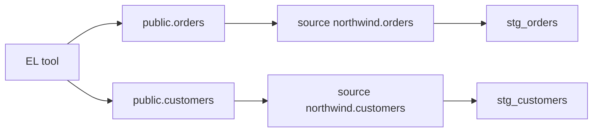

## Introduction

Raw tables are loaded by tools such as Fivetran, Airbyte or a Python job. dbt did not create them, so you cannot `ref()` them. Instead you declare them once as **sources** and select from them with `source()`.

## Definition

A **source** is a YAML declaration of an existing table: a source name (often the loading system or schema), a database and schema, and a list of tables. `{{ source('northwind', 'orders') }}` compiles to the fully qualified table name.

## Why it matters

- Raw table names live in one place. If the loader moves the schema, you change one line.
- Sources appear in the DAG and docs, so lineage starts at the real origin.
- You can test raw data and check freshness before building anything on top.

## How it works

1. dbt reads `sources:` blocks from any `.yml` file under `models/`.
2. `source('src', 'tbl')` resolves to `database.schema.identifier` and adds a DAG edge.
3. `dbt source freshness` queries `max(loaded_at_field)` for each table and compares it to `warn_after` and `error_after`.
4. Tests declared on source columns run with `dbt test --select source:northwind`.

## Syntax and configuration

`models/staging/_sources.yml`:

```yaml
version: 2

sources:
  - name: northwind
    database: northwind
    schema: public
    description: Raw Northwind tables loaded nightly.
    loaded_at_field: _loaded_at
    freshness:
      warn_after: {count: 24, period: hour}
      error_after: {count: 48, period: hour}
    tables:
      - name: orders
        columns:
          - name: order_id
            data_tests: [unique, not_null]
      - name: order_details
      - name: customers
        identifier: customers   # physical name, if different from name
      - name: products
        freshness: null         # disable freshness for this table
```

In dbt 1.8+ the key is `data_tests:`; `tests:` still works and is what 1.7 uses.

```bash
dbt source freshness
dbt source freshness --select source:northwind.orders
dbt test --select source:northwind
dbt build --select source:northwind+     # everything that reads the source
```

## Examples

```jinja
select
    customer_id,
    company_name,
    contact_name,
    city,
    country
from {{ source('northwind', 'customers') }}
```

Compiled:

```sql
SELECT customer_id, company_name, contact_name, city, country
FROM public.customers
ORDER BY customer_id
LIMIT 5;
```

A freshness check is essentially this query. Northwind has no load timestamp, so `order_date` stands in:

```sql
SELECT MAX(order_date)                       AS max_loaded_at,
       COUNT(*)                              AS row_count
FROM orders;
```

## Architecture



## Practical example

Only staging models should call `source()`. Everything else calls `ref()` on a staging model. This keeps renames and casts in one place:

```jinja
-- models/staging/stg_products.sql
select
    product_id,
    product_name,
    category_id,
    unit_price::numeric(10, 2) as unit_price,
    discontinued::boolean        as is_discontinued
from {{ source('northwind', 'products') }}
```

## Exercises

1. Why not write `from public.orders` directly in a model?
   <details><summary>Answer</summary>The table would be missing from the DAG and docs, freshness checks would not cover it, and a schema change would need edits in every model.</details>
2. Which command fails a CI job when orders were last loaded three days ago, given the config above?
   <details><summary>Answer</summary>`dbt source freshness`; 72 hours exceeds `error_after` of 48 hours, so it returns an error.</details>
3. How do you run only models that depend on the northwind source?
   <details><summary>Answer</summary>`dbt run --select source:northwind+`</details>

## Common mistakes

- Calling `source()` from marts. Route everything through staging.
- Using `ref()` on a raw table. `ref()` is for dbt-built nodes only.
- Setting freshness without `loaded_at_field`. dbt has nothing to compare.
- Choosing a business date (`order_date`) as `loaded_at_field`. It measures business activity, not load time.

## Performance and best practices

- One `_sources.yml` per source system, next to its staging models.
- Add `unique` and `not_null` tests on source primary keys to catch loader bugs early.
- Run `dbt source freshness` before `dbt build` in scheduled jobs.
- Index the `loaded_at_field` column on large tables so freshness checks stay cheap.

## Interview questions

### What is the difference between source() and ref()?

`source()` points to a table that dbt did not build and is declared in YAML. `ref()` points to a dbt node such as a model, seed or snapshot. Both add DAG edges.

### How does source freshness work?

dbt selects `max(loaded_at_field)` from each table, compares the age with `warn_after` and `error_after`, and reports pass, warn or error.

### Why should only staging models select from sources?

It creates one controlled entry point per raw table for renames, casts and light cleaning. Downstream models depend on a stable interface.

## Quick revision

- Sources declare raw tables in YAML under `sources:`.
- `{{ source('src', 'table') }}` compiles to the qualified name.
- `identifier` maps a logical name to a physical table.
- `dbt source freshness` uses `loaded_at_field`, `warn_after`, `error_after`.
- Tests can sit on source columns.
- Only staging models call `source()`.
