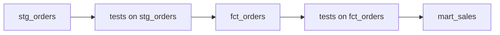

## Introduction

A model that builds is not a model that is correct. dbt tests are queries that look for bad rows: duplicate keys, NULLs, unknown codes or orphaned foreign keys. Warehouses rarely enforce constraints, so tests are the safety net.

## Definition

A dbt **data test** is a `SELECT` that returns failing rows. Zero rows means pass. There are two kinds:

- **Generic tests**: parameterised, attached to columns in YAML. Built-in: `unique`, `not_null`, `accepted_values`, `relationships`.
- **Singular tests**: one-off `.sql` files in `tests/` that return failing rows.

dbt 1.8 also added **unit tests** (`unit_tests:` in YAML) that check model logic against mocked inputs.

## Why it matters

Tests catch upstream breakage before dashboards show wrong numbers. With `dbt build`, a failing test stops downstream models from building on bad data.

## How it works

1. dbt compiles each test into a query, for example a `GROUP BY ... HAVING count(*) > 1` for `unique`.
2. It runs the query as `select count(*) ... from (<test>)`.
3. Count 0 is pass. Above 0 is fail, or warn if `severity: warn`, with `warn_if` and `error_if` thresholds.
4. With `store_failures: true` the failing rows are saved to a table for debugging.

## Syntax and configuration

`models/marts/schema.yml`:

```yaml
version: 2

models:
  - name: fct_orders
    columns:
      - name: order_id
        data_tests:
          - unique
          - not_null
      - name: customer_id
        data_tests:
          - not_null
          - relationships:
              to: ref('dim_customers')
              field: customer_id
      - name: ship_via
        data_tests:
          - accepted_values:
              values: [1, 2, 3]
              quote: false
      - name: employee_id
        data_tests:
          - not_null:
              config:
                severity: warn
                store_failures: true
```

Singular test, `tests/assert_no_negative_freight.sql`:

```jinja
select order_id, freight
from {{ ref('fct_orders') }}
where freight < 0
```

```bash
dbt test
dbt test --select fct_orders
dbt test --select test_type:generic
dbt test --select test_type:singular
dbt build --select fct_orders        # build, then test, then children
```

## Examples

The compiled `unique` test on `orders.order_id`, wrapped the way dbt counts failures:

```sql
SELECT COUNT(*) AS failures
FROM (
  SELECT order_id AS unique_field, COUNT(*) AS n_records
  FROM orders
  WHERE order_id IS NOT NULL
  GROUP BY order_id
  HAVING COUNT(*) > 1
) AS dbt_internal_test;
```

`not_null` on `employee_id`. Northwind has one order with a NULL employee, so this returns 1 failure:

```sql
SELECT COUNT(*) AS failures
FROM (
  SELECT employee_id FROM orders WHERE employee_id IS NULL
) AS dbt_internal_test;
```

`relationships` from orders to customers:

```sql
SELECT COUNT(*) AS failures
FROM (
  SELECT o.customer_id AS from_field
  FROM orders o
  LEFT JOIN customers c ON c.customer_id = o.customer_id
  WHERE o.customer_id IS NOT NULL AND c.customer_id IS NULL
) AS dbt_internal_test;
```

`accepted_values` on `ship_via`:

```sql
SELECT COUNT(*) AS failures
FROM (
  SELECT ship_via AS value_field, COUNT(*) AS n_records
  FROM orders
  GROUP BY ship_via
  HAVING ship_via NOT IN (1, 2, 3)
) AS dbt_internal_test;
```

## Architecture

`dbt build` runs each model's tests before its children. A failing error-severity test skips everything downstream.



## Practical example

A custom generic test lives in `tests/generic/` (or `macros/`) and is reusable in YAML:

```jinja

select {{ column_name }}
from {{ model }}
where {{ column_name }} <= 0

```

```yaml
      - name: order_amount
        data_tests: [positive_value]
```

Packages such as `dbt_utils` and `dbt_expectations` add many more (`unique_combination_of_columns`, `expression_is_true`, ranges).

## Exercises

1. Which test catches an order whose customer was deleted from `dim_customers`?
   <details><summary>Answer</summary>`relationships` with `to: ref('dim_customers')` and `field: customer_id`.</details>
2. The `not_null` test on `employee_id` fails on one known legacy row. How do you keep the build green but visible?
   <details><summary>Answer</summary>Set `severity: warn` (optionally `warn_if: ">1"` style thresholds) and `store_failures: true`, or filter with `where:` config and document why.</details>
3. What does a singular test need to return to pass?
   <details><summary>Answer</summary>Zero rows.</details>

## Common mistakes

- Writing a singular test that returns good rows. Tests must return the failures.
- Testing only marts. Test source keys too, so the root cause is obvious.
- Running `dbt run` then `dbt test` in production. Bad data is already published; use `dbt build`.
- Quoting numeric values in `accepted_values` without `quote: false`.

## Performance and best practices

- At minimum: `unique` + `not_null` on every model's primary key.
- Use `where:` config or `dbt_utils` recency tests to limit expensive tests on huge tables.
- `store_failures` makes triage faster.
- Tag slow tests and run them less often.

## Interview questions

### What are the four built-in generic tests?

`unique`, `not_null`, `accepted_values` and `relationships`.

### What is the difference between a generic and a singular test?

A generic test is a parameterised macro applied to many columns in YAML. A singular test is a single SQL file for one specific assertion.

### How does dbt decide whether a test passed?

It counts the rows the test query returns. Zero passes. Otherwise it fails or warns depending on `severity`, `error_if` and `warn_if`.

### Why use dbt build instead of run then test?

`build` tests each node right after building it and skips downstream nodes on failure, so bad data does not propagate.

## Quick revision

- Test = query returning failing rows; 0 rows = pass.
- Generic: unique, not_null, accepted_values, relationships.
- Singular: `.sql` files in `tests/`.
- `severity: warn`, `store_failures: true`, `where:` config.
- Custom generic tests with ``.
- `dbt build` stops bad data flowing downstream.
