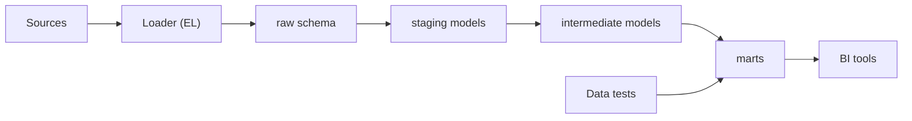

## Introduction

Cloud warehouses made storage cheap and compute elastic. Instead of transforming data on a separate server, many teams now load raw data first and transform it where it lives. That is ELT.

## Definition

ELT (Extract, Load, Transform) copies source data into the target **unchanged**, then runs transformations **inside** the target, usually as SQL models (views or tables) built on top of the raw layer.

## Why it matters

- Raw history is always available in the warehouse, so a new business rule can be applied to all past data.
- Transformations are plain SQL, version-controlled and testable (dbt is the common tool).
- Fewer moving parts: no separate transform cluster.
- Interviewers often ask when you would pick ETL over ELT and vice versa.

## How it works

1. **Extract and load:** a loader (Fivetran, Airbyte, a Python job, `COPY`) lands source tables in a `raw` schema.
2. **Staging models:** one-to-one cleaned views over raw tables: rename, cast, deduplicate.
3. **Intermediate models:** joins and business logic.
4. **Marts:** final facts and dimensions for BI.
5. **Tests:** uniqueness, not-null and relationship checks run after each build.

## Syntax and configuration

The layering expressed as SQL objects:

```sql-syntax
CREATE SCHEMA raw;      -- exact copies of source tables
CREATE SCHEMA staging;  -- cleaned, typed views
CREATE SCHEMA marts;    -- facts and dimensions

CREATE VIEW staging.stg_orders AS
SELECT order_id, customer_id, order_date::date AS order_date, freight::numeric AS freight
FROM raw.orders;

CREATE TABLE marts.fct_orders AS
SELECT ... FROM staging.stg_orders JOIN staging.stg_order_lines USING (order_id);
```

In dbt, the same model is a file with Jinja references:

```jinja
-- models/marts/fct_orders.sql
select o.order_id, o.customer_id, sum(l.revenue) as revenue
from {{ ref('stg_orders') }} o
join {{ ref('stg_order_lines') }} l using (order_id)
group by 1, 2
```

## Examples

Staging and mart layers over Northwind, built inside the database:

```sql
CREATE TEMP VIEW stg_order_lines AS
SELECT order_id,
       product_id,
       unit_price * quantity * (1 - discount) AS revenue
FROM order_details;

CREATE TEMP VIEW mart_customer_revenue AS
SELECT o.customer_id,
       COUNT(DISTINCT o.order_id)        AS orders,
       ROUND(SUM(l.revenue)::numeric, 2) AS revenue
FROM orders o
JOIN stg_order_lines l ON l.order_id = o.order_id
GROUP BY o.customer_id;

SELECT * FROM mart_customer_revenue ORDER BY revenue DESC LIMIT 5
```

## Architecture



The loader only copies. All business logic lives in the SQL models from `staging` to `marts`, and tests run against the built models.

## Practical example

ELT in miniature: land raw JSON-ish rows untouched in SQLite, then transform with SQL inside the "warehouse".

```python
import sqlite3

wh = sqlite3.connect(":memory:")
wh.execute("CREATE TABLE raw_orders(payload_order_id TEXT, payload_customer TEXT, payload_amount TEXT, _loaded_at TEXT)")
raw = [("1", "alfki", "100.5", "2024-01-01"), ("2", "BONAP", "20", "2024-01-01"),
       ("1", "alfki", "100.5", "2024-01-02")]  # duplicate delivered twice
wh.executemany("INSERT INTO raw_orders VALUES (?,?,?,?)", raw)  # Load: no changes

# Transform inside the warehouse: cast, clean, deduplicate (keep latest load)
wh.executescript("""
CREATE VIEW stg_orders AS
SELECT CAST(payload_order_id AS INT) AS order_id,
       UPPER(payload_customer)       AS customer_id,
       CAST(payload_amount AS REAL)  AS amount
FROM (SELECT *, ROW_NUMBER() OVER (PARTITION BY payload_order_id ORDER BY _loaded_at DESC) AS rn
      FROM raw_orders)
WHERE rn = 1;
CREATE VIEW mart_customer AS
SELECT customer_id, COUNT(*) AS orders, SUM(amount) AS revenue FROM stg_orders GROUP BY customer_id;
""")
print(wh.execute("SELECT * FROM mart_customer ORDER BY customer_id").fetchall())
assert wh.execute("SELECT COUNT(*) FROM raw_orders").fetchone()[0] == 3  # raw keeps everything
```

## Exercises

1. A new rule says cancelled orders must be excluded from revenue for the last three years. Why is this easier in ELT?
<details><summary>Answer</summary>The raw history is already in the warehouse; you change the SQL model and rebuild. In ETL you may need to re-extract from the source.</details>

2. Give one case where ETL is the better choice.
<details><summary>Answer</summary>When sensitive data (PII, card numbers) must be masked or dropped before it ever lands in the warehouse, or when the target cannot run heavy transforms.</details>

3. What is the job of a staging model?
<details><summary>Answer</summary>A one-to-one cleaned view of a raw table: rename columns, cast types, deduplicate. No joins or business logic.</details>

## Common mistakes

- Putting business logic into the loader, which makes it ETL with none of the benefits.
- Querying `raw` tables directly from BI tools.
- No tests on models, so silent duplicates reach the marts.
- Rebuilding every model as a full table each run when incremental models would do.

## Performance and best practices

- Keep raw tables append-only with a `_loaded_at` column.
- Materialise heavy marts as tables (or incremental tables) and keep light staging models as views.
- Partition or cluster large raw tables by load date.
- Run tests after each build and fail the pipeline on errors.

## Interview questions

### Why has ELT become popular?

Cloud warehouses separate cheap storage from elastic compute, so loading raw data and transforming with SQL is simple, scalable and keeps full history for reprocessing.

### What are the downsides of ELT?

Raw (possibly sensitive) data lands in the warehouse, warehouse compute costs grow with transformations, and poorly governed SQL models can sprawl.

### What layers would you create in an ELT warehouse?

`raw` (exact copies), `staging` (cleaned one-to-one models), `intermediate` (joins and logic) and `marts` (facts and dimensions for consumers).

### Where does dbt fit?

dbt is the T in ELT: it compiles SQL models with dependencies, materialises them in the warehouse and runs data tests.

## Quick revision

- ELT: load raw first, transform inside the warehouse.
- Layers: raw, staging, intermediate, marts.
- Raw history enables reprocessing with new rules.
- Mask sensitive data before load when policy requires it (ETL-style).
- dbt manages SQL transformations and tests.
- Views for light models, tables for heavy ones.
