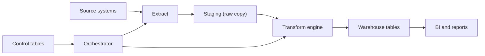

## Introduction

Every analytics platform has to move data from systems that run the business to systems that answer questions. ETL (Extract, Transform, Load) is the oldest and still the most common way to organise that movement.

## Definition

ETL is a pipeline pattern with three stages:

- **Extract:** read data from source systems.
- **Transform:** clean, join and reshape it in a processing engine outside the target.
- **Load:** write the finished result into the target, usually a warehouse.

The defining trait is that transformation happens **before** the data reaches the target.

## Why it matters

- Source systems (OLTP databases, APIs, files) are not designed for analytics. Heavy queries against them hurt production.
- Raw data is messy: duplicates, bad types, missing keys. Someone has to fix it once, centrally.
- Interviewers expect you to draw the layers of a pipeline and explain where each responsibility lives.

## How it works

A typical ETL architecture has these layers:

1. **Sources:** OLTP databases, SaaS APIs, CSV/JSON drops, event logs.
2. **Landing / staging:** raw copies of extracted data, kept unchanged so you can replay.
3. **Transformation engine:** Python, Spark or an ETL tool applies business rules.
4. **Target:** warehouse tables (facts and dimensions) or a data mart.
5. **Control plane:** orchestration (scheduler, dependencies), control tables (watermarks, run logs), monitoring and alerting.

Each run is a batch with a run id. Each step should be restartable without corrupting the target.

## Syntax and configuration

Pipelines are usually described as configuration plus code. A minimal job definition:

```yaml
job: orders_daily
schedule: "0 2 * * *"
source:
  type: postgres
  table: orders
  incremental_column: order_date
staging: stg_orders
transform: transforms/orders.py
target:
  table: fact_orders
  mode: upsert
  key: [order_id]
on_failure: alert_and_stop
```

A control table records each run:

```sql-syntax
CREATE TABLE etl_run_log (
  run_id      BIGSERIAL PRIMARY KEY,
  job_name    TEXT NOT NULL,
  started_at  TIMESTAMPTZ NOT NULL DEFAULT now(),
  finished_at TIMESTAMPTZ,
  status      TEXT NOT NULL CHECK (status IN ('running','success','failed')),
  rows_read   INT,
  rows_loaded INT
);
```

## Examples

The three stages expressed in SQL on Northwind: extract order lines into staging, transform to revenue per order, and show what would be loaded.

```sql
CREATE TEMP TABLE stg_order_lines AS
SELECT order_id, product_id, unit_price, quantity, discount
FROM order_details;

CREATE TEMP TABLE fact_order_revenue AS
SELECT o.order_id,
       o.customer_id,
       o.order_date,
       ROUND(SUM(s.unit_price * s.quantity * (1 - s.discount))::numeric, 2) AS revenue
FROM stg_order_lines s
JOIN orders o ON o.order_id = s.order_id
GROUP BY o.order_id, o.customer_id, o.order_date;

SELECT * FROM fact_order_revenue ORDER BY order_id LIMIT 5
```

## Architecture



The orchestrator triggers each stage in order. Control tables hold watermarks and run history so the orchestrator knows what to extract next and whether the last run succeeded.

## Practical example

A complete, tiny ETL job in Python with an in-memory SQLite "source" and "warehouse" and a run log.

```python
import sqlite3
from datetime import datetime, timezone

src = sqlite3.connect(":memory:")
src.executescript("""
CREATE TABLE orders(order_id INT, customer TEXT, amount TEXT, status TEXT);
INSERT INTO orders VALUES (1,' alfki ','100.50','shipped'),(2,'BONAP','20','cancelled'),
                          (3,'alfki','35.25','shipped'),(4,'QUICK','bad','shipped');
""")
dwh = sqlite3.connect(":memory:")
dwh.executescript("""
CREATE TABLE fact_sales(order_id INT PRIMARY KEY, customer TEXT, amount REAL);
CREATE TABLE etl_run_log(run_id INTEGER PRIMARY KEY, job TEXT, status TEXT,
                         rows_read INT, rows_loaded INT, rows_rejected INT, finished_at TEXT);
""")

def extract():
    return src.execute("SELECT order_id, customer, amount, status FROM orders").fetchall()

def transform(rows):
    good, bad = [], []
    for order_id, customer, amount, status in rows:
        if status == "cancelled":
            continue
        try:
            good.append((order_id, customer.strip().upper(), float(amount)))
        except ValueError:
            bad.append(order_id)
    return good, bad

def load(rows):
    with dwh:  # one transaction
        dwh.executemany("INSERT OR REPLACE INTO fact_sales VALUES (?,?,?)", rows)
    return len(rows)

raw = extract()
good, bad = transform(raw)
loaded = load(good)
dwh.execute("INSERT INTO etl_run_log(job,status,rows_read,rows_loaded,rows_rejected,finished_at) VALUES (?,?,?,?,?,?)",
            ("orders_daily", "success", len(raw), loaded, len(bad), datetime.now(timezone.utc).isoformat()))
print(dwh.execute("SELECT * FROM fact_sales ORDER BY order_id").fetchall())
print(dwh.execute("SELECT job, status, rows_read, rows_loaded, rows_rejected FROM etl_run_log").fetchall())
```

## Exercises

1. Why keep a raw staging copy instead of transforming straight from the source?
<details><summary>Answer</summary>You can replay transformations after a bug fix without re-reading the source, and you can audit exactly what arrived.</details>

2. Add a `rows_rejected` threshold to the practical example that marks the run `failed` if more than 10% of rows are rejected.
<details><summary>Answer</summary>Compute `len(bad) / len(raw)`; if it exceeds 0.1, write status `failed` and skip `load()`.</details>

3. Which layer should own the watermark for incremental loads?
<details><summary>Answer</summary>The control plane: a control table updated in the same transaction as the load, read by the extract step.</details>

## Common mistakes

- Transforming directly against the production OLTP database during business hours.
- No staging layer, so a bad transform means re-extracting everything.
- No run log, so nobody can tell which batch produced a bad row.
- Mixing load and transform logic in one giant script that cannot be restarted halfway.

## Performance and best practices

- Extract with narrow, indexed, incremental queries.
- Do set-based transforms (SQL, pandas vectorised) rather than row-by-row loops.
- Load in bulk (`COPY`, batched inserts) inside one transaction per batch.
- Make every step idempotent so retries are safe.
- Record row counts per stage and alert on anomalies.

## Interview questions

### What is the difference between ETL and ELT?

ETL transforms data in a separate engine before loading. ELT loads raw data into the warehouse first and transforms it there with SQL. ELT suits cheap, scalable cloud warehouses; ETL suits strict cleansing or masking before data lands.

### What is a staging area for?

It holds raw extracted data unchanged. It decouples extraction from transformation, enables replays and audits, and keeps load on the source short.

### What belongs in an ETL control table?

Job name, run id, start/end time, status, row counts per stage, and the watermark used. It drives restarts and monitoring.

### How do you make an ETL pipeline restartable?

Split it into idempotent steps, persist state (watermarks, run status) transactionally, and load with upserts or partition overwrites so a rerun gives the same result.

## Quick revision

- ETL = extract, transform outside the target, then load.
- Layers: source, staging, transform, target, control plane.
- Staging keeps raw data for replay and audit.
- Control tables store watermarks and run history.
- Each step must be idempotent and restartable.
- Bulk, set-based operations beat row-by-row processing.
