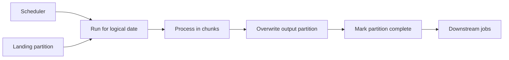

## Introduction

Most analytics data is processed in batches: last night's orders, last hour's events. Batch processing trades latency for simplicity, throughput and easy reruns.

## Definition

Batch processing runs a job over a **bounded** set of data (a time window, a file, a partition) on a schedule or trigger, producing a complete output for that set before the job ends.

## Why it matters

- Simple to reason about: each run has a clear input and output.
- High throughput and cheap: resources are used only while the job runs.
- Reruns and backfills are natural: just re-run a window.

## How it works

1. A scheduler triggers a run for a **logical date** (e.g. 2024-05-01).
2. The job reads exactly that window's data.
3. It processes in chunks that fit in memory.
4. It writes the window's output by overwriting that partition (idempotent).
5. Downstream jobs depend on the partition being complete.

Batch size is a trade-off: bigger batches mean better throughput but higher latency and bigger reruns.

## Syntax and configuration

A cron schedule and a run parameterised by logical date:

```yaml
job: daily_sales
schedule: "0 3 * * *"      # 03:00 every day
params:
  run_date: "{{ ds }}"     # logical date supplied by the scheduler
max_active_runs: 1
catchup: true              # backfill missed days
```

The window query:

```sql-syntax
DELETE FROM daily_sales WHERE sales_date = :run_date;
INSERT INTO daily_sales
SELECT order_date, SUM(...) FROM orders WHERE order_date = :run_date GROUP BY order_date;
```

## Examples

Build one monthly batch partition from Northwind, overwriting it so the run can repeat safely:

```sql
CREATE TEMP TABLE monthly_sales (month DATE PRIMARY KEY, orders INT, revenue NUMERIC);

DELETE FROM monthly_sales WHERE month = DATE '1997-05-01';
INSERT INTO monthly_sales
SELECT date_trunc('month', o.order_date)::date,
       COUNT(DISTINCT o.order_id),
       ROUND(SUM(od.unit_price * od.quantity * (1 - od.discount))::numeric, 2)
FROM orders o
JOIN order_details od ON od.order_id = o.order_id
WHERE o.order_date >= DATE '1997-05-01' AND o.order_date < DATE '1997-06-01'
GROUP BY 1
RETURNING *
```

## Architecture



Each run owns one partition. Downstream jobs wait for the completion marker rather than guessing.

## Practical example

Chunked batch processing with pandas: read a large CSV in chunks, aggregate per day, and overwrite per-day partitions.

```python
import io
import numpy as np
import pandas as pd

rng = np.random.default_rng(42)
n = 50_000
csv = io.StringIO()
pd.DataFrame({
    "order_date": rng.choice(pd.date_range("2024-05-01", periods=3).strftime("%Y-%m-%d"), n),
    "amount": rng.integers(1, 100, n),
}).to_csv(csv, index=False)
csv.seek(0)

partitions = {}  # output store: one entry per logical date

def run_batch(source, chunksize=10_000):
    totals = {}
    for chunk in pd.read_csv(source, chunksize=chunksize):
        for day, amt in chunk.groupby("order_date")["amount"].sum().items():
            totals[day] = totals.get(day, 0) + int(amt)
    for day, amt in totals.items():
        partitions[day] = amt  # overwrite, never append: reruns are safe

run_batch(csv)
first = dict(partitions)
csv.seek(0)
run_batch(csv)  # rerun same input
assert partitions == first
print(partitions)
```

## Exercises

1. What is a logical date and why do batch jobs use it instead of the wall clock?
<details><summary>Answer</summary>It is the data window a run is responsible for. Using it makes reruns and backfills process the same window regardless of when they run.</details>

2. A daily job appends its output. It failed half-way and was retried. What is wrong and how do you fix it?
<details><summary>Answer</summary>Partial rows from the first attempt are duplicated. Overwrite the day's partition (delete + insert in one transaction) instead of appending.</details>

3. When would you switch a batch job to streaming?
<details><summary>Answer</summary>When consumers need data in seconds or minutes (fraud, alerting, live dashboards) and the cost of always-on processing is justified.</details>

## Common mistakes

- Using `now()` or `today()` inside the job instead of the logical date.
- Appending output, so reruns duplicate.
- Loading a whole file into memory instead of chunking.
- Downstream jobs starting before upstream partitions are complete.
- Overlapping runs writing the same partition (set `max_active_runs`).

## Performance and best practices

- Partition data by date so each run touches only its window.
- Chunk large inputs; use vectorised operations within chunks.
- Overwrite partitions for idempotency.
- Use completion markers or sensors for dependencies.
- Size batches to meet the latency SLA, not larger.

## Interview questions

### What are the trade-offs between batch and streaming?

Batch: higher latency, simpler, cheaper, easy reruns. Streaming: low latency, always-on cost, harder ordering, state and exactly-once concerns.

### How do you backfill a year of data in a batch pipeline?

Run the job once per logical date (or partition) over the range, ideally in parallel with a concurrency limit; idempotent partition overwrites make it safe.

### How do you process a file larger than memory in Python?

Stream it in chunks (`pd.read_csv(chunksize=...)` or line iteration), aggregate incrementally, and combine partial results.

## Quick revision

- Batch: bounded input, scheduled run, complete output.
- Parameterise by logical date, not wall clock.
- Overwrite output partitions for safe reruns.
- Chunk large inputs.
- Backfill by running past windows.
- Batch for hours-level latency; streaming for seconds.
