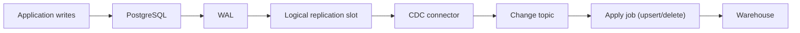

## Introduction

Incremental queries see only the latest state and miss deletes. When you need every change, in order, with low latency, you use Change Data Capture.

## Definition

Change Data Capture (CDC) identifies and delivers row-level changes (insert, update, delete) from a source system, usually as an ordered stream of change events with before/after values and a position (LSN, offset).

## Why it matters

- Captures hard deletes and every intermediate version.
- Near-real-time replication with low load on the source.
- Foundation of streaming pipelines and SCD Type 2 history.

## How it works

| Approach | Mechanism | Pros | Cons |
|---|---|---|---|
| Timestamp-based | Poll `updated_at > watermark` | Simple, no DB setup | Misses deletes and intermediate updates; needs reliable column |
| Trigger-based | Triggers write to an audit/change table | Captures deletes; works anywhere | Adds write overhead to every transaction; triggers to maintain |
| Log-based | Read the transaction log (PostgreSQL WAL via logical decoding, MySQL binlog) | Complete, ordered, low overhead | Needs privileges and setup; log retention to manage |

Log-based CDC in PostgreSQL uses logical replication slots (`wal_level = logical`) and an output plugin like `pgoutput`; tools such as Debezium publish the changes to Kafka.

Consumers apply events in order, keyed by primary key, and remember the last applied position so restarts resume correctly.

## Syntax and configuration

PostgreSQL log-based CDC (requires `wal_level = logical` and replication privileges):

```sql-syntax
CREATE PUBLICATION orders_pub FOR TABLE orders, order_details;
SELECT pg_create_logical_replication_slot('etl_slot', 'pgoutput');
-- or with the test_decoding plugin to peek at changes:
SELECT * FROM pg_logical_slot_get_changes('etl_slot', NULL, NULL);
```

Debezium connector configuration (abridged):

```json
{
  "connector.class": "io.debezium.connector.postgresql.PostgresConnector",
  "database.hostname": "db",
  "database.dbname": "northwind",
  "plugin.name": "pgoutput",
  "slot.name": "etl_slot",
  "table.include.list": "public.orders",
  "topic.prefix": "nw"
}
```

## Examples

Trigger-based CDC on Northwind: a trigger writes each change on `shippers` to a change table, including deletes.

```sql
CREATE TEMP TABLE shippers_changes (
  change_id  BIGSERIAL PRIMARY KEY,
  op         CHAR(1) NOT NULL,
  shipper_id INT NOT NULL,
  row_data   JSONB,
  changed_at TIMESTAMPTZ DEFAULT clock_timestamp()
);

CREATE FUNCTION pg_temp.capture_shipper() RETURNS trigger LANGUAGE plpgsql AS $$
BEGIN
  IF TG_OP = 'DELETE' THEN
    INSERT INTO shippers_changes(op, shipper_id, row_data) VALUES ('D', OLD.shipper_id, to_jsonb(OLD));
    RETURN OLD;
  END IF;
  INSERT INTO shippers_changes(op, shipper_id, row_data) VALUES (left(TG_OP, 1), NEW.shipper_id, to_jsonb(NEW));
  RETURN NEW;
END $$;

CREATE TRIGGER shippers_cdc AFTER INSERT OR UPDATE OR DELETE ON shippers
FOR EACH ROW EXECUTE FUNCTION pg_temp.capture_shipper();

INSERT INTO shippers (shipper_id, company_name) VALUES (99, 'Test Freight');
UPDATE shippers SET company_name = 'Test Freight Ltd' WHERE shipper_id = 99;
DELETE FROM shippers WHERE shipper_id = 99;

SELECT change_id, op, shipper_id, row_data->>'company_name' AS company_name
FROM shippers_changes ORDER BY change_id
```

Applying a change batch to a replica: keep the last event per key, then delete or upsert.

```sql
CREATE TEMP TABLE replica_shippers AS SELECT shipper_id, company_name FROM shippers;
ALTER TABLE replica_shippers ADD PRIMARY KEY (shipper_id);

CREATE TEMP TABLE change_batch (lsn INT, op CHAR(1), shipper_id INT, company_name TEXT);
INSERT INTO change_batch VALUES
  (1, 'I', 50, 'New Co'), (2, 'U', 50, 'New Co Ltd'), (3, 'U', 1, 'Renamed Express'), (4, 'D', 2, NULL);

CREATE TEMP TABLE latest AS
SELECT DISTINCT ON (shipper_id) * FROM change_batch ORDER BY shipper_id, lsn DESC;

DELETE FROM replica_shippers r USING latest l WHERE l.op = 'D' AND r.shipper_id = l.shipper_id;

INSERT INTO replica_shippers (shipper_id, company_name)
SELECT shipper_id, company_name FROM latest WHERE op <> 'D'
ON CONFLICT (shipper_id) DO UPDATE SET company_name = EXCLUDED.company_name;

SELECT * FROM replica_shippers ORDER BY shipper_id
```

## Architecture



Changes flow from the write-ahead log through a replication slot to a topic. The apply job consumes events in order and commits its position after applying them.

## Practical example

Consume an ordered CDC event stream with an offset checkpoint. Replaying from an old offset (at-least-once delivery) does not corrupt the target.

```python
import json

events = [json.dumps(e) for e in [
    {"lsn": 1, "op": "c", "key": 1, "after": {"name": "Speedy", "city": "Berlin"}},
    {"lsn": 2, "op": "c", "key": 2, "after": {"name": "United", "city": "Paris"}},
    {"lsn": 3, "op": "u", "key": 1, "after": {"name": "Speedy", "city": "Hamburg"}},
    {"lsn": 4, "op": "d", "key": 2, "after": None},
]]

target, state = {}, {"applied_lsn": 0}

def apply(stream):
    for raw in stream:
        e = json.loads(raw)
        if e["lsn"] <= state["applied_lsn"]:
            continue  # already applied: skip duplicates on replay
        if e["op"] == "d":
            target.pop(e["key"], None)
        else:
            target[e["key"]] = e["after"]
        state["applied_lsn"] = e["lsn"]  # checkpoint after apply

apply(events[:3])
apply(events)        # consumer restarted from offset 0: replays 1-3, applies 4
print(target, state)
assert target == {1: {"name": "Speedy", "city": "Hamburg"}} and state["applied_lsn"] == 4
```

## Exercises

1. Which CDC approach would you use for a busy 500 GB PostgreSQL table where deletes matter?
<details><summary>Answer</summary>Log-based CDC via logical decoding (e.g. Debezium with pgoutput): complete, ordered and low overhead on writes.</details>

2. What happens if a logical replication slot's consumer stops for days?
<details><summary>Answer</summary>PostgreSQL keeps WAL for the slot, so disk fills up. Monitor slot lag and drop or advance abandoned slots.</details>

3. Why collapse a change batch to the latest event per key before applying?
<details><summary>Answer</summary>It reduces work and avoids applying the same key twice in one upsert statement, which PostgreSQL rejects.</details>

## Common mistakes

- Calling timestamp polling "CDC" and expecting deletes.
- Applying events out of order (e.g. parallel consumers on the same key).
- Committing the offset before the target write succeeds (data loss).
- Forgetting the initial snapshot: CDC only sends changes after the slot was created.
- Leaving unused replication slots that retain WAL.

## Performance and best practices

- Take an initial consistent snapshot, then stream from the slot position.
- Partition topics by primary key to keep per-key ordering.
- Make the apply idempotent (skip `lsn <= applied`, upsert by key).
- Monitor replication slot lag and WAL size.
- Set `REPLICA IDENTITY FULL` only when you need full before-images.

## Interview questions

### Compare log-based, trigger-based and timestamp-based CDC.

Timestamp: simple polling, misses deletes and intermediate changes. Trigger: captures everything into change tables but slows every write. Log-based: reads the WAL/binlog, complete and low-overhead, but needs setup and slot management.

### How does PostgreSQL support log-based CDC?

Logical decoding: with `wal_level = logical`, a replication slot decodes WAL changes through an output plugin (`pgoutput`, `wal2json`, `test_decoding`) and retains WAL until the consumer confirms.

### How do you guarantee correctness with at-least-once delivery?

Make the apply idempotent: track the last applied position and upsert/delete by primary key, so redelivered events have no extra effect.

### How do you start CDC on a table with existing data?

Take a consistent snapshot tied to the slot's starting position, load it, then apply changes from that position onward.

## Quick revision

- CDC delivers inserts, updates and deletes in order.
- Timestamp polling misses deletes; triggers add write cost; log-based is complete.
- PostgreSQL: logical decoding, replication slots, `pgoutput`.
- Snapshot first, then stream.
- Apply idempotently by key and position.
- Monitor slot lag to avoid WAL bloat.
