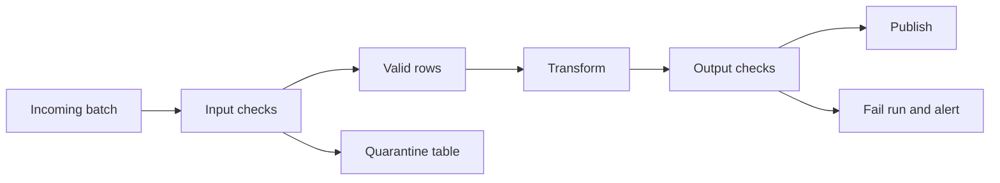

## Introduction

A pipeline that runs green but loads wrong data is worse than one that fails. Validation catches bad data before consumers see it.

## Definition

Data validation is the set of automated checks a pipeline runs on incoming or produced data, each with a severity: **error** (stop the load) or **warn** (load but alert), with failing rows optionally quarantined.

## Why it matters

- Source systems change without warning.
- Silent duplicates and nulls corrupt metrics and erode trust.
- Interviewers expect a concrete list of checks and a policy for failures.

## How it works

Common check types:

| Check | Example |
|---|---|
| Schema | Expected columns and types exist |
| Completeness | Required columns not NULL; row count within expected range |
| Uniqueness | Primary/business key unique |
| Validity / range | `quantity > 0`, discount between 0 and 1 |
| Referential integrity | Every `customer_id` exists in customers |
| Freshness | Latest `order_date` within N hours |
| Reconciliation | Source and target counts and sums match |

Checks run at two points: on input (before transform) and on output (before publish).

## Syntax and configuration

A check written as SQL returning failing rows (zero rows = pass):

```sql-syntax
-- uniqueness
SELECT key, COUNT(*) FROM target GROUP BY key HAVING COUNT(*) > 1;
-- referential integrity
SELECT c.* FROM child c LEFT JOIN parent p ON p.id = c.parent_id WHERE p.id IS NULL;
```

The same checks declared in dbt:

```yaml
models:
  - name: fct_orders
    columns:
      - name: order_id
        tests: [unique, not_null]
      - name: customer_id
        tests:
          - relationships: {to: ref('dim_customer'), field: customer_id}
```

## Examples

One query that runs a suite of checks on Northwind and returns a result per check:

```sql
SELECT 'orders.order_id unique' AS check_name,
       COUNT(*) - COUNT(DISTINCT order_id) AS failures, 'error' AS severity FROM orders
UNION ALL
SELECT 'orders.employee_id not null', COUNT(*) FILTER (WHERE employee_id IS NULL), 'warn' FROM orders
UNION ALL
SELECT 'order_details.quantity > 0', COUNT(*) FILTER (WHERE quantity <= 0), 'error' FROM order_details
UNION ALL
SELECT 'order_details.discount in [0,1]', COUNT(*) FILTER (WHERE discount NOT BETWEEN 0 AND 1), 'error' FROM order_details
UNION ALL
SELECT 'orders.customer_id exists', COUNT(*), 'error'
FROM orders o LEFT JOIN customers c ON c.customer_id = o.customer_id
WHERE o.customer_id IS NOT NULL AND c.customer_id IS NULL
```

Reconciliation: compare a "target" built from the source with the source itself.

```sql
CREATE TEMP TABLE fact_lines AS SELECT * FROM order_details;

SELECT (SELECT COUNT(*) FROM order_details) AS source_rows,
       (SELECT COUNT(*) FROM fact_lines)    AS target_rows,
       (SELECT SUM(quantity) FROM order_details) = (SELECT SUM(quantity) FROM fact_lines) AS qty_matches
```

## Architecture



Row-level failures go to quarantine; batch-level failures (schema change, uniqueness, reconciliation) stop the run before publishing.

## Practical example

A small validation framework in pandas: declarative checks, severities, quarantine and a pass/fail decision.

```python
import io
import pandas as pd

batch = pd.read_csv(io.StringIO("""order_id,customer_id,quantity,discount
1,ALFKI,5,0.1
2,BONAP,0,0.0
3,,2,0.0
3,QUICK,1,1.5
"""))
customers = {"ALFKI", "BONAP", "QUICK"}
EXPECTED = {"order_id", "customer_id", "quantity", "discount"}

def validate(df):
    if set(df.columns) != EXPECTED:
        raise ValueError(f"schema drift: {set(df.columns) ^ EXPECTED}")
    rules = {  # name: (severity, boolean mask of FAILING rows)
        "customer_id not null": ("error", df["customer_id"].isna()),
        "customer_id exists":   ("error", df["customer_id"].notna() & ~df["customer_id"].isin(customers)),
        "quantity > 0":         ("error", df["quantity"] <= 0),
        "discount in [0,1]":    ("error", ~df["discount"].between(0, 1)),
        "order_id unique":      ("warn",  df["order_id"].duplicated(keep=False)),
    }
    report, bad = [], pd.Series(False, index=df.index)
    for name, (sev, mask) in rules.items():
        report.append({"check": name, "severity": sev, "failures": int(mask.sum())})
        if sev == "error":
            bad |= mask
    return df[~bad], df[bad], pd.DataFrame(report)

good, quarantine, report = validate(batch)
print(report.to_string(index=False))
print("loaded:", good["order_id"].tolist(), "quarantined:", quarantine["order_id"].tolist())
fail_ratio = len(quarantine) / len(batch)
print("run status:", "failed" if fail_ratio > 0.5 else "success")
```

## Exercises

1. Which checks should stop the pipeline and which should only warn?
<details><summary>Answer</summary>Stop on schema drift, primary-key duplicates, failed reconciliation or empty batches. Warn on soft rules like unusual null rates or slightly late data.</details>

2. Write SQL that finds `order_details` rows whose `product_id` does not exist in `products`.
<details><summary>Answer</summary>`SELECT od.* FROM order_details od LEFT JOIN products p ON p.product_id = od.product_id WHERE p.product_id IS NULL;`</details>

3. Why add a maximum quarantine ratio?
<details><summary>Answer</summary>If most rows fail, the problem is systemic (bad file, schema change); loading the few survivors would publish a misleadingly small dataset.</details>

## Common mistakes

- Validating only the output, so bad input wastes compute.
- Dropping invalid rows silently instead of quarantining them with a reason.
- Hard-coded expected row counts instead of ranges relative to history.
- Checks that never fail (always green) because they test the wrong column.
- No freshness check: stale data passes every other test.

## Performance and best practices

- Keep checks set-based (one aggregate query per table rather than per row).
- Store check results per run for trend monitoring.
- Quarantine with the run id and failed rule name.
- Enforce what you can with database constraints too.
- Review and tune thresholds as data evolves.

## Interview questions

### What data quality checks do you add to a pipeline?

Schema, not-null on required columns, key uniqueness, valid ranges and enums, referential integrity, freshness, volume anomalies and source-to-target reconciliation.

### What is a quarantine (dead-letter) table?

A table where rows failing validation are stored with the reason and run id, so the good rows can load and the bad ones can be inspected and replayed.

### How do you reconcile source and target?

Compare row counts and control totals (sums of amounts, counts per day) between source extract and loaded target for the same window; mismatches fail the run.

## Quick revision

- Check schema, completeness, uniqueness, validity, referential integrity, freshness.
- Error stops the run; warn alerts only.
- Quarantine bad rows with reason and run id.
- Reconcile counts and sums source vs target.
- Validate input and output.
- Store results to spot trends.
