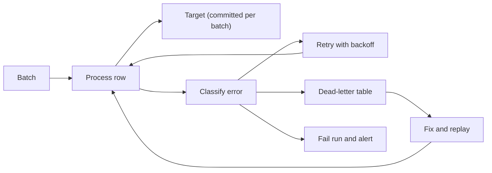

## Introduction

Pipelines fail: networks drop, files arrive malformed, schemas change. Good error handling decides which failures to retry, which rows to set aside and when to stop and wake someone up.

## Definition

ETL error handling is the policy and code that classifies failures (transient, data, logic, infrastructure), responds to each (retry, quarantine, fail), keeps the target consistent and reports enough context to fix the problem.

## Why it matters

- One bad row should not block millions of good ones.
- A crash half-way must not leave the target half-loaded.
- Swallowed exceptions hide data loss.

## How it works

| Error type | Example | Response |
|---|---|---|
| Transient | Timeout, 503, deadlock, connection reset | Retry with backoff |
| Row-level data | Unparseable date, FK missing | Send row to dead-letter table, continue |
| Batch-level data | Schema drift, empty file, reconciliation failure | Fail the run, alert |
| Logic / bug | `KeyError` in transform | Fail fast, alert, fix, rerun |
| Infrastructure | Disk full, permission denied | Fail, alert on-call |

Keep the target consistent with transactions: commit only complete batches, and use savepoints to isolate a bad sub-batch.

## Syntax and configuration

Python structure separating transient from permanent errors:

```python-syntax
class TransientError(Exception): ...
class DataError(Exception): ...

try:
    rows = extract()
except (TimeoutError, ConnectionError) as e:
    raise TransientError(str(e)) from e      # orchestrator will retry
```

Dead-letter table:

```sql-syntax
CREATE TABLE etl_dead_letter (
  id         BIGSERIAL PRIMARY KEY,
  run_id     BIGINT NOT NULL,
  source     TEXT NOT NULL,
  payload    JSONB NOT NULL,
  error      TEXT NOT NULL,
  created_at TIMESTAMPTZ NOT NULL DEFAULT now(),
  replayed   BOOLEAN NOT NULL DEFAULT false
);
```

## Examples

Route rows that would violate a foreign key to a dead-letter table instead of failing the whole insert:

```sql
CREATE TEMP TABLE stg_orders (order_id INT, customer_id TEXT, freight NUMERIC);
INSERT INTO stg_orders VALUES (90001, 'ALFKI', 10), (90002, 'NOPE1', 5), (90003, 'BONAP', 7);

CREATE TEMP TABLE etl_dead_letter (run_id INT, payload JSONB, error TEXT);

INSERT INTO etl_dead_letter (run_id, payload, error)
SELECT 1, to_jsonb(s), 'unknown customer_id'
FROM stg_orders s
WHERE NOT EXISTS (SELECT 1 FROM customers c WHERE c.customer_id = s.customer_id);

INSERT INTO orders (order_id, customer_id, freight)
SELECT s.order_id, s.customer_id, s.freight
FROM stg_orders s
WHERE EXISTS (SELECT 1 FROM customers c WHERE c.customer_id = s.customer_id);

SELECT 'loaded' AS outcome, COUNT(*) AS n FROM orders WHERE order_id >= 90001
UNION ALL
SELECT 'dead_letter', COUNT(*) FROM etl_dead_letter
```

## Architecture



Every error goes through classification. Transient errors loop back through retry, bad rows go to the dead-letter table for later replay, and systemic problems fail the run.

## Practical example

Row-level error handling with savepoints in SQLite: bad rows go to a dead-letter table; a systemic error rate aborts the whole batch.

```python
import json
import sqlite3

db = sqlite3.connect(":memory:", isolation_level=None)  # manage transactions explicitly
db.executescript("""
CREATE TABLE fact_orders(order_id INT PRIMARY KEY, amount REAL NOT NULL CHECK (amount >= 0));
CREATE TABLE dead_letter(payload TEXT, error TEXT);
""")
MAX_ERROR_RATE = 0.4

def load(batch):
    errors = 0
    db.execute("BEGIN")
    for row in batch:
        db.execute("SAVEPOINT row_sp")
        try:
            db.execute("INSERT INTO fact_orders VALUES (?, ?)", (int(row["id"]), float(row["amount"])))
            db.execute("RELEASE row_sp")
        except (ValueError, KeyError, sqlite3.IntegrityError) as e:
            db.execute("ROLLBACK TO row_sp")
            db.execute("RELEASE row_sp")
            db.execute("INSERT INTO dead_letter VALUES (?, ?)", (json.dumps(row), f"{type(e).__name__}: {e}"))
            errors += 1
    if errors / len(batch) > MAX_ERROR_RATE:
        db.execute("ROLLBACK")
        raise RuntimeError(f"{errors}/{len(batch)} rows failed - batch rejected")
    db.execute("COMMIT")
    return errors

batch = [{"id": "1", "amount": "10"}, {"id": "2", "amount": "-5"}, {"id": "x", "amount": "1"},
         {"id": "3", "amount": "7"}, {"id": "1", "amount": "9"}, {"id": "4", "amount": "3"}]
try:
    load(batch)
except RuntimeError as e:
    print("aborted:", e)
print("loaded:", db.execute("SELECT * FROM fact_orders").fetchall())
print("dead letters:", db.execute("SELECT error FROM dead_letter").fetchall())

print("second batch errors:", load([{"id": "5", "amount": "1"}, {"id": "6", "amount": "2"}, {"id": "7"}]))
print("dead letters:", db.execute("SELECT COUNT(*) FROM dead_letter").fetchone()[0])
```

## Exercises

1. Classify: (a) HTTP 503, (b) `"2024-13-45"` in a date column, (c) a new column appeared in the source file.
<details><summary>Answer</summary>(a) transient, retry; (b) row-level, dead-letter; (c) batch-level schema drift, fail and alert (or handle via schema evolution policy).</details>

2. Why did the first batch's dead-letter rows also disappear in the practical example?
<details><summary>Answer</summary>They were written inside the same transaction that was rolled back. Write dead letters on a separate connection or after the decision if you want to keep them for aborted batches.</details>

3. What context should an alert include?
<details><summary>Answer</summary>Job, run id, logical date, step, error class and message, row counts so far, and a link to logs or the dead-letter rows.</details>

## Common mistakes

- `except Exception: pass`, losing data silently.
- Retrying permanent errors (bad data) forever.
- Committing row by row, leaving partial batches after a crash.
- Dead-letter tables nobody monitors or replays.
- Alerts without run id or context.

## Performance and best practices

- Validate in bulk first; use row-by-row savepoints only for the failing subset.
- Classify exceptions into a small set of custom types.
- Cap the dead-letter ratio per batch.
- Make replays idempotent and mark replayed rows.
- Log structured errors (JSON) with run id.

## Interview questions

### How do you handle bad records without stopping the pipeline?

Validate and route failing rows to a dead-letter table with the error and run id, load the rest, alert if the failure rate passes a threshold, and replay fixed rows later.

### What is the difference between transient and permanent errors?

Transient errors (timeouts, throttling, deadlocks) may succeed on retry. Permanent errors (bad data, bugs, auth failures) will fail again and need quarantine or a fix.

### How do you keep the target consistent if a job crashes mid-load?

Load each batch in one transaction (or into a staging table then swap), and design steps to be idempotent so the rerun produces the correct final state.

### What is a dead-letter queue?

A holding place (topic or table) for messages or rows that cannot be processed, kept with failure details for inspection and replay.

## Quick revision

- Classify: transient, row-level data, batch-level data, bug, infrastructure.
- Retry only transient errors.
- Bad rows go to a dead-letter table with reason and run id.
- Fail the batch when the error rate is too high.
- Transactions and savepoints keep the target consistent.
- Alerts need context; dead letters need replay.
