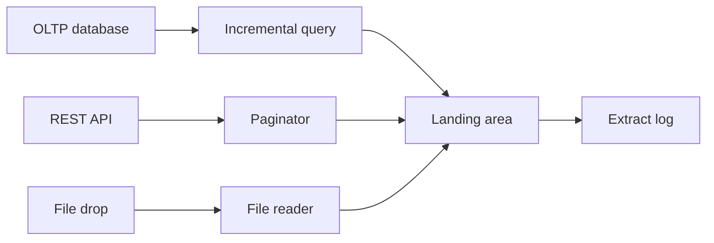

## Introduction

Extraction is the first and often the most fragile step. Sources are owned by other teams, change without notice and must not be slowed down by your pipeline.

## Definition

Data extraction reads records from a source system (database, file, API, event stream) and lands them in a staging area, together with metadata about when and how they were read.

## Why it matters

- A heavy extract query can lock or slow a production database.
- Missed rows at extraction can never be recovered downstream.
- The extraction method (full, incremental, CDC) decides cost, latency and correctness of the whole pipeline.

## How it works

Common extraction methods:

| Method | How | Good for |
|---|---|---|
| Full extract | `SELECT *` every run | Small or reference tables |
| Incremental query | `WHERE updated_at > :watermark` | Tables with a reliable change column |
| CDC | Read the database log | Large, busy tables; deletes needed |
| File drop | Read new CSV/JSON files | Partners, legacy systems |
| API | Paginated HTTP calls | SaaS sources |

Every extract should record: source, extract time, the range read (watermark or page), and the row count.

## Syntax and configuration

Incremental database extract with a bound parameter:

```sql-syntax
SELECT order_id, customer_id, order_date, freight
FROM orders
WHERE order_date >  :last_watermark
  AND order_date <= :current_high_watermark
ORDER BY order_date, order_id;
```

Paginated API extraction (not executed: needs network):

```python-syntax
import requests
page, rows = 1, []
while True:
    r = requests.get("https://api.example.com/orders", params={"page": page, "per_page": 500}, timeout=30)
    r.raise_for_status()
    batch = r.json()["data"]
    if not batch:
        break
    rows.extend(batch)
    page += 1
```

## Examples

Extract one bounded window of Northwind orders, adding extraction metadata columns:

```sql
SELECT order_id,
       customer_id,
       order_date,
       freight,
       now()          AS _extracted_at,
       'northwind.orders' AS _source
FROM orders
WHERE order_date >  DATE '1997-12-31'
  AND order_date <= DATE '1998-03-31'
ORDER BY order_date, order_id
LIMIT 5
```

Check the size of what you are about to pull before you pull it:

```sql
SELECT date_trunc('year', order_date)::date AS year, COUNT(*) AS rows
FROM orders
GROUP BY 1
ORDER BY 1
```

## Architecture



All extractors write into one landing area and log what they read, so downstream steps do not care where data came from.

## Practical example

Extract from a "source" in chunks with keyset pagination (no `OFFSET`), tagging each row with batch metadata.

```python
import sqlite3
from datetime import datetime, timezone

src = sqlite3.connect(":memory:")
src.execute("CREATE TABLE orders(order_id INTEGER PRIMARY KEY, amount REAL)")
src.executemany("INSERT INTO orders VALUES (?,?)", [(i, i * 1.5) for i in range(1, 1001)])

def extract_chunks(conn, chunk=250):
    last_id = 0
    while True:
        rows = conn.execute(
            "SELECT order_id, amount FROM orders WHERE order_id > ? ORDER BY order_id LIMIT ?",
            (last_id, chunk)).fetchall()
        if not rows:
            return
        last_id = rows[-1][0]
        yield rows

extracted_at = datetime.now(timezone.utc).isoformat()
landing = []
for batch_no, rows in enumerate(extract_chunks(src), start=1):
    landing.extend((oid, amt, batch_no, extracted_at) for oid, amt in rows)

print(len(landing), "rows in", landing[-1][2], "batches")
assert len({r[0] for r in landing}) == 1000  # nothing missed, nothing doubled
```

## Exercises

1. Why is keyset pagination (`WHERE id > last_id`) safer than `OFFSET` for large extracts?
<details><summary>Answer</summary>`OFFSET` rescans skipped rows (slow) and shifts if rows are inserted or deleted during the extract, causing missed or duplicate rows.</details>

2. Your incremental extract uses `updated_at > last_watermark`. Rows deleted at the source never arrive. How do you fix it?
<details><summary>Answer</summary>Use soft deletes (`is_deleted` with `updated_at`), CDC from the log, or a periodic full key comparison.</details>

3. What metadata should every landed row or batch carry?
<details><summary>Answer</summary>Source name, extraction timestamp, batch/run id and the range (watermark or page) that was read.</details>

## Common mistakes

- `SELECT *` on a huge table every hour.
- Using `now()` as the upper bound without a lag, missing transactions still committing.
- Extracting from the primary instead of a read replica.
- No timeout or pagination on API calls.
- Assuming the source schema never changes.

## Performance and best practices

- Extract from replicas or exports, not the primary, when possible.
- Bound each extract with a lower and upper watermark.
- Index the incremental column at the source.
- Use keyset pagination and fixed chunk sizes.
- Land raw data unchanged; transform later.

## Interview questions

### What extraction methods do you know?

Full extract, incremental query on a change column, log-based CDC, file drops and paginated APIs. Choice depends on volume, latency and whether deletes must be captured.

### How do you avoid impacting the source database?

Read from a replica, extract incrementally with indexed predicates, run off-peak, use chunking and limit parallelism.

### How do you handle an API that rate-limits you?

Respect `Retry-After`, back off exponentially with jitter, cap concurrency and resume from the last successful page or cursor.

## Quick revision

- Extraction lands raw data plus metadata.
- Full for small tables, incremental or CDC for large ones.
- Bound extracts with low and high watermarks.
- Keyset pagination over `OFFSET`.
- Read replicas protect production.
- Deletes need soft-delete flags or CDC.
