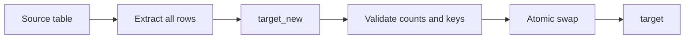

## Introduction

The simplest load is to throw the target away and rebuild it from the source. It is often the right first version of a pipeline.

## Definition

A full load extracts **all** rows from the source and replaces the **entire** target table on every run, rather than applying only changes.

## Why it matters

- Simple and naturally idempotent: every run produces the same target from the same source.
- Captures deletes for free, since a deleted source row simply is not reloaded.
- Becomes slow and expensive as tables grow, which is why incremental loads exist.

## How it works

1. Extract every source row.
2. Load into a fresh staging table.
3. Validate (row counts, key uniqueness).
4. Replace the target atomically: `TRUNCATE` + `INSERT` in one transaction, or build a new table and rename it into place.

## Syntax and configuration

```sql-syntax
-- Option 1: truncate and reload in one transaction
BEGIN;
TRUNCATE target_table;
INSERT INTO target_table SELECT ... FROM staging_table;
COMMIT;

-- Option 2: build new, then swap (readers blocked only during rename)
CREATE TABLE target_new AS SELECT ... FROM staging_table;
BEGIN;
ALTER TABLE target_table RENAME TO target_old;
ALTER TABLE target_new   RENAME TO target_table;
COMMIT;
DROP TABLE target_old;
```

In PostgreSQL `TRUNCATE` is transactional: a rollback restores the data. Some other databases commit `TRUNCATE` implicitly.

## Examples

Full reload of a customer dimension, run twice to show the result is identical:

```sql
CREATE TEMP TABLE dim_customer AS
SELECT customer_id, company_name, country FROM customers WHERE false;

TRUNCATE dim_customer;
INSERT INTO dim_customer SELECT customer_id, company_name, country FROM customers;

TRUNCATE dim_customer;
INSERT INTO dim_customer SELECT customer_id, company_name, country FROM customers;

SELECT COUNT(*) AS rows_in_target,
       (SELECT COUNT(*) FROM customers) AS rows_in_source
FROM dim_customer
```

## Architecture



The new copy is built and validated off to the side; only a passing build is swapped in.

## Practical example

Full load with a validation gate and atomic swap, using pandas and SQLite.

```python
import sqlite3
import pandas as pd

source = pd.DataFrame({"product_id": [1, 2, 3], "name": ["Chai", "Chang", "Syrup"], "price": [18.0, 19.0, 10.0]})
wh = sqlite3.connect(":memory:")
pd.DataFrame({"product_id": [1, 99], "name": ["Chai", "Deleted at source"], "price": [17.0, 1.0]}).to_sql("dim_product", wh, index=False)

def full_load(df, conn, table):
    df.to_sql(f"{table}_new", conn, index=False, if_exists="replace")
    n = conn.execute(f"SELECT COUNT(*), COUNT(DISTINCT product_id) FROM {table}_new").fetchone()
    if n[0] != len(df) or n[0] != n[1]:
        conn.execute(f"DROP TABLE {table}_new")
        raise ValueError("validation failed, target untouched")
    with conn:
        conn.execute(f"DROP TABLE IF EXISTS {table}")
        conn.execute(f"ALTER TABLE {table}_new RENAME TO {table}")

full_load(source, wh, "dim_product")
print(pd.read_sql("SELECT * FROM dim_product ORDER BY product_id", wh).to_string(index=False))
assert 99 not in pd.read_sql("SELECT product_id FROM dim_product", wh)["product_id"].tolist()  # delete captured
```

## Exercises

1. Why does a full load capture source deletes automatically?
<details><summary>Answer</summary>The target is rebuilt only from rows that currently exist in the source, so removed rows vanish.</details>

2. A full load of a 2-billion-row table takes 6 hours. Name two alternatives.
<details><summary>Answer</summary>Incremental load with a watermark, or CDC; alternatively full-reload only recent partitions.</details>

3. What goes wrong if you run `TRUNCATE` and `INSERT` as separate auto-committed statements?
<details><summary>Answer</summary>If the insert fails, the target stays empty; readers also see an empty table between the two statements.</details>

## Common mistakes

- Truncating outside a transaction.
- No validation before the swap, so an empty extract wipes the target.
- Full-loading large fact tables daily out of habit.
- Losing grants, indexes or views when dropping and recreating tables.

## Performance and best practices

- Use full loads for small dimensions and reference data.
- Guard with a minimum-row-count check (e.g. at least 90% of the previous run).
- Load into an unindexed table, then create indexes before the swap.
- Re-apply grants and dependent views after swaps, or use `TRUNCATE` + `INSERT` to keep them.

## Interview questions

### When is a full load better than an incremental load?

When the table is small, the source has no reliable change column, deletes must be captured simply, or correctness matters more than cost.

### How do you make a full load safe for readers?

Do truncate and insert in one transaction, or build a new table and rename it in a short transaction.

### What protects a full load from an empty or broken extract?

A validation gate: compare row counts to the source and to the previous run, check key uniqueness, and abort before replacing the target.

## Quick revision

- Full load: reload everything, every run.
- Idempotent and captures deletes.
- Cost grows with table size.
- Replace atomically: one transaction or table swap.
- Validate before replacing.
- Best for small dimensions and reference data.
