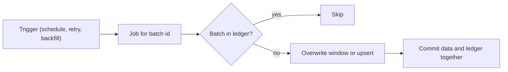

## Introduction

Retries, backfills, manual reruns and at-least-once delivery all mean your job will run more than once on the same input. Idempotency makes that safe.

## Definition

An ETL operation is idempotent when running it once or many times with the same input leaves the target in the same state: `f(f(x)) = f(x)`.

## Why it matters

- Enables automatic retries without duplicates.
- Makes backfills and reruns routine instead of risky.
- Required for correctness with at-least-once messaging and CDC.

## How it works

Techniques, from most to least common:

| Technique | How |
|---|---|
| Upsert on a natural key | `INSERT ... ON CONFLICT (key) DO UPDATE` |
| Overwrite the window | `DELETE WHERE date = :d; INSERT ...` in one transaction, or partition replace |
| Full replace | Truncate and reload atomically |
| Ledger of processed inputs | Record file names / batch ids / offsets; skip already processed |
| Deterministic ids | Derive surrogate keys from content (hash) instead of sequences |
| Dedup on read | `ROW_NUMBER()` by key, keep one |

Avoid in idempotent jobs: plain appends, `now()` in business columns, sequences as keys for re-inserted data, increments like `SET count = count + 1`.

## Syntax and configuration

```sql-syntax
-- delete-insert window (idempotent per logical date)
BEGIN;
DELETE FROM fact_sales WHERE sales_date = :run_date;
INSERT INTO fact_sales SELECT ... WHERE sales_date = :run_date;
COMMIT;

-- processed-batch ledger
CREATE TABLE etl_processed_batches (batch_id TEXT PRIMARY KEY, processed_at TIMESTAMPTZ DEFAULT now());
INSERT INTO etl_processed_batches (batch_id) VALUES (:batch_id) ON CONFLICT DO NOTHING RETURNING batch_id;
-- zero rows returned => already processed, skip
```

## Examples

The same March 1998 window applied twice with delete-insert: the target always has one row per order line for the day.

```sql
CREATE TEMP TABLE fact_lines (order_id INT, product_id INT, order_date DATE, revenue NUMERIC,
                              PRIMARY KEY (order_id, product_id));

DELETE FROM fact_lines WHERE order_date BETWEEN DATE '1998-03-01' AND DATE '1998-03-31';
INSERT INTO fact_lines
SELECT od.order_id, od.product_id, o.order_date, od.unit_price * od.quantity * (1 - od.discount)
FROM order_details od JOIN orders o ON o.order_id = od.order_id
WHERE o.order_date BETWEEN DATE '1998-03-01' AND DATE '1998-03-31';

DELETE FROM fact_lines WHERE order_date BETWEEN DATE '1998-03-01' AND DATE '1998-03-31';
INSERT INTO fact_lines
SELECT od.order_id, od.product_id, o.order_date, od.unit_price * od.quantity * (1 - od.discount)
FROM order_details od JOIN orders o ON o.order_id = od.order_id
WHERE o.order_date BETWEEN DATE '1998-03-01' AND DATE '1998-03-31';

SELECT COUNT(*) AS rows, COUNT(DISTINCT (order_id, product_id)) AS distinct_keys FROM fact_lines
```

A ledger: the second claim of the same batch returns no row, telling the job to skip.

```sql
CREATE TEMP TABLE etl_processed_batches (batch_id TEXT PRIMARY KEY);
INSERT INTO etl_processed_batches VALUES ('orders_1998-01-01') ON CONFLICT DO NOTHING;

SELECT 'orders_1998-01-01' AS batch_id,
       EXISTS (SELECT 1 FROM etl_processed_batches WHERE batch_id = 'orders_1998-01-01') AS already_processed
```

## Architecture



Whatever triggered the run, the job either skips a batch already committed or rewrites its window; the data and the ledger entry commit in one transaction.

## Practical example

Compare a naive append job with an idempotent one when the same file is delivered twice and a retry happens.

```python
import hashlib
import io
import sqlite3
import pandas as pd

files = {
    "orders_2024-05-01.csv": "order_id,amount\n1,10\n2,20\n",
    "orders_2024-05-02.csv": "order_id,amount\n2,25\n3,30\n",
}
deliveries = ["orders_2024-05-01.csv", "orders_2024-05-02.csv", "orders_2024-05-01.csv"]  # duplicate delivery

db = sqlite3.connect(":memory:")
db.executescript("""
CREATE TABLE naive(order_id INT, amount REAL);
CREATE TABLE fact(order_id INT PRIMARY KEY, amount REAL, source_file TEXT);
CREATE TABLE ledger(file_name TEXT PRIMARY KEY, checksum TEXT);
""")

def naive_load(name):
    pd.read_csv(io.StringIO(files[name])).to_sql("naive", db, if_exists="append", index=False)

def idempotent_load(name):
    content = files[name]
    checksum = hashlib.sha256(content.encode()).hexdigest()
    if db.execute("SELECT 1 FROM ledger WHERE file_name=? AND checksum=?", (name, checksum)).fetchone():
        return "skipped"
    df = pd.read_csv(io.StringIO(content))
    with db:  # data + ledger in one transaction
        db.executemany("""INSERT INTO fact VALUES (?,?,?)
                          ON CONFLICT(order_id) DO UPDATE SET amount=excluded.amount, source_file=excluded.source_file""",
                       [(int(r.order_id), float(r.amount), name) for r in df.itertuples()])
        db.execute("INSERT OR REPLACE INTO ledger VALUES (?,?)", (name, checksum))
    return "loaded"

for f in deliveries:
    naive_load(f)
    print(f, idempotent_load(f))
idempotent_load("orders_2024-05-02.csv")  # manual rerun

print("naive rows:", db.execute("SELECT COUNT(*) FROM naive").fetchone()[0])
print("fact:", db.execute("SELECT order_id, amount FROM fact ORDER BY order_id").fetchall())
assert db.execute("SELECT COUNT(*) FROM fact").fetchone()[0] == 3
```

## Exercises

1. Is `UPDATE accounts SET balance = balance + 10 WHERE id = 1` idempotent? How would you make the load idempotent?
<details><summary>Answer</summary>No; each run adds 10 again. Store the transaction with a unique id (ignore duplicates) and derive the balance from transactions, or set an absolute value.</details>

2. Why does the ledger in the practical example store a checksum and not only the file name?
<details><summary>Answer</summary>A corrected file re-sent under the same name has a different checksum, so it is reprocessed instead of wrongly skipped.</details>

3. Why is `DELETE` + `INSERT` for a date window idempotent but `INSERT` alone is not?
<details><summary>Answer</summary>The delete removes whatever any previous run wrote for that window, so the final state depends only on the input, not on how many times the job ran.</details>

## Common mistakes

- Appending in jobs that have retries enabled.
- Using sequence-generated ids as the dedup key (each run gets new ids).
- Writing the ledger and the data in separate transactions.
- Delete window and insert window that do not match exactly.
- Business columns filled with `now()`, so reruns change results.

## Performance and best practices

- Choose a natural/business key for every target table.
- Prefer partition overwrite for large facts; upsert for dimensions.
- Commit data and progress (ledger, watermark, offset) atomically.
- Use deterministic transforms and hash-based keys when needed.
- Test idempotency: run the job twice in CI and compare outputs.

## Interview questions

### What does idempotent mean for a data pipeline?

Running it multiple times with the same input produces the same target state as running it once.

### How do you make a daily load idempotent?

Overwrite that day's partition (delete-insert in one transaction or partition replace), or upsert on a natural key, and record progress in the same transaction.

### How do you handle duplicate messages from an at-least-once source?

Deduplicate by a unique event id (ledger or primary key with `ON CONFLICT DO NOTHING`) or upsert by entity key with ordering by offset/version.

### Why are idempotency and retries usually discussed together?

Retries re-run operations that may have partially or fully succeeded; only idempotent operations can be retried without corrupting data.

## Quick revision

- Idempotent: same input, any number of runs, same result.
- Upsert on natural keys; overwrite windows/partitions.
- Ledger of processed batches with checksums.
- Commit data and progress together.
- Avoid appends, increments and `now()` in business data.
- Test by running twice.
