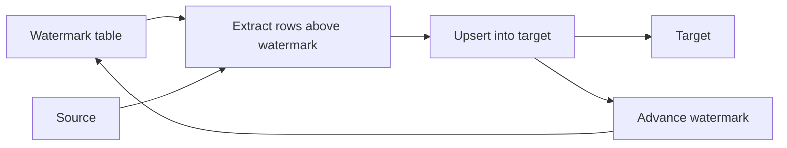

## Introduction

Once a table is too big to reload every run, you load only what changed since last time. Doing that without missing or duplicating rows is the core skill of incremental loading.

## Definition

An incremental load extracts rows whose change column (`updated_at`, an increasing id, a date) is greater than a stored **high watermark**, merges them into the target, and advances the watermark only after the load commits.

## Why it matters

- Runs in minutes instead of hours on large tables.
- Lowers load on the source and cost in the warehouse.
- Easy to get subtly wrong: late-arriving rows, clock skew and deletes.

## How it works

1. Read the last watermark from a control table.
2. Compute the new upper bound (e.g. `max(updated_at)` in the source, or `now() - safety lag`).
3. Extract rows with `watermark - lookback < updated_at <= upper_bound`.
4. Upsert them into the target on the business key.
5. In the same transaction, save `upper_bound` as the new watermark.

The **lookback** re-reads a small overlap to catch late commits; the upsert makes the overlap harmless.

## Syntax and configuration

```sql-syntax
-- control table
CREATE TABLE etl_watermark (
  job_name   TEXT PRIMARY KEY,
  high_water TIMESTAMPTZ NOT NULL
);

-- one run, in one transaction
BEGIN;
INSERT INTO target (...)
SELECT ... FROM source
WHERE updated_at >  (SELECT high_water FROM etl_watermark WHERE job_name = 'orders') - interval '10 minutes'
  AND updated_at <= :upper_bound
ON CONFLICT (id) DO UPDATE SET ... = EXCLUDED....;

UPDATE etl_watermark SET high_water = :upper_bound WHERE job_name = 'orders';
COMMIT;
```

## Examples

Watermark-driven incremental load on Northwind. The target already holds orders up to 1997-12-31; this run loads the next quarter and advances the watermark in the same transaction.

```sql
CREATE TEMP TABLE etl_watermark (job_name TEXT PRIMARY KEY, high_water DATE NOT NULL);
INSERT INTO etl_watermark VALUES ('fact_orders', DATE '1997-12-31');

CREATE TEMP TABLE fact_orders (order_id INT PRIMARY KEY, customer_id TEXT, order_date DATE, freight NUMERIC);
INSERT INTO fact_orders
SELECT order_id, customer_id, order_date, freight FROM orders WHERE order_date <= DATE '1997-12-31';

WITH bounds AS (
  SELECT w.high_water AS lo, DATE '1998-03-31' AS hi
  FROM etl_watermark w WHERE w.job_name = 'fact_orders'
), loaded AS (
  INSERT INTO fact_orders (order_id, customer_id, order_date, freight)
  SELECT o.order_id, o.customer_id, o.order_date, o.freight
  FROM orders o, bounds b
  WHERE o.order_date > b.lo AND o.order_date <= b.hi
  ON CONFLICT (order_id) DO UPDATE
    SET freight = EXCLUDED.freight, customer_id = EXCLUDED.customer_id
  RETURNING order_id
)
UPDATE etl_watermark w
SET high_water = (SELECT hi FROM bounds)
WHERE w.job_name = 'fact_orders'
RETURNING w.high_water, (SELECT COUNT(*) FROM loaded) AS rows_loaded
```

## Architecture



The watermark is read at the start and written only after the upsert succeeds, in the same transaction, so a failed run simply re-reads the same window.

## Practical example

A full incremental job in Python: watermark, lookback window, upsert and atomic watermark update. A late-arriving row is caught by the lookback.

```python
import sqlite3

src = sqlite3.connect(":memory:")
src.execute("CREATE TABLE orders(order_id INT PRIMARY KEY, amount REAL, updated_at INT)")
wh = sqlite3.connect(":memory:")
wh.executescript("""
CREATE TABLE fact_orders(order_id INT PRIMARY KEY, amount REAL, updated_at INT);
CREATE TABLE etl_watermark(job TEXT PRIMARY KEY, high_water INT);
INSERT INTO etl_watermark VALUES ('orders', 0);
""")
LOOKBACK = 5  # re-read this many time units to catch late commits

def run():
    hw = wh.execute("SELECT high_water FROM etl_watermark WHERE job='orders'").fetchone()[0]
    upper = src.execute("SELECT COALESCE(MAX(updated_at), 0) FROM orders").fetchone()[0]
    rows = src.execute("SELECT order_id, amount, updated_at FROM orders WHERE updated_at > ? AND updated_at <= ?",
                       (hw - LOOKBACK, upper)).fetchall()
    with wh:  # load + watermark commit together
        wh.executemany("""INSERT INTO fact_orders VALUES (?,?,?)
                          ON CONFLICT(order_id) DO UPDATE SET amount=excluded.amount, updated_at=excluded.updated_at""", rows)
        wh.execute("UPDATE etl_watermark SET high_water=? WHERE job='orders'", (max(hw, upper),))
    return len(rows)

src.executemany("INSERT INTO orders VALUES (?,?,?)", [(1, 10, 100), (2, 20, 101)])
print("run 1 rows:", run())
src.execute("INSERT INTO orders VALUES (3, 30, 99)")      # late arrival with older timestamp
src.execute("UPDATE orders SET amount=25, updated_at=103 WHERE order_id=2")
print("run 2 rows:", run())
print("run 3 rows:", run())                               # rerun is harmless
print(wh.execute("SELECT * FROM fact_orders ORDER BY order_id").fetchall())
assert wh.execute("SELECT COUNT(*) FROM fact_orders").fetchone()[0] == 3
```

## Exercises

1. Why must the watermark update be in the same transaction as the load?
<details><summary>Answer</summary>If the load commits but the watermark does not, the next run re-reads (harmless with upserts). If the watermark commits but the load does not, rows are skipped forever.</details>

2. Why use `max(updated_at)` from the extracted data (or the source) as the new watermark instead of `now()`?
<details><summary>Answer</summary>Clocks differ between servers and in-flight transactions may commit with earlier timestamps; using the data's own maximum (plus a lookback) avoids gaps.</details>

3. Incremental loads on `updated_at` miss hard deletes. Give two fixes.
<details><summary>Answer</summary>Soft deletes at the source (`deleted_at` updated with `updated_at`), or log-based CDC; a periodic key reconciliation also works.</details>

## Common mistakes

- Using `>=` without an upsert, duplicating boundary rows.
- Advancing the watermark before the load commits.
- Watermark on a column that is not updated on every change.
- No lookback, so late-committing transactions are skipped.
- Plain `INSERT` instead of upsert, so reruns duplicate.

## Performance and best practices

- Index the watermark column at the source.
- Keep a lookback window and make the load idempotent.
- Store watermarks per job (and per partition if parallel).
- Schedule periodic full reconciliations to catch drift.
- Support backfills by letting the job accept explicit `lo`/`hi` bounds.

## Interview questions

### What is a high watermark?

The largest change-column value already loaded, stored in a control table. The next run extracts rows above it.

### How do you handle late-arriving data in an incremental load?

Re-read a lookback window below the watermark and upsert, so late rows are picked up and already-loaded rows are just overwritten.

### How do you backfill an incremental table?

Run the same job with explicit historical bounds (partition by partition); because it upserts, overlapping windows are safe.

### Incremental load vs CDC?

Incremental queries poll a change column and miss hard deletes and intermediate versions. CDC reads every insert, update and delete from the database log.

## Quick revision

- Load rows where `watermark < change_col <= upper_bound`.
- Advance the watermark in the same transaction as the load.
- Lookback window plus upsert handles late data.
- Upsert makes reruns and overlaps safe.
- Hard deletes need soft deletes or CDC.
- Accept explicit bounds for backfills.
